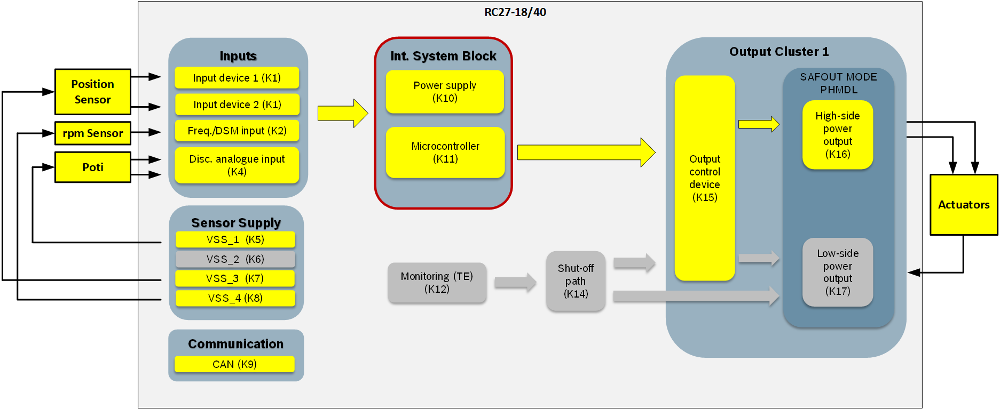
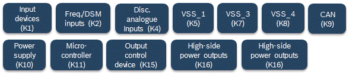
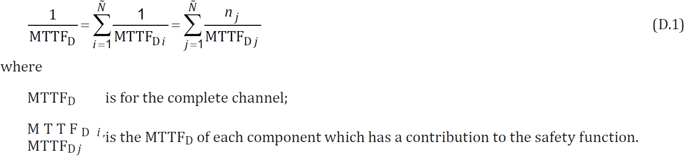
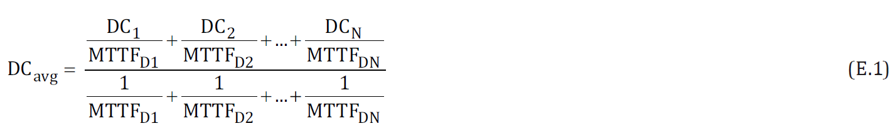

# Example: safe current control with PHMDL {#example-safe-current-control-with-phmdl .p_Heading1 style="page-break-after: avoid;"}

+:-----------------------------------------------------------------------------------------------------------------------------------------------------------------------------------------------------------------+--------------------------------------------------------------------------------------------------------------------------------------------------------------------------------------+
| **Navigation:**  [Safety manual](safety-manual.html) \> [Reliability parameters](reliabilityparameters.html) \> [Examples for using the reliability parameters](examplesofusingthereliabilityparameters.html) \> |    |
|                                                                                                                                                                                                                  |                                                                                                                                                                                      |
| # Example: safe current control with PHMDL {#example-safe-current-control-with-phmdl-1 .p_Heading1 style="page-break-after: avoid;"}                                                                             |                                                                                                                                                                                      |
+------------------------------------------------------------------------------------------------------------------------------------------------------------------------------------------------------------------+--------------------------------------------------------------------------------------------------------------------------------------------------------------------------------------+

<figure style="margin:0;padding:0">

<figcaption aria-hidden="true">
Figure 108: Example for current control in PHMDL mode in RC27-18/40
</figcaption>
</figure>

In this example, RC is wired, configured and programmed (application software) to read periodically 2 position sensors (one sensor used for plausibility check), 1 speed sensor (RPM sensor), 1 potentiometer as well as 1 joystick commands via CAN bus, and to control 2 actuators operating in PHMDL mode correspondingly to realize safe current control of the 2 actuators. The "system integrity" safety function ensures that all the required inputs are read and processed correctly as required by the ASW as well as the corresponding outputs are set correctly as required by the ASW.

As shown in the figure above, the relevant safety-related modules for this example are:

-Input device 1 (K1),

-Frequency/ DSM input (K2),

-Discrete analogue input (K4),

-VSS_1 (K5),

-VSS_3 (K7),

-VSS_4 (K8),

-CAN (K9),

-Power supply (K10),

-Micro-controller (K11),

-Output control device (K15), and

-Safe current control (K16) x 2

<figure style="margin:0;padding:0">

<figcaption aria-hidden="true">
Figure 109: Safety-relevant modules
</figcaption>
</figure>

The formula D.1 given by EN ISO 13849-1, Annex D (equivalent to formula in ISO 25119-2 Annex B.3) can be used to calculate the MTTFD for each channel.

{style="margin:0;width:6.3021in;height:1.4792in;border:none"}

 

The DCavg of the whole safety function can be calculated using the formula E.1 of EN ISO 13849-1, Annex E (equivalent to formula in ISO 25119-2, Annex C.4)  

{style="margin:0;width:6.2292in;height:0.8854in;border:none"}

 

Assuming the example application has a temperature profile given by T2 as shown in the [Temperature profile](temperatureprofileofthecontrolunit.html){.topiclink}, the corresponding MTTFD and DC value of each safety-related module can be read directly out of the [Reliability parameters of the safety function "system integrity"](reliabilityparameterssystemintegrity.html){.topiclink} and the calculation of the MTTFD and the calculation of the MTTFD of the main channel and the DCavg of this safety function could be proceeded as follows:

 

+----------------+----------------+-------------+----------------+-------------+
| Function group | MTTFD          | 1/MTTFD     | DC             | DC/MTTFD    |
+================+================+=============+================+=============+
| K1             | 1940           | 5.15E-04    | 90\*           | 0.046       |
+----------------+----------------+-------------+----------------+-------------+
| K2             | 2914           | 3.43E-04    | 90\*           | 0.031       |
+----------------+----------------+-------------+----------------+-------------+
| K4             | 16777          | 5.96E-05    | 90\*           | 0.005       |
+----------------+----------------+-------------+----------------+-------------+
| K5             | 3023           | 3.31E-04    | 97             | 0.032       |
+----------------+----------------+-------------+----------------+-------------+
| K7             | 2614           | 3.83E-04    | 89             | 0.034       |
+----------------+----------------+-------------+----------------+-------------+
| K8             | 1005           | 9.95E-04    | 94             | 0.094       |
+----------------+----------------+-------------+----------------+-------------+
| K9             | 1437           | 6.96E-04    | 90\*           | 0.063       |
+----------------+----------------+-------------+----------------+-------------+
| K10            | 345            | 2.90E-03    | 95             | 0.275       |
+----------------+----------------+-------------+----------------+-------------+
| K11            | 700            | 1.43E-03    | 85             | 0.121       |
+----------------+----------------+-------------+----------------+-------------+
| K15            | 1261           | 7.93E-04    | 98             | 0.078       |
+----------------+----------------+-------------+----------------+-------------+
| K16            | 2044           | 4.89E-04    | 88             | 0.043       |
+----------------+----------------+-------------+----------------+-------------+
| K16            | 2044           | 4.89E-04    | 88             | 0.043       |
+----------------+----------------+-------------+----------------+-------------+
|                | Sum 1/MTTFDi : | 9.42E-03    | Sum DC/MTTFDi: | 0.866       |
|                +----------------+-------------+----------------+-------------+
|                | MTTFD:         | 106         | DCavg:         | 92%         |
+----------------+----------------+-------------+----------------+-------------+
| \* Assumptions made for the example application                              |
+------------------------------------------------------------------------------+

[]{#fig_8e7fcd .hmanchor}Table 18: MTTFD and DC values for the example with temperature profile T2 of RC18-12/40 and RC28-17/40

 

For RC18-12/40 and RC28-17/40, it leads to the result that MTTFD of the main channel is 106 years and the DCavg of the RC for this safety function is 92%.

This result could be used further by the machine manufacturer, together with the safety-related parameters of the sensors, actuators, command unit and communication channels to calculate the MTTFD and DCavg of the whole safety function, and therefore provide the required evidences of PL / AgPL conformity.

 

+--------------------------------------------------------------------------------+-------------------------------------------------------------------------------------------------------------------------------------------------------------------------------------------------------------+
| {style="margin:0;width:2.1667in;height:0.6979in;border:none"} | "Output control device (K15)" is only to be considered once for each output cluster in the MTTFD and DC calculation, regardless how many power outputs of this output cluster is used in a safety function. |
|                                                                                |                                                                                                                                                                                                             |
|                                                                                |                                                                                                                                                                                                             |
|                                                                                |                                                                                                                                                                                                             |
|                                                                                | For safe output configurations with more than one output control device, "Output control device (K15)" values shall be considered multiple times.                                                           |
+--------------------------------------------------------------------------------+-------------------------------------------------------------------------------------------------------------------------------------------------------------------------------------------------------------+
