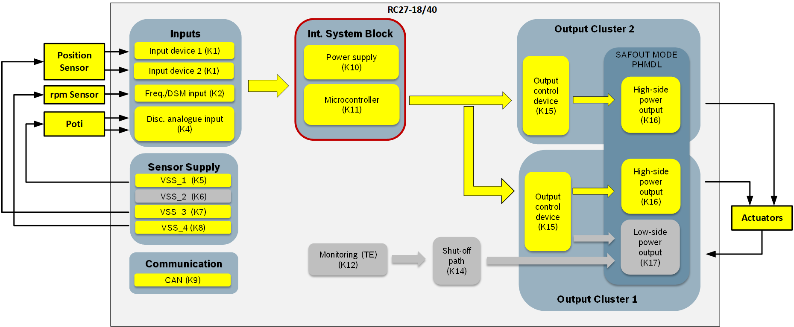

# Example: safe output configuration with 2 output clusters {#example-safe-output-configuration-with-2-output-clusters .p_Heading1 style="page-break-after: avoid;"}

+:-----------------------------------------------------------------------------------------------------------------------------------------------------------------------------------------------------------------+--------------------------------------------------------------------------------------------------------------------------------------------------------------------------------------+
| **Navigation:**  [Safety manual](safety-manual.html) \> [Reliability parameters](reliabilityparameters.html) \> [Examples for using the reliability parameters](examplesofusingthereliabilityparameters.html) \> |    |
|                                                                                                                                                                                                                  |                                                                                                                                                                                      |
| # Example: safe output configuration with 2 output clusters {#example-safe-output-configuration-with-2-output-clusters-1 .p_Heading1 style="page-break-after: avoid;"}                                           |                                                                                                                                                                                      |
+------------------------------------------------------------------------------------------------------------------------------------------------------------------------------------------------------------------+--------------------------------------------------------------------------------------------------------------------------------------------------------------------------------------+

<figure style="margin:0;padding:0">

<figcaption aria-hidden="true">
Figure 111: Example for output configuration in PHMDL mode in RC27-18/40
</figcaption>
</figure>

In this example, RC27-18/40 is used for the same application, but the PHMDL mode involves, differently from the first example, two output control devices.

As shown in the above figure, the relevant safety-related modules for this example are:

-Input device 1 (K1),

-Frequency/ DSM input (K2),

-Discrete analogue input (K4),

-VSS_1 (K5),

-VSS_3 (K7),

-VSS_4 (K8),

-CAN (K9),

-Power supply (K10),

-Microcontroller (K11),

-Output control device (K15) x2, and

-Safe current control (K16) x 2

Assuming the example application has a temperature profile given by T2 as shown in [Temperature profile](temperatureprofileofthecontrolunit.html){.topiclink}, the corresponding MTTFD and DC value of each safety-related module can be read directly out of the [Reliability parameters of the safety function "system integrity"](reliabilityparameterssystemintegrity.html){.topiclink} and the calculation of the MTTFD of the main channel and the DCavg of this safety function could be proceeded as follows using the formulas given in [Example 1: safe current control with PHMDL](example1safecurrentcontrolwithphmdl.html){.topiclink}:

 

+----------------+----------------+-------------+----------------+-------------+
| Function group | MTTFD          | 1/MTTFD     | DC             | DC/MTTFD    |
+================+================+=============+================+=============+
| K1             | 1940           | 5.15E-04    | 90\*           | 0.046       |
+----------------+----------------+-------------+----------------+-------------+
| K2             | 2914           | 3.43E-04    | 90\*           | 0.031       |
+----------------+----------------+-------------+----------------+-------------+
| K4             | 16777          | 5.96E-05    | 90\*           | 0.005       |
+----------------+----------------+-------------+----------------+-------------+
| K5             | 3023           | 3.31E-04    | 97             | 0.032       |
+----------------+----------------+-------------+----------------+-------------+
| K7             | 2614           | 3.83E-04    | 89             | 0.034       |
+----------------+----------------+-------------+----------------+-------------+
| K8             | 1005           | 9.95E-04    | 94             | 0.094       |
+----------------+----------------+-------------+----------------+-------------+
| K9             | 1437           | 6.96E-04    | 90\*           | 0.063       |
+----------------+----------------+-------------+----------------+-------------+
| K10            | 345            | 2.90E-03    | 95             | 0.275       |
+----------------+----------------+-------------+----------------+-------------+
| K11            | 700            | 1.43E-03    | 85             | 0.121       |
+----------------+----------------+-------------+----------------+-------------+
| K15            | 1261           | 7.93E-04    | 98             | 0.078       |
+----------------+----------------+-------------+----------------+-------------+
| K15            | 1261           | 7.93E-04    | 98             | 0.078       |
+----------------+----------------+-------------+----------------+-------------+
| K16            | 2044           | 4.89E-04    | 88             | 0.043       |
+----------------+----------------+-------------+----------------+-------------+
| K16            | 2044           | 4.89E-04    | 88             | 0.043       |
+----------------+----------------+-------------+----------------+-------------+
|                | Sum 1/MTTFDi : | 1.02E-02    | Sum DC/MTTFDi: | 0.943       |
|                +----------------+-------------+----------------+-------------+
|                | MTTFD:         | 98          | DCavg:         | 92%         |
+----------------+----------------+-------------+----------------+-------------+
| \* Assumptions made for the example application                              |
+------------------------------------------------------------------------------+

[]{#fig_12f3f0 .hmanchor}Table 20: MTTFD and DC values for the example with temperature profile T2 of RC18-12/40 and RC27-18/40

 

It leads to the result that MTTFD of the main channel is 98 years and the DCavg of the RC for this safety function is 92%.  

This result could be used further by the machine manufacturer, together with the safety-related parameters of the sensors, actuators, command unit and communication channels to calculate the MTTFD and DCavg of the whole safety function, and therefore provide the required evidences of PL / AgPL conformity.

 

+--------------------------------------------------------------------------------+-------------------------------------------------------------------------------------------------------------------------------------------------------------------------------------------------------------+
| {style="margin:0;width:2.1667in;height:0.6979in;border:none"} | "Output control device (K15)" is only to be considered once for each output cluster in the MTTFD and DC calculation, regardless how many power outputs of this output cluster is used in a safety function. |
|                                                                                |                                                                                                                                                                                                             |
|                                                                                |                                                                                                                                                                                                             |
|                                                                                |                                                                                                                                                                                                             |
|                                                                                | For safe output configurations with more than one output control device, "Output control device (K15)" values shall be considered multiple times.                                                           |
+--------------------------------------------------------------------------------+-------------------------------------------------------------------------------------------------------------------------------------------------------------------------------------------------------------+
