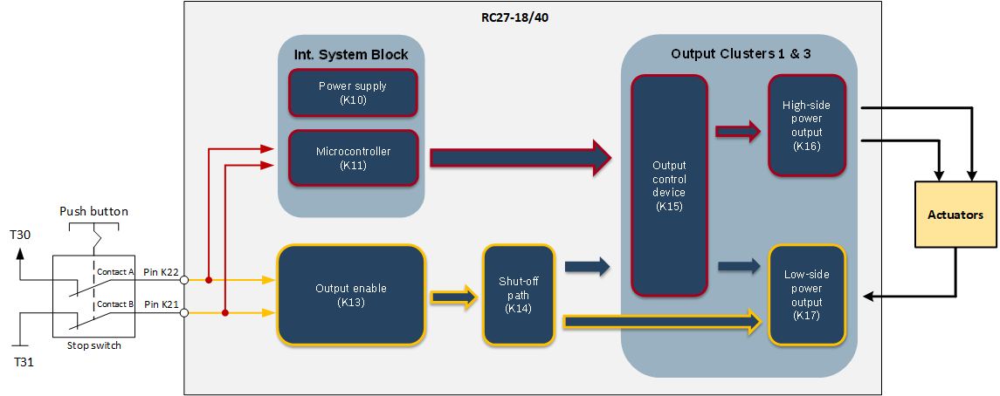
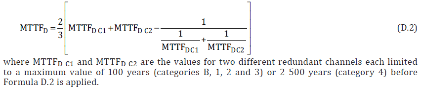
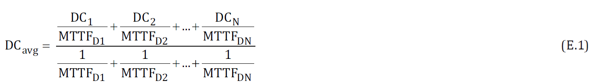

# Example: external stop switch {#example-external-stop-switch .p_Heading1 style="page-break-after: avoid;"}

+:-----------------------------------------------------------------------------------------------------------------------------------------------------------------------------------------------------------------+----------------------------------------------------------------------------------------------------------------------------------------------------------------------------------------------------------+
| **Navigation:**  [Safety manual](safety-manual.html) \> [Reliability parameters](reliabilityparameters.html) \> [Examples for using the reliability parameters](examplesofusingthereliabilityparameters.html) \> |    |
|                                                                                                                                                                                                                  |                                                                                                                                                                                                          |
| # Example: external stop switch {#example-external-stop-switch-1 .p_Heading1 style="page-break-after: avoid;"}                                                                                                   |                                                                                                                                                                                                          |
+------------------------------------------------------------------------------------------------------------------------------------------------------------------------------------------------------------------+----------------------------------------------------------------------------------------------------------------------------------------------------------------------------------------------------------+

 

<figure style="margin:0;padding:0">

<figcaption aria-hidden="true">
Figure 110: Example for external stop switch  in PHMDL mode in RC27-18/40
</figcaption>
</figure>

In this example, RC is wired to control 2 actuators as PHMDL mode via output cluster 1. The "external stop function" safety function ensures that once the external stop switch is pushed, both actuators are switched off safely within 200 ms.

As shown in the above figure, the first channel of this Cat. 3 safety function contains following functional groups:

-Power supply (K10),

-Microcontroller (K11),

-Output control device (K15), and

-Safe current control (K16) x 2

while the following functional groups belong to the second channel of the Cat. 3 architecture:

-Output enable (K13),

-Shut-OFF path (K14), and

-Low-side power output (K17)

 

The formula D.2 given by EN ISO 13849-1, Annex D can be used to calculate the MTTFD for the Cat. 3 architecture (Formula B.4 given by ISO 25119-2, Annex B can be used as well, and will give a better result).

{style="margin:0;width:6.3125in;height:1.3125in;border:none"}

 

The DCavg of the whole safety function can be calculated using the formula E.1 of EN ISO 13849-1, Annex E (equivalent to formula in ISO 25119-2, Annex C.4)  

{style="margin:0;width:6.2292in;height:0.8854in;border:none"}

 

Assuming the example application has a temperature profile given by T3 as shown in the [Temperature profile](temperatureprofileofthecontrolunit.html){.topiclink}, the corresponding MTTFD and DC value of each safety-related functional group can be read directly out of the [Reliability parameters of the safety function "external stop switch"](reliabilityparametersexternalstopswitch.html){.topiclink} and the calculation of the MTTFD and the DCavg of this safety function could be proceeded as follows:

 

 

 

+-----------------+---------------+----------+----------------+----------+
| Function group  | MTTFD         | 1/MTTFD  | DC             | DC/MTTFD |
+=================+===============+==========+================+==========+
| K10             | 192           | 5.21E-03 | 95             | 0.495    |
+-----------------+---------------+----------+----------------+----------+
| K11             | 691           | 1.45E-03 | 98             | 0.142    |
+-----------------+---------------+----------+----------------+----------+
| K15             | 741           | 1.35E-03 | 94             | 0.127    |
+-----------------+---------------+----------+----------------+----------+
| K16             | 1810          | 5.52E-04 | 99             | 0.055    |
+-----------------+---------------+----------+----------------+----------+
| K16             | 1810          | 5.52E-04 | 99             | 0.055    |
+-----------------+---------------+----------+----------------+----------+
| Channel 1       | Sum 1/MTTFDi: | 9.11E-03 | Sum DC/MTTFDi: | 0.873    |
|                 +---------------+----------+----------------+----------+
|                 | MTTFD:        | 109.8    | DCavg:         | 95.8%    |
+-----------------+---------------+----------+----------------+----------+
| K13             | 12225         | 8.18E-05 | 98             | 0.008    |
+-----------------+---------------+----------+----------------+----------+
| K14             | 14305         | 6.99E-05 | 98             | 0.007    |
+-----------------+---------------+----------+----------------+----------+
| K17             | 1338          | 7.47E-04 | 99             | 0.074    |
+-----------------+---------------+----------+----------------+----------+
| Channel 2       | Sum 1/MTTFDi: | 8.99E-04 | Sum DC/MTTFDi: | 0.089    |
|                 +---------------+----------+----------------+----------+
|                 | MTTFD:        | 1112.2   | DCavg:         | 98.8%    |
+-----------------+---------------+----------+----------------+----------+
| Safety function | MTTFD:        | 748      | DCavg:         | 96%      |
+-----------------+---------------+----------+----------------+----------+

[]{#fig_85ac3c .hmanchor}Table 19: MTTFD and DC values for the example with temperature profile T3 of RC18-12/40 and RC27-18/40

It leads to the result that MTTFD of the main channel is 748 years and the DCavg of the RC for this safety function is 96%.

 

This result could be used further by the machine manufacturer, together with the safety-related parameters of the sensors, actuators, command unit and communication channels to calculate the MTTFD and DCavg of the whole safety function, and therefore provide the required evidences of PL / AgPL conformity.

 

+--------------------------------------------------------------------------------+-------------------------------------------------------------------------------------------------------------------------------------------------------------------------------------------------------------+
| {style="margin:0;width:2.1667in;height:0.6979in;border:none"} | "Output control device (K15)" is only to be considered once for each output cluster in the MTTFD and DC calculation, regardless how many power outputs of this output cluster is used in a safety function. |
|                                                                                |                                                                                                                                                                                                             |
|                                                                                |                                                                                                                                                                                                             |
|                                                                                |                                                                                                                                                                                                             |
|                                                                                | For safe output configurations with more than one output control device, "Output control device (K15)" values shall be considered multiple times.                                                           |
+--------------------------------------------------------------------------------+-------------------------------------------------------------------------------------------------------------------------------------------------------------------------------------------------------------+
