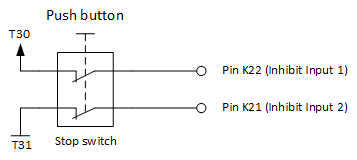

# Using the safety function "external stop switch" {#using-the-safety-function-external-stop-switch .p_Heading1 style="page-break-after: avoid;"}

+:----------------------------------------------------------------------------------------------------------------------------------------------------+------------------------------------------------------------------------------------------------------------------------------------------------------+
| **Navigation:**  [Safety manual](safety-manual.html) \> [Safety-related functions](safety-relatedfunctions.html) \>                                 |    |
|                                                                                                                                                     |                                                                                                                                                      |
| # Using the safety function "external stop switch" {#using-the-safety-function-external-stop-switch-1 .p_Heading1 style="page-break-after: avoid;"} |                                                                                                                                                      |
+-----------------------------------------------------------------------------------------------------------------------------------------------------+------------------------------------------------------------------------------------------------------------------------------------------------------+

This chapter gives instructions for using the "external stop switch" safety function to implement a high reliable stop of the machine movement.

  {style="margin:0;width:8.3333in;height:0.4583in;border:none"}
  ------------------------------------------------------------------------------------------------------------------------------------------------
  Using RCs for safety-related stop functions without following the instructions in this chapter may result in danger to life and/or properties.

 

## Connecting an external stop switch {#connecting-an-external-stop-switch .p_Heading2 style="page-break-after: avoid;"}

For the external stop function, a two-channel switch with direct opening action and self-locking function shall be used. The switch shall be connected to the RC as illustrated in the following figure (see connection diagram in [\[RE95207\]](references.html#re_95207){.topiclink}, [\[RE95208\]](references.html#re_95208){.topiclink} as well).

<figure style="margin:0;padding:0">

<figcaption aria-hidden="true">
Figure 113: Connection of external stop switch
</figcaption>
</figure>

## Proof tests of the external stop function {#proof-tests-of-the-external-stop-function .p_Heading2 style="page-break-after: avoid;"}

Thanks to the periodic monitoring implemented in the RCs (details see [Failure detection possibilities](failuredetectionpossibilities.html){.topiclink}), a failure of the RC regarding the external stop function will be detected in time during normal operation and leads to shut-OFF of all relevant power outputs.

According to the requirement of ISO 13849-1 and ISO 25119-2, whenever reasonably practicable, the single fault shall be detected at or before the next demand upon the safety function.

In order to detect e.g., latent failures of the external stop switch, following proof tests of the external stop function shall be performed at least once every 24 hour:

-Activation test: after making sure that the relevant power outputs are switched on, the external stop switch shall be activated for at least 1s, and it shall be checked if the corresponding actuators are switched off.

-Deactivation test: the external stop switch shall be released, and it shall be checked if it is possible to switch on the corresponding actuators by the application software.

The ASW shall check the error memory for DFC_rbr_mo_INHLatch (for details see [Diagnostic Trouble Code](diagnostic-trouble-code.html){.topiclink}) during each startup. If the error message is present, the proof tests described above shall be performed and the actuation of the power outputs belonging to cluster 1 or 3 is only allowed after successful proof tests without any error report.  
