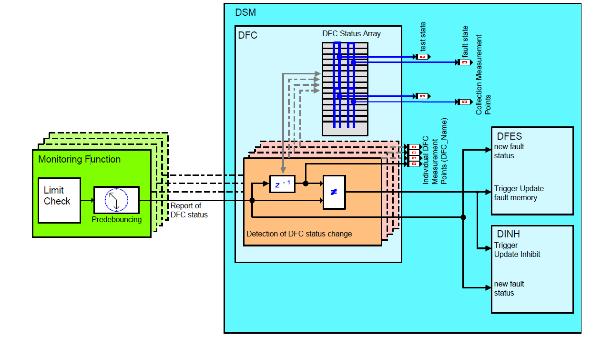
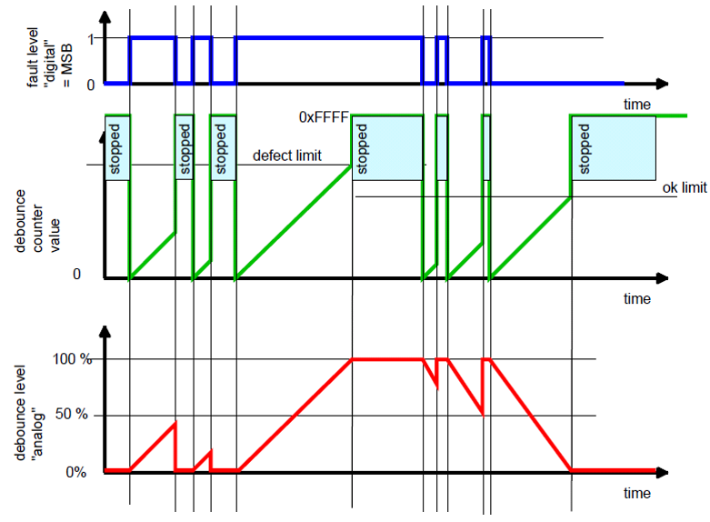
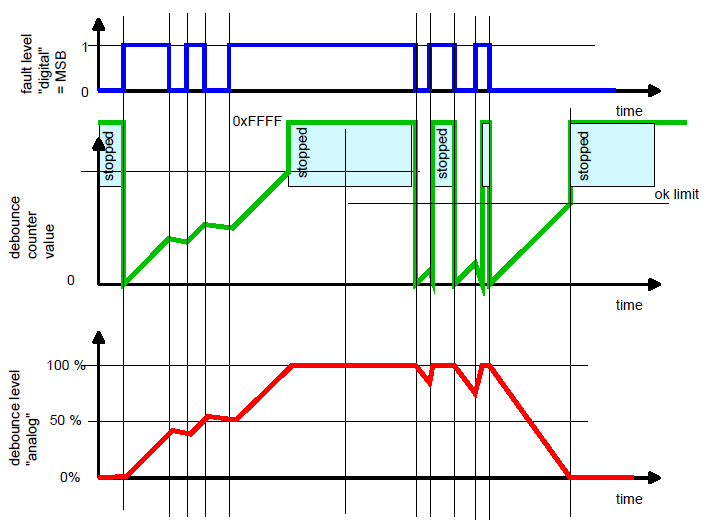
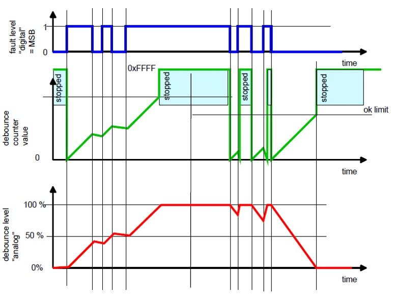
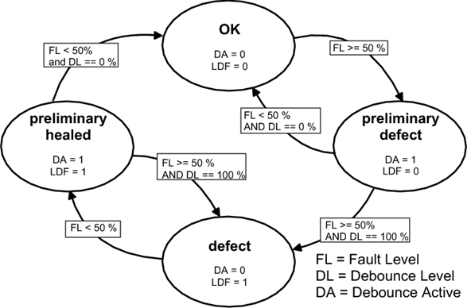
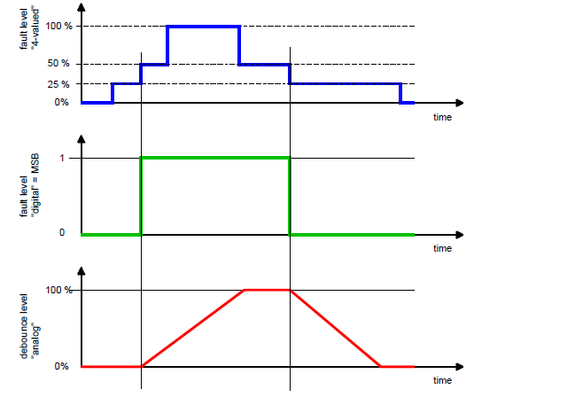

# Fault detection {#fault-detection .p_Heading1 style="page-break-after: avoid;"}

+:------------------------------------------------------------------------------------+------------------------------------+
| **Navigation:**  »No topics above this level«                                       |  |
|                                                                                     |                                    |
| # Fault detection {#fault-detection-1 .p_Heading1 style="page-break-after: avoid;"} |                                    |
+-------------------------------------------------------------------------------------+------------------------------------+

#   {#section .p_Heading1 style="page-break-after: avoid;"}

# {style="margin:0;width:10.6042in;height:6.0313in;border:none"} {#dfc .p_Heading1 style="page-break-after: avoid;"}

 

Fault Codes

 

For each fault exist a diagnostic fault check (DFC) for the fault check handling.

 

A DFC is defined over the identifier and the debounce mode. The identifier is used for the access of the DFC and the debounce mode selects if and how a fault is debounced.

 

For each DFC is a status available and this contains information about:\
 

- the last reported fault level

- the last reported debounce level

- the tested status

- additional derived information\
 

Upon detection of a fault (reporting of a faulty check = fault event) an entry within the fault event storage is created in which additional detailed information is stored (environment conditions, cycle counter).

 

 

DSM Debounce Methods:

 

Storing, healing and reporting of faults when the fault has been present in the system for a calibrated time or number of events.

 

- Three possible debouncing methods for fault entries exist:

 

- "In a Row" debouncing

- "symmetrical  up/down" debouncing

- "asymmetrical up/down" debouncing

 

 

In-Row Debouncing:

 

The error must be present or absent without interruption for the entire debounce time for a fault entry to be stored.When the error is no longer present during debouncing, debouncing is restarted from 0.

- DDRC_DurDeb.DFC_xyzDebDef_C.

- DDRC_DurDeb.DFC_xyzDebOk_C.

 

<figure style="margin:0;padding:0">

<figcaption aria-hidden="true">
Time IN-ROW Debounce
</figcaption>
</figure>

 

Up-Down Debouncing:

 

During defect debouncing the counter counts upwards as long as an undebounced fault is currently present. If the fault is no longer present, the counter counts downwards and is not reset.Useful to detect noisy or disturbed signals.

 

Calibration labels:

- DDRC_DurDeb.DFC_xyzDebDef_C

- DDRC_DurDeb.DFC_xyzDebOk_C

- DDRC_RatDeb.DFC_xyzUDRat_C = 1 (symmetrical up/down debouncing)

 

<figure style="margin:0;padding:0">

<figcaption aria-hidden="true">
Up-Down Debouncing
</figcaption>
</figure>

 

Asymmetrical Up\\Down Debouncing:

 

Time periods during which the fault is present are higher prioritized than time periods during which the fault is not present.

 

- This method allows faults to be detected/stored that have about the same amount of defect and ok detections.

 

- Calibration labels:

- DDRC_DurDeb.DFC_xyzDebDef_C

- DDRC_DurDeb.DFC_xyzDebOk_C

 

DDRC_RatDeb.DFC_xyzUDRat_C = e.g. 3\*

 

Note: During defect debouncing, healing is 3x slower.

During healing debouncing, defect recognition is 3x faster.

 

The advantage of \"up/down\" debouncing is the ability to handle changing signals. If the ratio is on average at 50%, however, it can happen that the debounce level never reaches 100%. Therefore, each \"up/down\" debounce has an additional applicable asymmetry factor.

 

<figure style="margin:0;padding:0">

<figcaption aria-hidden="true">
Asymetrical Up\Down Debouncing
</figcaption>
</figure>

 

In the following diagram, the graph \"debounce level \'analog\'\" shows that during debounce \"in the direction of error\" a healing, which is reported in between, is evaluated weaker by the factor \"1/Ratio\". The gradient in the direction of 0% (= OK) is weaker here. However, if the error is debounced once and the debounce is \"in the direction of healing\", then an error occurs, which is reported in between, is evaluated more strongly by the factor \"Ratio\".

 

The advantage of this factor lies in the handling of disturbed signals. A factor of 4 results in a diagnosis, which on average is more than 20% of the calls reports an error, over time to a debounce level of 100%.

 

The factor can be set between 1 and 4.

 

State Machine for DFC handling

 

{style="margin:0 auto 0 auto;width:6.1146in;height:4.0417in;border:none"}

DFC:Fault Level,Debounce level and DFC status\
 

# Functionality {#functionality .p_Heading1 style="page-break-after: avoid;"}

 

Each time a monitoring function determines a new result, the DFC−Handler is called with the evaluated status. This happens either directly (function uses the low level interface), via DDRC (DSM Diagnostic Debounce and Report Check) or via the legacy interface for fault paths(DFP).

 

The DFC − Handler compares this new result with the last reported result. If nothing has changed, no further action is taken.If something has changed, the new result is used to update the array which contains all DFC status. Furthermore, the Inhibit handler is called to check whether the change is relevant for any FId and to update the FId status if necessary.

 

On a status change, also the fault event storage (DFES) handler is called to check if a DFES entry must be created or updated.For each DFC, a measurement point is provided which contains all available status information (plus some DSM internal bits). This measurement point is updated immediately after a report of a new result by the monitoring function has occurred.

 

Check Status information content

The DFC status contains three components which are reported by the monitoring function. These components are explained in the following sections.

 

Fault Level

There are 2 bits for representing the severity of a fault (0%, 25%, 50% and 100%). The fault level is generated by the monitoring function. For ordinary monitoring, only the fault levels 0% (= ok) and 100% (= defect) are used. The fault level 50% and 100% can be used to differ between a normal and a strong fault (graduated inhibitions). The fault level 25% is relevant for the inhibit handler (DINH) only.

 

Purpose

The graduated fault level allows monitoring functions to distinguish between different degradations without the need of a separate DFC (e.g. different limits for exhaust influence and drive ability).

Simple functions (most of the monitoring functions) only use the fault levels 0% and 100%.The different fault levels are fully supported by the inhibit handler (DINH) and can be used to stop (inhibit) FIDs.The error memory handling (DFES) only evaluates the highest bit of the fault level. That means for the DFES, the fault levels \< 50% are regarded as Test ok and the fault levels \>= 50% are regarded as defect. For all debouncing, also only the most significant bit is used.

 

Behaviour

The fault level always represents the actual result of the monitoring without debouncing. That means the fault level is visible without delay.

 

Debounce Level

The debounce level represents the validation degree of a fault by the pre debouncing. The debounce level is part of the interface between diagnostic function and DSM. In combination with the fault level, the debounce level delivers the basis for the calculation of the DFC state bits LDF (last debounced fault state) and DA (debounce active).

 

Purpose

Due to the availability of the debounce level, it is possible to react within the inhibit handler to preliminary defects. See DINH for details.Furthermore, the Shadow DFES (known from some EDC16 projects) or second stage filtering (as known by some gasoline projects) can be done in an effective way based on the predebouncing (details see DFES). This includes also the possibility to store environmental conditions before final defect recognition.

 

Behavior

The debouncing is based on the most significant bit of the fault level as input value. That means, for the debouncing, the fault level is treated as a digital signal. If this input is 0 (no error), the debounce level is 0% after finishing the debouncing. If the input bit is 1 (error detected), the debounce level is 100% after finishing the debouncing. The behavior in between depends on the method of debouncing (for the integrated predebouncing details, see DDRC).

 

{style="margin:0 auto 0 auto;width:6.7604in;height:4.7604in;border:none"}

Example for behavior of debouce level with Simple undisturbed Debouncing

 

                                                         

 
