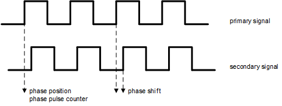

# Frequency acquisition {#frequency-acquisition .p_Heading1 style="page-break-after: avoid;"}

+:--------------------------------------------------------------------------------------------------------+------------------------------------------------------------------------------------------------------------------------------------+
| **Navigation:**  [System features](system-concepts.html) \> [BSW](bsw.html) \> [Inputs](inputs.html) \> |    |
|                                                                                                         |                                                                                                                                    |
| # Frequency acquisition {#frequency-acquisition-1 .p_Heading1 style="page-break-after: avoid;"}         |                                                                                                                                    |
+---------------------------------------------------------------------------------------------------------+------------------------------------------------------------------------------------------------------------------------------------+

General information about frequency measurement

 

Special inputs allow frequency measurement. To be more precise, these special inputs can measure properties of cyclic signals. Most common signal properties utilized in the applications are :

 

- Period duration or frequency

- Pulse duration or duty cycle

 

The frequency signal is evaluated using a special hardware subsystem of the microcontroller and is updated after every period of the signal. The measurement range of the frequency inputs is defined from 1Hz to 20kHz.

 

In some applications it might be required to keep a count on how often a signal edge occurs during a special time window. A 15 bit counter is available to keep the count. In order to accomplish this a simple period counter is provided by each frequency input which can be read by application software at any moment of time. This counter is incremented with each new signal period. Application software is responsible for overflow handling of this period counter.

 

Every application must consider that frequency measurement is done using a digital system. Therefore not all kind of cyclic signals can be processed. It is recommended to read out signal status information in addition to signal properties. For example if the period duration is too long and cannot be measured, this is signaled to the application software via signal status information.

 

For more information see  bds_in_fi and   bds_in_fi_getStatus.

 

 

DSM sensor

 

The DSM frequency inputs can be used for reading in DSM sensor (see RE 95132) signals. If a DSM sensor is connected to an input of this type, application can read out some more information in addition to the aforementioned signal properties. The additional information is as given below.

 

- Rotation direction

- Sensor status

 

For more information see also  bds_in_fi_cfg,  bds_in_fi  and  bds_in_fi_getStatus.

 

 

Phase measurement

 

The phase measurement is used to read two interdependent frequency signals to get the phase information of the signals. The phase measurement is based on the frequency measurement and therefore all requirements are the same.

The phase measurement is triggered with the rising edge of the primary signal as shown in the figure below.

 

 

<figure style="margin:0;padding:0">

<figcaption aria-hidden="true">
Figure65: Phase measurement from two independent frequency signals
</figcaption>
</figure>

 

Following information is sampled:

- Frequency information

oFrequency \[dHz\] of primary signal.

oPeriods \[µs\] of both signals.

- Phase information

oTime stamps \[µs\] from the rising edge of the primary and the secondary signal.

oPhase shift \[µs\] between the primary and the secondary signal.

 

The magnitude of Phase pulse count depends on the direction of rotation. The pulse counter range is from -8388608 to +8388607 (24bits) with overflow. The phase position of the secondary signal is an indication of the direction of rotation. The detection of the direction of rotation can be done using sensors for example  using a DSA2 sensor (see RE 95133). The phase shift value can be +/-90 degree depending upon the direction of rotation.  

 

The following table shows the relation of the phase  angle of the signals to the measured values:

 

+-------------------------------+----------------+-------------------------+--------------------+--------------------+
| Level of secondary signal at  | Phase angle    | DSA2 rotation direction | Counting direction | Value of           |
|                               |                |                         |                    |                    |
| rising edge of primary signal | of the signals |                         | of pulse counter   | direction variable |
+-------------------------------+----------------+-------------------------+--------------------+--------------------+
| Low                           | -90°           | Anti-clockwise          | Increment          | 0                  |
+-------------------------------+----------------+-------------------------+--------------------+--------------------+
| High                          | +90°           | Clockwise               | Decrement          | 1                  |
+-------------------------------+----------------+-------------------------+--------------------+--------------------+

 

Another use is the torque measurement of a shaft with the help of the phase shift angle between the frequency signals of two sensors placed at the end of the shaft.

 

The following pairs are the possible supported pairs.

 

  ---------------- ------------------ ---------------
  primary signal   secondary signal   pair
  K52              K57                K52_K57
  K53              K36                K53_K36
  K54_VI           K37_VI             K54_VI_K37_VI
  K55_VI           K61_VI             K55_VI_K61_VI
  K59              K56                K59_K56
  K60              K58                K60_K58
  K30_VI           A43_VI             K30_VI_A43_VI
  A21              A22                A21_A22
  A23              A24                A23_A24
  ---------------- ------------------ ---------------

 

 

For more information see also  bds_in_phase.

 

 

 

Extended frequency acquisition

 

The extended frequency is used to acquire successive frequency periods and pulses without a loss of any period or pulse. Maximum 20 samples are possible.

 

Remark:

The extended frequency measurement is currently handled under the API function of Phase Measurement (see  bds_in_phase_getStatus). The API parameter that return the address pointer to the first array element of the data type structure bds_in_stPhase_ts are accessible to the ASW. The arrays are only available if Phase Measurement is enabled in eC.

 

Details:

 

oIn order to get the arrays with Period and Pulse the Phase Measurement should be activated in eC.

oThe API function bds_in_phase_getStatus provides a pointer to the start address of the array of data type structure bds_in_stPhase_ts.

oThe pointers of the start addresses are used to get the content of the arrays.

oThe arrays can be used within a periodically triggered ASW task to be simultaneously updated or by calling the API function each time an update is required.

oEach primary signal in the pair has an array with information about periods and pulses.

oThe secondary signal has an array entries corresponding to periods and an array with information about pulses. The one with pulses is currently filled with dummy value \"0\".

oEach array has max. 20 entries.

 

 
