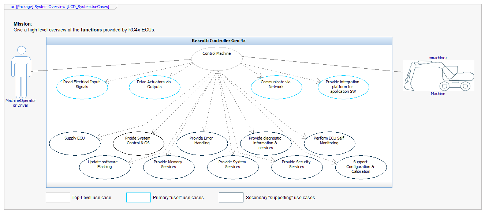

# Functional overview of the BSW {#functional-overview-of-the-bsw .p_Heading1 style="page-break-after: avoid;"}

+:------------------------------------------------------------------------------------------------------------------+-------------------------------------------------------------------------------------------------------------------------------+
| **Navigation:**  [System features](system-concepts.html) \> [SW architecture](sw-architecture.html) \>            |    |
|                                                                                                                   |                                                                                                                               |
| # Functional overview of the BSW {#functional-overview-of-the-bsw-1 .p_Heading1 style="page-break-after: avoid;"} |                                                                                                                               |
+-------------------------------------------------------------------------------------------------------------------+-------------------------------------------------------------------------------------------------------------------------------+

On a high abstraction level the RC provides the following system use cases via the BSW:

<figure style="margin:0;padding:0">

<figcaption aria-hidden="true">
Figure 30: RC high level use case overview.
</figcaption>
</figure>

 

This grouping of system use cases is used:

oInside this manual to structure the description of the [System Features](system-concepts.html){.topiclink}

oAs basis for the BSW C-APIs partitioning into packages, detailed in Structure of the BSW C-API
