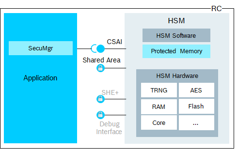

# Hardware Security Module (HSM) {#hardware-security-module-hsm .p_Heading1 style="page-break-after: avoid;"}

+:--------------------------------------------------------------------------------------------------------------------------------------------+------------------------------------------------------------------------------------------------------------------------------------+
| **Navigation:**  [System features](system-concepts.html) \> [Security](security.html) \> [Security components](security-components.html) \> |    |
|                                                                                                                                             |                                                                                                                                    |
| # Hardware Security Module (HSM) {#hardware-security-module-hsm-1 .p_Heading1 style="page-break-after: avoid;"}                             |                                                                                                                                    |
+---------------------------------------------------------------------------------------------------------------------------------------------+------------------------------------------------------------------------------------------------------------------------------------+

The HSM is a secured physical component in which sensitive information like passwords can be stored and processed. The main features include:

- Physically separate (i.e., special memory and CPU) and well protected hardware component, directly included within the RC

- Optimized for efficient cryptographic algorithms

- Secure storage of confidential information like passwords and private keys

- Data exchange via secure communication channels

<figure style="margin:0;padding:0">

<figcaption aria-hidden="true">
Figure8: HSM Overview. CSAI is used for communication between SecuMgr and HSM. 

</figcaption>
</figure>

The diagram above shows the interfaces and core mechanics of the HSM:

- The [Security Manager](security-manager.html){.topiclink} abstracts the communication between application and HSM.

- The Cryptographic Service Application Interface (CSAI) is used to exchange information between application and HSM.

- The physical True Random Number Generator (TRNG) ensures that security relevant random numbers cannot be predicted by a third party.

- Physical AES acceleration to optimize cryptographic operations.

- Integrated RAM, Program and Code Flash as well as a separate Core ensure that confidential information can be processed and stored within the HSM.

- The shared memory area provides a secure mechanism for exchanging information between the application and the HSM.

- SHE+ (Security Hardware Extension) and Debug Interface are inaccessible.

Since the HSM contains classified and security-related data, it is not possible to extract any data that is stored internally. The HSM interface only returns non-confidential data like an AES encrypted text or the confirmation of validity for a specific certificate. Amongst others, the HSM is capable to store multiple private keys, passwords and certificates directly on the Program or Data Flash, protecting them against extraction or manipulation.

## Using the HSM {#using-the-hsm .p_Heading2 style="page-break-after: avoid;"}

When you are developing an application for the RC, you can use the HSM to secure the ECU against unauthorized access (see [Authorization](authorization.html){.topiclink}). The  SEC module contains a set of functions that can be used to interact with the HSM. Aside from these functions, we do not offer other ways to interact with the HSM. Note, that you cannot use the HSM to store arbitrary information or run your own code as this could lead to unforeseeable side effects or security threats.

## Specification {#specification .p_Heading2 style="page-break-after: avoid;"}

The Software used in the RC HSM is CycurHSM2, which is a product of ESCRYPT.

 
