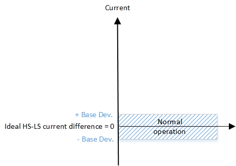
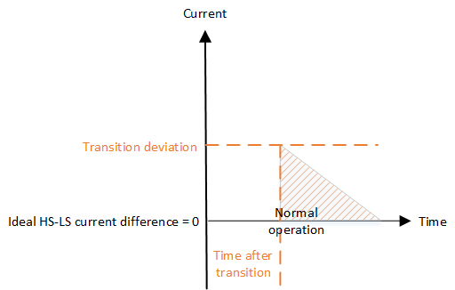
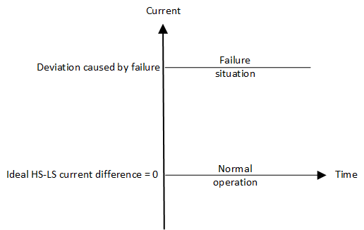
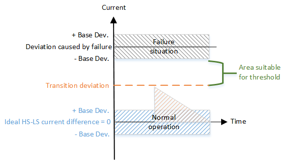

# High-side and low-side current comparison (HLCC) {#high-side-and-low-side-current-comparison-hlcc .p_Heading1 style="page-break-after: avoid;"}

+:---------------------------------------------------------------------------------------------------------------------------------------------------------------------------------------------------------------------------------------+------------------------------------------------------------------------------------------------------------------------------------------+
| **Navigation:**  [Safety manual](safety-manual.html) \> [Failure detection possibilities](failuredetectionpossibilities.html) \> [Failure detection capability of different SAFOUT configurations](failuredetectionsafeoutput.html) \> |    |
|                                                                                                                                                                                                                                        |                                                                                                                                          |
| # High-side and low-side current comparison (HLCC) {#high-side-and-low-side-current-comparison-hlcc-1 .p_Heading1 style="page-break-after: avoid;"}                                                                                    |                                                                                                                                          |
+----------------------------------------------------------------------------------------------------------------------------------------------------------------------------------------------------------------------------------------+------------------------------------------------------------------------------------------------------------------------------------------+

The safe output configurations [PHMDL](phmdl.html){.topiclink}, [PLDHS](pldhs.html){.topiclink}, [PLMDH](plmdh.html){.topiclink} and [PHDLS](phdls.html){.topiclink} are equipped with a high-side (HS) and low-side (LS) current comparison (HLCC) function. The HLCC function compares cyclically the absolute values of deviations of the HS and LS current feedback readings (=\|HS current feedback - LS current feedback\|) against a threshold.  

 

The HS and LS current deviations can be affected by different factors (see the following figure).

1.During normal operation, there is always a "base deviation" caused by the measurement tolerances of the HS and LS current feedbacks.

2.When switching between different actuators, e.g., there could be "transition deviation" caused by the inductance of the loads.

3.Under failure situations, there will be "deviation caused by failure" (see [Safety outputs](safety-outputs.html){.topiclink} for failure detections relied on the HLCC).

 

<figure style="margin:0;padding:0">

<figcaption>
Figure 104: Base deviation due to measuring tolerances.
</figcaption>
</figure>

<figure style="margin:0;padding:0">

<figcaption aria-hidden="true">
Figure 105: Transition deviatiion due to inductance of loads.
</figcaption>
</figure>

 

<figure style="margin:0;padding:0">

<figcaption aria-hidden="true">
Figure 106: Deviation caused by failures.
</figcaption>
</figure>

 

In order to ensure an undisturbed operation as well as to detect potential failures reliably, proper threshold shall be set using the API  bds_safout_cfgDiag for the individual applications. The criterion of a proper threshold is

Threshold \> \|Base deviation\| AND Threshold \> \|Transition deviation\| AND Threshold \< \|\|deviation caused by failure\| - \|Base deviation\|\|. This is illustrated in the picture below:

 

<figure style="margin:0;padding:0">

<figcaption aria-hidden="true">
Figure 107: Determination of the area suitable for setting a threshold to ensure undisturbed operation and the possibility to detect potential failures.
</figcaption>
</figure>

 

 

 

The base deviation varies with respect to control frequencies and set points. The worst case base deviation of the RC18-12/40 and RC27-18/40 are listed in the following table:

+---------------------------------------------+-----------------------------------------------------------------------------------------------------------------------------------------+
| PWM frequency                               | Worst case base deviation\*                                                                                                             |
|                                             +---------------------------------------------+---------------------------------------------+---------------------------------------------+
|                                             | Setpoint = 0.1 -1.0 A                       | Setpoint = 1.1 -2.4 A                       | Setpoint = 2.5 -3.9 A                       |
+=============================================+=============================================+=============================================+=============================================+
| 100 Hz                                      | \< 60 mA                                    | \< 110 mA                                                                                 |
+---------------------------------------------+---------------------------------------------+---------------------------------------------+---------------------------------------------+
| 1 kHz                                       | \< 50 mA                                    | \< 100 mA                                   | \< 210 mA                                   |
+---------------------------------------------+---------------------------------------------+---------------------------------------------+---------------------------------------------+
| \*Values derived via statistical analysis method (Normal Distribution, Percent of population in interval = 99,73% (3σ), Confidence level = 95%) based on test data.                   |
+---------------------------------------------------------------------------------------------------------------------------------------------------------------------------------------+

[]{#fig_77a410 .hmanchor}Table 16: Worst case base deviation of RC18-12/40 and RC27-18/40

 

The "transition deviation" shall be measured via tests for individual applications by the BSW:

- For RC18-12/40 and RC27-18/40, the transition deviation is only relevant for [PHDLS](phdls.html){.topiclink} and [PLDHS](pldhs.html){.topiclink} safety output configurations.

- The transition deviation of the first 20 ms after transition does not need to be considered.

 

The "deviation caused by failure" shall be derived via analysis / tests of the failure scenarios for individual applications. Failure detections of each safe output configuration that relies on the high-side and low-side current comparison are indicated [Safety outputs](safety-outputs.html){.topiclink}.

 

For safe output configurations with more than one HS or LS, the deviations shall be considered multiple times.

 
