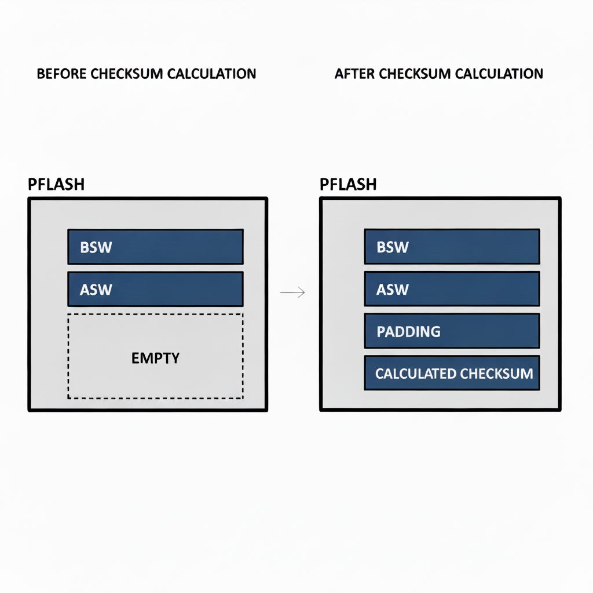

# How to calculate checksum for CODESYS merged HEX {#how-to-calculate-checksum-for-codesys-merged-hex .p_Heading1 style="page-break-after: avoid;"}

+:------------------------------------------------------------------------------------------------------------------------------------------------------+-------------------------------------------------------------------------------------------------------------------------------------+
| **Navigation:**  [How-Tos](how-to.html) \>                                                                                                            |    |
|                                                                                                                                                       |                                                                                                                                     |
| # How to calculate checksum for CODESYS merged HEX {#how-to-calculate-checksum-for-codesys-merged-hex-1 .p_Heading1 style="page-break-after: avoid;"} |                                                                                                                                     |
+-------------------------------------------------------------------------------------------------------------------------------------------------------+-------------------------------------------------------------------------------------------------------------------------------------+

For a quick start,make sure to prepare a proper environment, as outlined in this chapter. All the required tools and directories shall be in place.

{style="margin:0;width:4.3438in;height:4.3438in;border:none"}

 

If you have questions, contact your Rexroth representative directly or visit [https://community.mybodas.boschrexroth.com/](https://community.mybodas.boschrexroth.com/){.weblink target="_blank"}.
