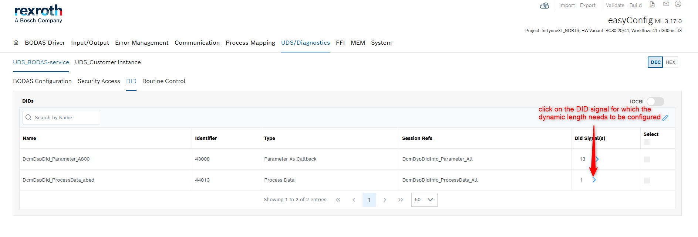
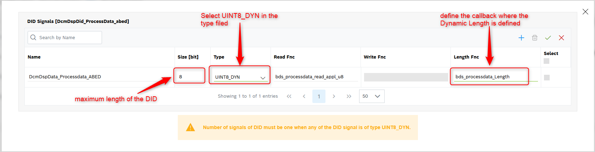

# How to Configure Dynamic Length for DIDs {#how-to-configure-dynamic-length-for-dids .p_Heading1 style="page-break-after: avoid;"}

+:--------------------------------------------------------------------------------------------------------------------------------------+--------------------------------------------------------------------------------------------------------------------------+
| **Navigation:**  [How-Tos](how-to.html) \>                                                                                            |    |
|                                                                                                                                       |                                                                                                                          |
| # How to Configure Dynamic Length for DIDs {#how-to-configure-dynamic-length-for-dids-1 .p_Heading1 style="page-break-after: avoid;"} |                                                                                                                          |
+---------------------------------------------------------------------------------------------------------------------------------------+--------------------------------------------------------------------------------------------------------------------------+

In Unified Diagnostic Services (UDS), a Data Identifier (DID) uniquely identifies a piece of diagnostic data.

Normally, a DID has a fixed response length. However, certain applications require the response size to vary depending on run-time conditions.

 

Examples include:

- Variable-length log data,

- Certificate data,

- VIN extensions,

- Calibration data,

- User-defined strings,

- Dynamic sensor information, etc..,

easyConfig supports these through Dynamic Length DIDs.

 

Why Dynamic Length?

A fixed-length DID always returns the configured number of bytes.

Example:

DID : 0xF190

Length : 17 bytes

Response : 62 F1 90 11 22 33 \.... 99 (total 17 bytes)

Some applications cannot determine the response size until run-time. Instead of creating multiple DIDs, a single Dynamic Length DID can return the required amount of data.

 

Configuration of Dynamic Length of DIDs through easyConfig:

 

1\) Under UDS/Diagnostics tab, select the UDS_BODAS-service and select DID section. Select the desired signal where dynamic length needs to be configured.

 

{style="margin:0;width:15.3333in;height:5.2188in;border:none"}

2\) Under the signal select the type as UINT8_DYN and provide the callback name where Dynamic length will be defined in the Length Fnc

 

{style="margin:0;width:17.5000in;height:4.4896in;border:none"}

 

Once the build is complete, the callback function prototype will be generated. using that callback, user can define his own length for that DID.

 

Points to remember while configuring the dynamic length for DIDs:

1\) The maximum length of the DID that can be configured through dynamic length callback must be less than or equal to Size configured for the corresponding signal.

2\) More than one signal( UINT8_DYN type or other types) is not allowed to be configured as dynamic length in a DID.

 
