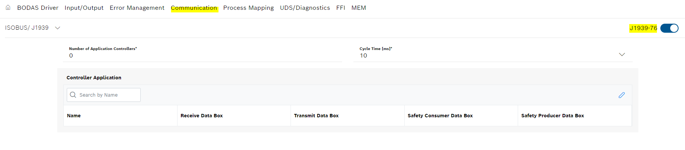

# How to develop a J1939-76 Application {#how-to-develop-a-j1939-76-application .p_Heading1 style="page-break-after: avoid;"}

+:--------------------------------------------------------------------------------------------------------------------------------+------------------------------------------------------------------------------------------------------------------------------------------+
| **Navigation:**  [How-Tos](how-to.html) \>                                                                                      |    |
|                                                                                                                                 |                                                                                                                                          |
| # How to develop a J1939-76 Application {#how-to-develop-a-j1939-76-application-1 .p_Heading1 style="page-break-after: avoid;"} |                                                                                                                                          |
+---------------------------------------------------------------------------------------------------------------------------------+------------------------------------------------------------------------------------------------------------------------------------------+

The integration of the J1939-76 communication stack has to be done with the following steps:

1\) Prepare the BSW configuration within easyConfig tool:

a\) Define a CAN receive buffer within easyConfig:

- A buffer size of at least 10 is recommended per CA instance.

b\) Define a CAN transmit buffer within easyConfig:

- A buffer size of at least 10 is recommended per CA instance.

c\) Define the total number of required ISOBUS/J1939 controller application instances within easyConfig or alternatively use bds_isobus_registerInstances BSW API

d\) Enable the J1939-76 feature in easyConfig GUI available in ISOBUS/J1939 tab.

The image below highlights the easyConfig GUI options for enabling the J1939-76 safety extension for ASW. J1939-76 is enabled in the image below.

 

<figure style="margin:0;padding:0">

<figcaption aria-hidden="true">
Figure136: easyConfig option for enabling the J1939-76 safety extension
</figcaption>
</figure>

 

  ------------------------------------------------------------------------------------------ --------------------------------------------------------------------------------------------------------------------------------------------------------------
  {style="margin:0;width:2.1667in;height:0.7083in;border:none"}    If J1939-76 feature is enabled in easyConfig, at least 1 safety Producer and 1 safety Consumer databox has to    be registered using easyConfig or BSW APIs
  ------------------------------------------------------------------------------------------ --------------------------------------------------------------------------------------------------------------------------------------------------------------

 

e\) Define the number of J1939-76 Producer SDG databoxes of each controller application instance:

- Configure the required number of Producer SDG databoxes within easyConfig  -or-

- configure value 0 in easyConfig and use API function bds_isobus_registerProdSdgDataboxes in application.

f\) Define the number of J1939-76 Consumer SDG databoxes of each controller application instance within easyConfig:

- Configure the required number of Consumer SDG databoxes within easyConfig  -or-

- configure value 0 in easyConfig and use API function bds_isobus_registerCnsrSdgDataboxes in application.

g\)  Define the cycle period for ISOBUS Main Task. By default it will be in 10ms.

 

2\) The header files required for J1939-76 application \'bds_isobus_sfty.h\' and \'bds_isobus_api.h\' are part of \'bds_bsw.h\'. Include header file \'bds_bsw.h\' within the application.

 

3\) Define the J1939-76 Producer SDG databoxes of each controller application instance:

- Define a data buffer for each databox (e.g. array or structure) with the required size of data (up to 8 bytes)

- Optional define a Producer SDG callback function for each databox of type bds_isobus_sdgProdCallback_tpf

- Initialize each Producer SDG databoxe with the function bds_isobus_initProdSdgDatabox with the PGN to be transmitted

 

4\) Define the J1939-76 Consumer SDG databoxes of each controller application instance:

- Define a data buffer for each databox (e.g. array or structure) with the required size of data (up to 8 bytes)

- Optional define a Consumer SDG callback function for each databox of type bds_isobus_sdgCnsrCallback_tpf

- Initialize each Consumer SDG databox with the function bds_isobus_initCnsrSdgDatabox with the PGN to be transmitted

 

5\) Define the controller applications:

- Define the controller application (CA) name with the function bds_isobus_setCaName of each controller application instance

- The CA name is required for the address claiming procedure

- Define also with bds_isobus_setCaName whether the arbitrary address capabilty should be active for the corresponding CA instance

- Define the initial source address of each CA instance and assign it to a CAN channel with the function bds_isobus_setCaAddr

- Optionally define hardware and software identification strings for the PGNs 0x00FDC5 (ECU identification information) and 0x00FEDA (Software identification) with the function bds_isobus_setCaInfo

 

6\) Start the ISOBUS communication:

- Initialize and start the ISOBUS communication of all CA instances of one CAN channel with the function bds_isobus_initComm

- The communication has to be started separately on each CAN channel

7\) Consumer SDGs:

- The reception of a Consumer SDG can be detected either by checking the Consumer SDG status with an Consumer callback function which can be defined with function bds_isobus_initCnsrSdgDatabox

- After the successfully reception of a Consumer SDG the received data can be copied from the databox buffer

 

8\) Producer SDGs:

- The J1939-76 Producer SDGs will be transmitted cyclically as per the given time interval in the databox intialization.

 
