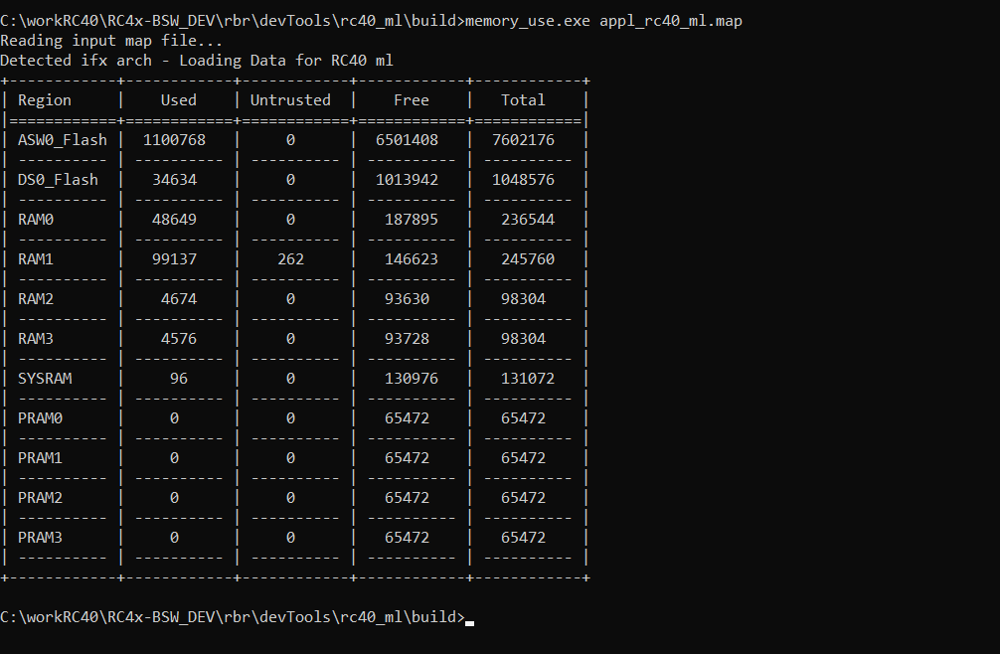

# How to execute memory_use.exe {#how-to-execute-memory_use.exe .p_Heading1 style="page-break-after: avoid;"}

+:----------------------------------------------------------------------------------------------------------------+------------------------------------+
| **Navigation:**  »No topics above this level«                                                                   |  |
|                                                                                                                 |                                    |
| # How to execute memory_use.exe {#how-to-execute-memory_use.exe-1 .p_Heading1 style="page-break-after: avoid;"} |                                    |
+-----------------------------------------------------------------------------------------------------------------+------------------------------------+

1\. Copy RC4x-BSW_DEV\\rbr\\bsw\\rc40_ml\\testApplication\\obj\\appl_rc40_ml.map to RC4x-BSW_DEV\\rbr\\devTools\\rc40_ml\\build\>

2\. Open Command Window

3\. Go to RC4x-BSW_DEV\\rbr\\devTools\\rc40_ml\\build\>

4\. Execute this command memory_use.exe appl_rc40_ml.map

We will get the memory information as shown in below image.

{style="margin:0;width:5.0417in;height:3.3021in;border:none"}
