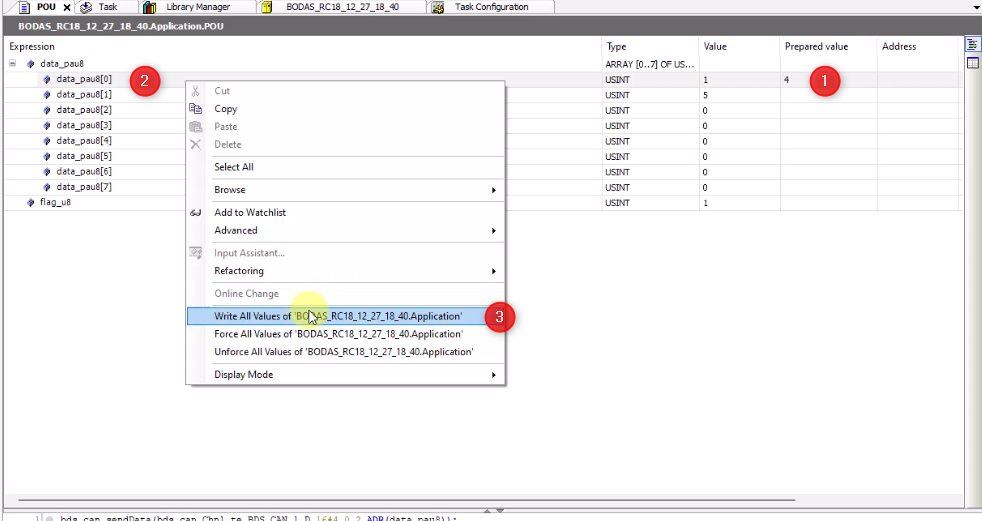
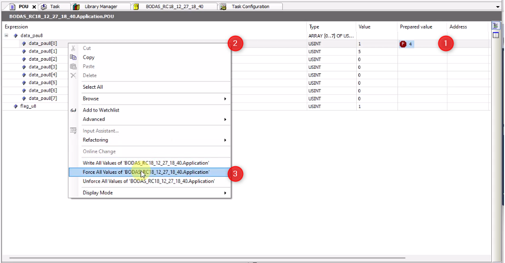

# How to Write and Force Values {#how-to-write-and-force-values .p_Heading1 style="page-break-after: avoid;"}

+:--------------------------------------------------------------------------------------------------------------------------------+---------------------------------------------------------------------------------------------------------------------------------------------------------------------------------------------------------+
| **Navigation:**  [How-Tos](how-to.html) \> [How to use Forcing/Writing for CODESYS](how-to-use-forcing-writing-codesys.html) \> |    |
|                                                                                                                                 |                                                                                                                                                                                                         |
| # How to Write and Force Values {#how-to-write-and-force-values-1 .p_Heading1 style="page-break-after: avoid;"}                 |                                                                                                                                                                                                         |
+---------------------------------------------------------------------------------------------------------------------------------+---------------------------------------------------------------------------------------------------------------------------------------------------------------------------------------------------------+

This section provides step-by-step instructions for writing and forcing variable values in CODESYS.

 

## How to write a value {#how-to-write-a-value .p_Heading2 style="page-break-after: avoid;"}

1.Log in to the RC40 and ensure the program is running.

2.Open the POU view where you can monitor the variables.

3.Double-click the current value in the \"Prepared value\" column next to your variable.

4.Enter the new value the user wishes to write.

5.From the menu, choose Write All Values. The values will be sent to the RC40.

 

{style="margin:0;width:10.2292in;height:5.4271in;border:none"}

## How to force a value {#how-to-force-a-value .p_Heading2 style="page-break-after: avoid;"}

1.Log in to the PLC and ensure your program is running.

2.Open the POU view where the user can monitor the variables.

3.Enter the new value the user wishes to write.

4.From the menu, choose Force All Values. The values will be sent to the RC40. The user will see a small red (F) symbol next to the variable, indicating it is under a force.

{style="margin:0;width:10.3229in;height:5.3750in;border:none"}

 

## How to release a forced value {#how-to-release-a-forced-value .p_Heading2 style="page-break-after: avoid;"}

1.From the menu, choose Debug \> Unforce Values.

2.Confirm the action. All active forces on the RC40 will be released at once, and the program logic will take control of the variables\' values again. The red (F) symbol will disappear.

 
