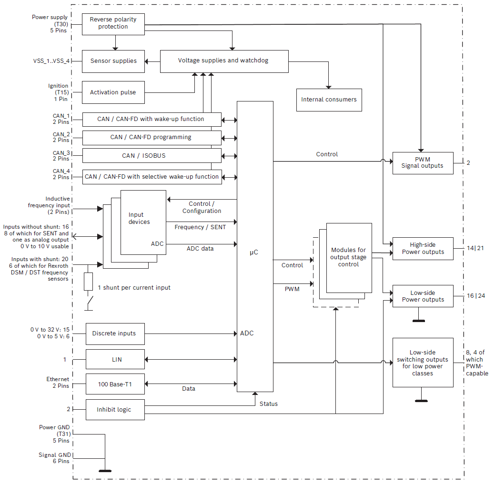

# RC HW architecture {#rc-hw-architecture .p_Heading1 style="page-break-after: avoid;"}

+:------------------------------------------------------------------------------------------+--------------------------------------------------------------------------------------------------------------------------+
| **Navigation:**  [Hardware](hw-reference-manual.html) \>                                  |    |
|                                                                                           |                                                                                                                          |
| # RC HW architecture {#rc-hw-architecture-1 .p_Heading1 style="page-break-after: avoid;"} |                                                                                                                          |
+-------------------------------------------------------------------------------------------+--------------------------------------------------------------------------------------------------------------------------+

## Block circuit diagram {#block-circuit-diagram .p_Heading2 style="page-break-after: avoid;"}

<figure style="margin:0;padding:0">

<figcaption aria-hidden="true">
Figure135: HW architecture of RC18-12E/40 and RC27-18E/40. Other RC40 variants are subsets.
</figcaption>
</figure>

 

## Ordering Code {#ordering-code .p_Heading2 style="page-break-after: avoid;"}

 

+----+----+----+---+----+
| 01 | 02 | 03 |   | 04 |
+----+----+----+---+----+
| RC |    |    | / | 40 |
+====+====+====+===+====+
|    |             |    |
+----+-------------+----+

+------+--------+--------+--------+----+
| Type |        |        |        |    |
+------+--------+--------+--------+----+
| 01   | BODAS controller         | RC |
+======+========+========+========+====+

+-------------+----------------+----------------+----------------+-------------+
| Version     |                |                |                |             |
+=============+================+================+================+=============+
| 02          | 1st number:                                      | 5-6         |
|             |                                                  |             |
|             | Number of current-controlled power outputs       |             |
|             |                                                  |             |
|             | 2nd number:                                      |             |
|             |                                                  |             |
|             | Power switching outputs                          |             |
|             |                                                  +-------------+
|             |                                                  | 18-12       |
|             |                                                  +-------------+
|             |                                                  | 27-18       |
+-------------+--------------------------------------------------+-------------+

+--------+---------------+---------------+---------------+---+
| Option |               |               |               |   |
+========+===============+===============+===============+===+
| 03     | Without Ethernet interface 100Base-T1         |   |
|        +-----------------------------------------------+---+
|        | With Ethernet interface 100Base-T1            | E |
+--------+-----------------------------------------------+---+

+--------+---------+---------+---------+----+
| Series |         |         |         |    |
+--------+---------+---------+---------+----+
| 04     | Series 4, index 0           | 40 |
+========+=========+=========+=========+====+
