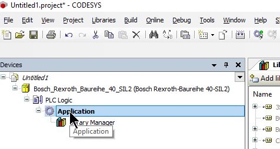
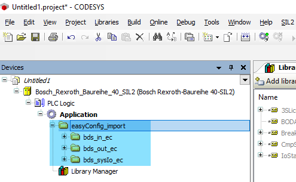

# Import easyConfig generated xml files {#import-easyconfig-generated-xml-files .p_Heading1 style="page-break-after: avoid;"}

+:----------------------------------------------------------------------------------------------------------------------------------------------------------------------------------------------------------------------------------+-------------------------------------------------------------------------------------------------------------------------------------------------+
| **Navigation:**  [Introduction](introduction.html) \> [First steps with RC](preparation.html) \> [Configurations](required-tools.html) \> [Step 5: ASW development & components involved](step-5-asw-development--compon.html) \> |    |
|                                                                                                                                                                                                                                   |                                                                                                                                                 |
| # Import easyConfig generated xml files {#import-easyconfig-generated-xml-files-1 .p_Heading1 style="page-break-after: avoid;"}                                                                                                   |                                                                                                                                                 |
+-----------------------------------------------------------------------------------------------------------------------------------------------------------------------------------------------------------------------------------+-------------------------------------------------------------------------------------------------------------------------------------------------+

All the configurations of the device that are carried out in easyConfig and needed for ASW development are exported to 3 different xml files. In order to have the configurations of device in CODESYS, the corresponding xml files have to be imported to the CODESYS working project. This can be done as following:

- In opened CODESYS project \> select Application

   

<figure style="margin:0;padding:0">

<figcaption aria-hidden="true">
Right mouse clock on Application Icon
</figcaption>
</figure>

- Then click on tab Project \> ImportPLCOpenXML \> Browse the xml files that is present in the download folder of myBODAS build. All 3 xml files ( bds_rts_ec.xml, GvlDsmDfc.xml, GvlLinCanSignals.xml) have to be imported separately.

- You can now see the content imported from xml files under Application in the project.

   

<figure style="margin:0;padding:0">

<figcaption aria-hidden="true">
Input &amp; output pin configurtions from easyConfig imported to Codesys project
</figcaption>
</figure>

 

  -------------------------------------------------------------------------------- --------------------------------------------------------------------------------------------------------------------------------------------------------------------------------
  {style="margin:0;width:2.1667in;height:0.6979in;border:none"}   The above mentioned steps in this sub-chapter are needed for every new CODESYS project and for every change in device configurations in easyConfig and for every new workflow.
  -------------------------------------------------------------------------------- --------------------------------------------------------------------------------------------------------------------------------------------------------------------------------
