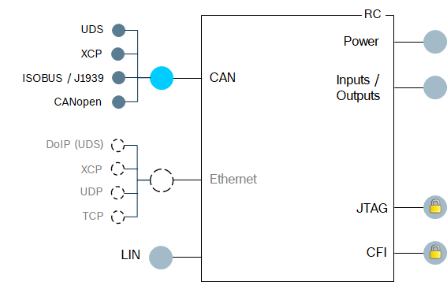

# Interface protection {#interface-protection .p_Heading1 style="page-break-after: avoid;"}

+:----------------------------------------------------------------------------------------------+----------------------------------------------------------------------------------------------------------------------------------+
| **Navigation:**  [System features](system-concepts.html) \> [Security](security.html) \>      |    |
|                                                                                               |                                                                                                                                  |
| # Interface protection {#interface-protection-1 .p_Heading1 style="page-break-after: avoid;"} |                                                                                                                                  |
+-----------------------------------------------------------------------------------------------+----------------------------------------------------------------------------------------------------------------------------------+

The device has several interfaces, some of which are used only for production or internal development. All interfaces to and from the device are depicted in the graphic below.

<figure style="margin:0;padding:0">

<figcaption aria-hidden="true">
Figure 7: Complete summary of RC interfaces.
</figcaption>
</figure>

## CAN Interface {#can-interface .p_Heading2 style="page-break-after: avoid;"}

The following interfaces are protected by security measures:

- XCP is disabled by default and should only be activated during the development of applications. More information on how to enable XCP on your device can be found here: [XCP Module](xcp-module.html){.topiclink}.

- The UDS protocol is usually enabled on all devices and is protected by the UDS Security Access service (0x27). More information about the access-level concept can be found here: [Authentication](authentication.html){.topiclink}.

The CAN communication itself is not specially protected by any security measures. Depending on the used protocol, security mechanics are either natively supported or can be implemented on top of the protocol.

## JTAG {#jtag .p_Heading2 style="page-break-after: avoid;"}

The JTAG (Joint Test Action Group, IEEE standard 1149.1) interface is used for testing and debugging the RC. In series devices, the JTAG interface is not populated and disabled by a cryptographically secure algorithm.

Development units with enabled JTAG interface and physically accessible JTAG connector are available on request. Rexroth recommends to use XCP for ASW development. Support for the use of JTAG tools is not provided by Rexroth.

## Bosch Car Processing Unit Flash Interface (CFI) {#bosch-car-processing-unit-flash-interface-cfi .p_Heading2 style="page-break-after: avoid;"}

This interface is used solely in the Rexroth production line and is not publicly accessible. The interface is used for internal tests and the initial programming of the device and is protected against unauthorized access (independent of the password levels). To use this interface, special hardware and software (not publicly available) is required.

## Local Interconnect Network (LIN) {#local-interconnect-network-lin .p_Heading2 style="page-break-after: avoid;"}

The [LIN communication](lin-module.html){.topiclink} is not natively protected by any security mechanisms. If security relevant information is transferred via the LIN network you are responsible for adding necessary security measures on the protocol level.

 
