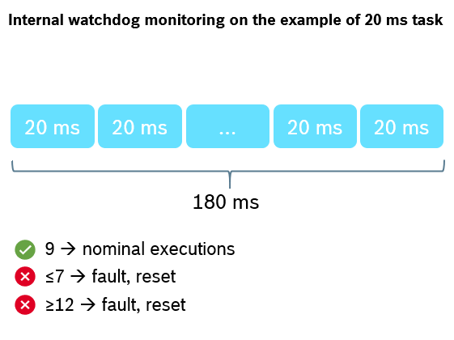

# Internal watchdog monitoring {#internal-watchdog-monitoring .p_Heading1 style="page-break-after: avoid;"}

+:------------------------------------------------------------------------------------------------------------------------------------------------------------------------------------+-------------------------------------------------------------------------------------------------------------------------------------------------+
| **Navigation:**  [System features](system-concepts.html) \> [BSW](bsw.html) \> [Self-monitoring](ecu-self-monitoring.html) \> [Cyclic monitoring](cyclic-monitoring-checks.html) \> |    |
|                                                                                                                                                                                     |                                                                                                                                                 |
| # Internal watchdog monitoring {#internal-watchdog-monitoring-1 .p_Heading1 style="page-break-after: avoid;"}                                                                       |                                                                                                                                                 |
+-------------------------------------------------------------------------------------------------------------------------------------------------------------------------------------+-------------------------------------------------------------------------------------------------------------------------------------------------+

The internal watchdog detects program execution failures, software hangs and automatically recovers the embedded system.

RC internal watchdog is triggered by:  

- An infinite loop

- A situation in which the system is waiting for a certain signal or event, which does not occur

- A deadlock

## Remarks: {#remarks .p_Heading2 style="page-break-after: avoid;"}

- Refer [Safety function and safe state](safetyfunctionandsafestate.html){.topiclink} for details on the safety functions provided by the RCs and the related considerations to be observed.

- Refer [Failure detection possibilities](failuredetectionpossibilities.html){.topiclink} for a broader overview of the different failure reactions observed.

## Alive monitoring algorithm {#alive-monitoring-algorithm .p_Heading2 style="page-break-after: avoid;"}

BODAS BSW uses the alive monitoring algorithm that checks if a supervised entity is executed sufficiently often in a certain period of time.

The alive monitoring algorithm used in RC has the following features:

- Monitoring the frequency of occurrence of an event

- Checking whether the supervised entity executed sufficiently often (not too frequently, not too rarely); minimum tolerance -1, maximum tolerance +2

- Fixed monitoring time of 180 ms

- All the cyclic tasks are monitored by the watchdog

- Recovery through the reset of the ECU, which leads to the reinitialization of the ECU and complete reinitialization of the software

 

The following table provides the information on the expected count, as well as the minimum and maximum tolerance for the cyclic tasks of the BSW.

Note: The calculation below is not applied to the cyclic tasks if their time period in ms does not divide 180 without a remainder. The expected count in such cases is decided by testing.

- Expected count = depends on the task period of a cyclic task: 180/ task period

- Minimum tolerance = expected count -1

- Maximum tolerance = expected count +2

  -------------- ---------------- ------------------- -------------------
  Tasks period   Expected count   Minimum tolerance   Maximum tolerance
  1ms            180              179                 182
  2ms            90               89                  92
  5ms            36               35                  38
  10ms           18               17                  20
  20ms           9                8                   11
  40ms           5                3                   7
  50ms           4                2                   6
  80ms           3                1                   5
  100ms          1                1                   3
  -------------- ---------------- ------------------- -------------------

 

The following figure shows an example on how the alive monitoring algorithm works in case of a 20 ms task.

<figure style="margin:0;padding:0">

<figcaption aria-hidden="true">
Figure 52: Internal watchog monitoring: 20 ms task
</figcaption>
</figure>

 

## Error Reaction {#error-reaction .p_Heading2 style="page-break-after: avoid;"}

  Error                            Reaction
  -------------------------------- ---------------------------------------------
  DFC                              no
  Error Code                       no
  High Power Outputs(\...,OFF)     yes
  ECU Reset                        yes
  Reaction time                    180ms
  Reset Reason  - Reset Group ID   MCU_RB_MCU_PERFORM_RESET
  Reset Reason  - Reset number     MCU_RESET_ILLEGAL_CALL_OF_MCU_PERFORM_RESET
