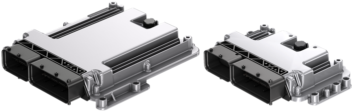

# Introduction - Manual Series 4x                                 BSW Workflow Version - .rts    ml300.rts .rts {#introduction---manual-series-4x-bsw-workflow-version---.rts-ml300.rts-.rts .p_Heading1 style="page-break-after: avoid;"}

+:---------------------------------------------------------------------------------------------------------------------------------------------------------------------------------------------------------------------------------------------+--------------------------------------------------------------------------+
| **Navigation:**  »No topics above this level«                                                                                                                                                                                                |   |
|                                                                                                                                                                                                                                              |                                                                          |
| # Introduction - Manual Series 4x                                 BSW Workflow Version - .rts    ml300.rts .rts {#introduction---manual-series-4x-bsw-workflow-version---.rts-ml300.rts-.rts-1 .p_Heading1 style="page-break-after: avoid;"} |                                                                          |
+----------------------------------------------------------------------------------------------------------------------------------------------------------------------------------------------------------------------------------------------+--------------------------------------------------------------------------+

## BODAS RC4x System & Application Manual {#bodas-rc4x-system-application-manual .p_Heading2 style="page-break-after: avoid;"}

{style="width:70%;max-width:7.3646in;height:auto;border:none"}

 

## Purpose {#purpose .p_Heading2 style="page-break-after: avoid;"}

The System & Application Manual for Rexroth control units of series 4x describes:

- The basic system concepts of the ECU

- The BSW API, which supports writing an own application

- A high level view of the controller hardware

- How-To\'s with step-by-step instructions for dedicated topics (e.g. migration from RC30)

The Customer Loader API (CLAPI), which supports writing a custom bootloader, is described in a separate manual.

## Chapter Content {#chapter-content .p_Heading2 style="page-break-after: avoid;"}

This chapter serves as an introduction into this manual and contains:

- Basic information about the system and the main applications it was designed for

- A description of the environment (tools, infrastructure, etc.)

- Conventions used in this document

- The first steps to set up the RC

 

 

{style="margin:0 0 0 auto;width:2.0000in;height:0.8021in;border:none"}
