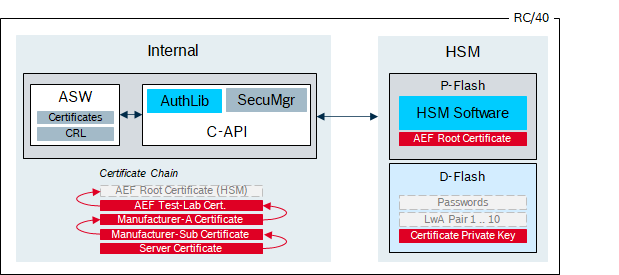

# Introduction {#introduction .p_Heading1 style="page-break-after: avoid;"}

+:-----------------------------------------------------------------------------------------------------------------------------------------------------------------------------------------------------------------------+------------------------------------------------------------------------------------------------------------------------------------------------------+
| **Navigation:**  [System features](system-concepts.html) \> [Security](security.html) \> [Security components](security-components.html) \> [Tractor Implement Management (TIM)](tractor-implement-management.html) \> |    |
|                                                                                                                                                                                                                        |                                                                                                                                                      |
| # Introduction {#introduction-1 .p_Heading1 style="page-break-after: avoid;"}                                                                                                                                          |                                                                                                                                                      |
+------------------------------------------------------------------------------------------------------------------------------------------------------------------------------------------------------------------------+------------------------------------------------------------------------------------------------------------------------------------------------------+

Tractor Implement Management enables an implement (a connected machine) to control safety critical functions of a tractor or any other vehicle, such as its current speed, by using the ISOBUS. A connected implement can for example autonomously determine the optimal speed of the towing tractor, therefore increasing the performance of the overall process. This provides ease-of-use to the operator, who does not have to closely monitor the tractor speed and can concentrate instead on observing the environment for potential obstacles.

<figure style="margin:0;padding:0">

<figcaption aria-hidden="true">
Figure12: Tractor Implement Management.
</figcaption>
</figure>

 

As the ISOBUS communication is not secure by design, there are many hurdles that need to be overcome when trying to establish a trusted connection between tractor and implement. Some of these hurdles include:

- Establishing a trust-basis between two machines from different vendors that have never interacted with each other before.

- Preventing a foreign party from re-engineering or compromising the trust basis by monitoring or manipulating the communication.

- Missing internet connectivity, which excludes the possibility to conduct real-time checks against a central database.

- Preventing machines that are not certified to take control of the tractor.

 

The following sections describe how Tractor Implement Management can be used on RCs. For more details and other aspects, please refer to the official AEF guidelines.

## The RC is TIM-ready {#the-rc-is-tim-ready .p_Heading2 style="page-break-after: avoid;"}

You can use the RC to realize TIM in accordance to AEF guidelines. Along with the RC, Rexroth provides a TIM-ready device and a basic software module that allows the application to utilize the [Hardware Security Module (HSM)](hardware-security-module.html){.topiclink} for storing and executing security-critical information and routines.

 

<figure style="margin:0;padding:0">

<figcaption aria-hidden="true">
Figure13: Overview of TIM-relevant features in an RC.
</figcaption>
</figure>

Be aware that the RC does not provide a full TIM software stack as this stack is distributed and maintained by the respective certification issuer.

 

 

 

 

 

 

 
