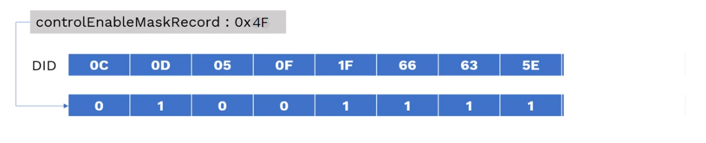

# SID - InputOutputControlByIdentifier (0x2F) {#sid---inputoutputcontrolbyidentifier-0x2f .p_Heading1 style="page-break-after: avoid; margin: 0.3125in 0 0 0.1354in;"}

+:----------------------------------------------------------------------------------------------------------------------------------------------------------------------------------------------------------------------------------------+--------------------------------------------------------------------------------------------------------------------------------------------------+
| **Navigation:**  [System features](system-concepts.html) \> [BSW](bsw.html) \> [Diagnostic services (UDS)](diagnostic-services.html) \> [UDS overview](uds---overview.html) \> [Supported UDS services](supported-uds-services.html) \> |    |
|                                                                                                                                                                                                                                         |                                                                                                                                                  |
| # SID - InputOutputControlByIdentifier (0x2F) {#sid---inputoutputcontrolbyidentifier-0x2f-1 .p_Heading1 style="page-break-after: avoid; margin: 0.3125in 0 0 0.1354in;"}                                                                |                                                                                                                                                  |
+-----------------------------------------------------------------------------------------------------------------------------------------------------------------------------------------------------------------------------------------+--------------------------------------------------------------------------------------------------------------------------------------------------+

This topic explains the service related to InputOutput Control functional unit - inputOutputControlByIdentifier.

 

Definition and Short description as per ISO 14229-1:

 

  -------------------------------- ----------------------------------------------------------------------------
  Service                          Description
  InputOutputControlByIdentifier   The client requests the control of an input/output specific to the server.
  -------------------------------- ----------------------------------------------------------------------------

 

The InputOutputControlByIdentifier service is used by the client to substitute a value for an input signal, internal server function and/or force control to a value for an output (actuator) of an electronic system. In general, this service is used for relatively simple (e.g. static) input substitution/output control whereas routineControl is used if more complex input substitution/output control is necessary.

## Remarks: {#remarks .p_Heading2 style="page-break-after: avoid;"}

The UDS request message contains

- a dataIdentifier - The client request message contains a dataIdentifier to reference the input signal, internal server function, and/or output signal(s) (actuators(s)) (in case of a device control access it might reference a group of signals) of the server (RC).

- the controlOptionRecord - [The controlOptionRecord](cross-partition-communication.html){.topiclink style="font-style: normal; font-weight: normal; color: #000000; background-color: transparent; text-decoration: none;"} parameter shall include all information required by the server\'s input signal(s), internal function(s) and/or output signal(s). It consists of one or multiple bytes(inputOutputControlParameter and controlState#1 to controlState#n, where controlState here refers to the DID signal value).

0x00 - returnControlToECU

0x01 - resetToDefault

0x02 - freezeCurrentState

0x03 - shortTermAdjustment

- The vehicle manufacturer may require that the request message contains a controlEnableMaskRecord if the dataIdentifier to be controlled references more than one parameter (i.e., DID with more than one signal).

## controlEnableMaskRecord {#controlenablemaskrecord .p_Heading2 style="page-break-after: avoid;"}

## Remarks: {#remarks-1 .p_Heading2 style="page-break-after: avoid;"}

- The controlEnableMaskRecord consists of one or multiple bytes (controlMask#1 to controlMask#r, where r = number of bytes of Control Mask).

- There shall be one bit in the controlEnableMaskRecord corresponding to each individual parameter defined within the dataIdentifier.

- A bit value of \'0\' in the controlEnableMaskRecord shall represent that the corresponding parameter is not affected by this request and a bit value of \'1\' shall represent that the corresponding parameter is affected by this request.

- The most significant bit of ControlMask#1 shall correspond to the first parameter in the ControlState starting at the most significant bit of ControlState#1, the second most significant bit of ControlMask#1 shall correspond to the second parameter in the ControlState, and continuing on in this fashion utilising as many ControlMask bytes as necessary to mask all parameters.\
For example, the least significant bit of ControlMask#2 would correspond to the 16th parameter in the ControlState.

## Example: {#example .p_Heading2 style="page-break-after: avoid;"}

## {style="margin:0;width:11.1146in;height:2.2604in;border:none"} {#controlenablemaskrecord-1 .p_Heading2 style="page-break-after: avoid;"}

- With the help of shortTermAdjustment we shall be able to change the above DID signals parameters. But sometimes, the user wishes to modify only the second or third signal. This is possible by using this option along with the request when there are multiple signals. In the above example, wherever the Value \'1\' is there, that relevant DID Signal can be modified with the help of shortTermAdjustment.

## List of supported DIDs: {#list-of-supported-dids .p_Heading2 style="page-break-after: avoid;"}

The easyConfig allows the configuration of the range of DIDs mentioned below for the service inputOutputControlByIdentifier according to ISO 14229-1.\
These values shall be used to reference the Vehicle manufacturer specific record dataIdentifiers and input/output identifiers within the server.

- 0x0100 -- 0xA5FF

- 0xA800 -- 0xACFF

- 0xB000 -- 0xB1FF

- 0xC000 -- 0xC2FF

- 0xCF00 -- 0xEFFF

- 0xF010 -- 0xF0FF

- 0xFD00 - 0xFEFF

 
