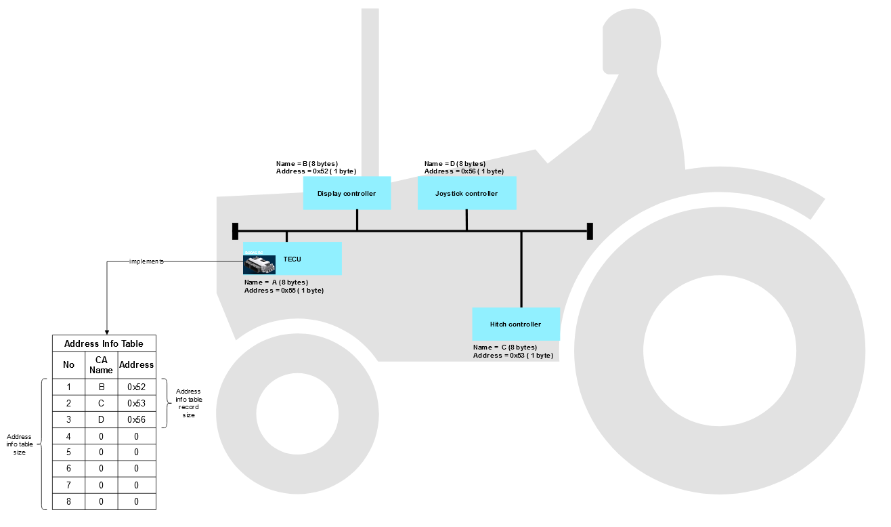

# ISOBUS Address info table {#isobus-address-info-table .p_Heading1 style="page-break-after: avoid;"}

+:-----------------------------------------------------------------------------------------------------------------------------------------------------------------------------------------+------------------------------------------------------------------------------------------------------------------------------------------+
| **Navigation:**  [System features](system-concepts.html) \> [BSW](bsw.html) \> [Network communication & protocols](network-comm-protocols.html) \> [ISOBUS/J1939](isobus-module.html) \> |    |
|                                                                                                                                                                                          |                                                                                                                                          |
| # ISOBUS Address info table {#isobus-address-info-table-1 .p_Heading1 style="page-break-after: avoid;"}                                                                                  |                                                                                                                                          |
+------------------------------------------------------------------------------------------------------------------------------------------------------------------------------------------+------------------------------------------------------------------------------------------------------------------------------------------+

In an ISOBUS/J1939 network, a Controller Application (CA) claims an address at power-on. It is also possible for a CA to dynamically update its address due to various events, such as an unsuccessful address claim or a commanded address change. To ensure seamless communication, other CAs in the network must be aware of the addresses of the CAs they need to communicate with. This can be achieved by maintaining a CA name versus address table that is dynamically updated with each address claim. This table allows the network to track dynamically changing addresses of CAs effectively.

The RC4x BSW ISOBUS library includes a mechanism known as the ISOBUS address info table, which manages the CA name versus address mapping. This feature allows application software to maintain updated databox configurations when CA addresses change.

The figure below illustrates a sample ISOBUS/J1939 network scenario featuring four different ECUs, each one with its own ISOBUS/J1939 CA. Every CA has a unique name and will attempt to claim an address at power-on through the address claim procedure. In this example, the Tractor ECU (TECU) utilizes the RC4x ISOBUS library, which implements an address info table capable of tracking the addresses of all CAs in the network.

  -------------------------------------------------------------------------------- -----------------------------------------------------------------
  {style="margin:0;width:2.1667in;height:0.6979in;border:none"}   The ISOBUS-assigned CA address is not linked to the UDS node-ID
  -------------------------------------------------------------------------------- -----------------------------------------------------------------

{style="margin:0;width:7.9896in;height:4.7188in;border:none"}

The ISOBUS Address info table maintains a list of CA\'s with their names and address information. The structure of the ISOBUS address info table is given below and is represented by the type  bds_isobus_caAddrInfoTbl_ts. Memory allocation for ISOBUS address info table is done through the API  bds_isobus_registerCaAddrTable for a each ISOBUS instance. The size of the ISOBUS address info table shall be decided based on the maximum possible number of CAs in the ISOBUS/J1939 network. If the number of detected CAs in the network exceeds the registered table size, additional CA information will be ignored and not updated in the table.

  --------------- --------------
  CA Name         CA Address
  Size: 8 bytes   Size: 1 byte
  --------------- --------------

The table is updated with each address claim message, except in the following cases:

1.The address claim message matches the ISOBUS/J1939 CA instance\'s own address.

2.The address info table has not been registered by the application software.

Updates to the address info table are communicated to the application software via a callback registered with the API  bds_isobus_registerCaAddrInfoCbk. The table is accessible to the application software because it is declared as a structure array within the application software itself. Additional information can be accessed using the APIs  bds_isobus_getCaAddrByName and  bds_isobus_getAddressInfoTblRecordSize.

 

  ------------------------------------------------------------------------------------------ ------------------------------------------------------------------------------------------------------------------------------------------------------------------------------------------------------------------------------------------------------------------------------------------------------------------------------------------------------------------------------------------------------------------------------------------------------------------------------
  {style="margin:0;width:2.1667in;height:0.7083in;border:none"}   The ISOBUS Address info table is updated when an address claim message is received. Therefore, if a CA sends an address claim message before the RC4x boot-up, the information for that particular CA will not be updated in the address info table. In such cases, broadcasting an RQST PGN for the address claim message can be used to force all CAs to resend their information. This will ensure that all CA information is captured in the ISOBUS address info table..
  ------------------------------------------------------------------------------------------ ------------------------------------------------------------------------------------------------------------------------------------------------------------------------------------------------------------------------------------------------------------------------------------------------------------------------------------------------------------------------------------------------------------------------------------------------------------------------------

 
