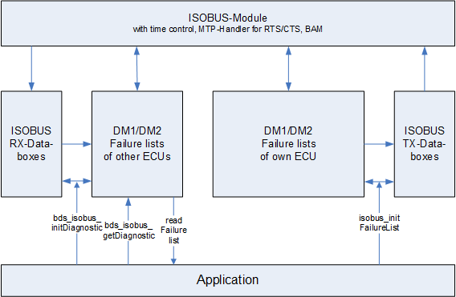

# ISOBUS DM1/DM2 failure handling {#isobus-dm1dm2-failure-handling .p_Heading1 style="page-break-after: avoid;"}

+:-----------------------------------------------------------------------------------------------------------------------------------------------------------------------------------------+----------------------------------------------------------------------------------------------------------------------------------+
| **Navigation:**  [System features](system-concepts.html) \> [BSW](bsw.html) \> [Network communication & protocols](network-comm-protocols.html) \> [ISOBUS/J1939](isobus-module.html) \> |    |
|                                                                                                                                                                                          |                                                                                                                                  |
| # ISOBUS DM1/DM2 failure handling {#isobus-dm1dm2-failure-handling-1 .p_Heading1 style="page-break-after: avoid;"}                                                                       |                                                                                                                                  |
+------------------------------------------------------------------------------------------------------------------------------------------------------------------------------------------+----------------------------------------------------------------------------------------------------------------------------------+

## Overview of functions for DM1/DM2 failure handling: {#overview-of-functions-for-dm1dm2-failure-handling .p_Heading2 style="page-break-after: avoid;"}

The optional DM1/DM2 failure handling can be defined independently for each controller application (CA) instance.

Several API functions exist for the handling of the failures of the own CA and for the reception of  DM1/DM2 failures from other ECUs. But a CA can not receive / transmit failures from / to another CA on the own ECU with these functions.

The following figure shows an overview of the ISOBUS failure handling of a controller application.The integration of the ISOBUS communication stack has to be done with the following steps:

 

<figure style="margin:0;padding:0">

<figcaption aria-hidden="true">
Figure78: Overview of the ISOBUS/J1939 failure handling of a controller application
</figcaption>
</figure>

 

There are up to 2 additional ISOBUS TX databoxes required for the sending of the DM1 and DM2 failures of the own controller application. They have to be taken into account during defining the number of TX databoxes with easyConfig tool. Both databox numbers have to be given during the initialization of the failure handling with the function  bds_isobus_initFailureList.

For each DM1 or DM2 failure list, which has to be received from another controller, a failure list and an additional ISOBUS RX databox have to be defined with the function  bds_isobus_initDiagnostic. The addtional RX databoxes have to be taken into account during defining the number of RX databoxes with easyConfig tool.

## Functions for DM1/DM2 failures of the own controller application: {#functions-for-dm1dm2-failures-of-the-own-controller-application .p_Heading2 style="page-break-after: avoid;"}

 

For the sending of DM1/2 messages only the recommended SPN conversion method version 4 is supported. The following function is provided for the DM1 and DM2 failure handling of the own controller application:

 

- bds_isobus_initFailurelist to define and initialize a DM1 and a DM2 failure list of the own CA.

The own DM1 and DM2 failure lists are read from the internal system error storage ( DSM module). The DM1 failures are still active and the DM2 failures were active in the past but are now inactive.

Limitation for sending DM1/DM2 messages: Up to 32 DTCs can be sent with one DM1/DM2 message due to protocol limitation. If there exits more than 32 DTCs only the first 32 DTCs will be sent.

Alternative application specific own DM1 and DM2 failure list handling:

If the implemented DM1/2 failure handling does not fit to the required functionality then also a complete own failure handling can be implemented within the application program in the following way:

- The funtion bds_isobus_initFailurelist must not be executed.

- The application must implement an own failure list handling for DM1 and optionally for DM2 failures. It must provide functions for creating and deleting failures within these lists.

- For sending the DM1 messages an isobus TX databox for the DM1 PGN 0xFECA has to be defined with the function  
