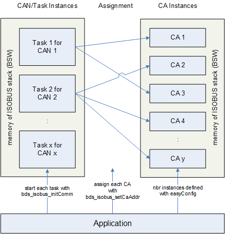
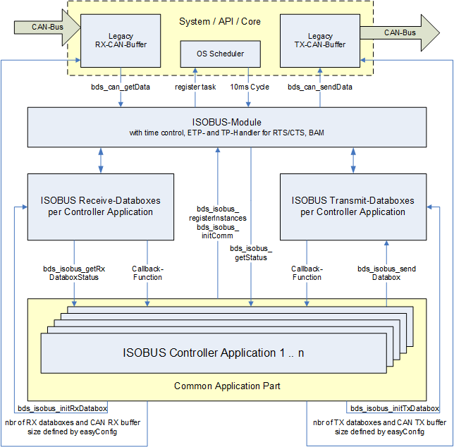

# ISOBUS general description {#isobus-general-description .p_Heading1 style="page-break-after: avoid;"}

+:-----------------------------------------------------------------------------------------------------------------------------------------------------------------------------------------+----------------------------------------------------------------------------------------------------------------------------------------------------------------+
| **Navigation:**  [System features](system-concepts.html) \> [BSW](bsw.html) \> [Network communication & protocols](network-comm-protocols.html) \> [ISOBUS/J1939](isobus-module.html) \> |    |
|                                                                                                                                                                                          |                                                                                                                                                                |
| # ISOBUS general description {#isobus-general-description-1 .p_Heading1 style="page-break-after: avoid;"}                                                                                |                                                                                                                                                                |
+------------------------------------------------------------------------------------------------------------------------------------------------------------------------------------------+----------------------------------------------------------------------------------------------------------------------------------------------------------------+

The ISOBUS module offers some API functions for a comfortable handling of the ISOBUS communication. The module allows a communication with several controller applications (CA) within the own ECU. Each of these CAs has its own unique address.

## Controller applications (CA) {#controller-applications-ca .p_Heading2 style="page-break-after: avoid;"}

For each required CA an instance within the ISOBUS communication stack has to be defined. The total amount of required instances has to be defined within easyConfig tool. The different CA instances may use the same or different CAN channels. The assignment of the CAs to the CAN channels and the definition of the own address will be done with the function  bds_isobus_setCaAddr. The CA name will be defined with the function  bds_isobus_setCaName. All CAs which are assigned to one CAN channel are controlled by one system task. Each of these tasks will be started with the function  bds_isobus_initComm. The following picture illustrates the handling of the instances.

 

<figure style="margin:0;padding:0">

<figcaption aria-hidden="true">
Figure79: Assignment of controller applications to CAN channels
</figcaption>
</figure>

 

 

## Communication {#communication .p_Heading2 style="page-break-after: avoid;"}

The ISOBUS message interface between the ISOBUS communication stack and the application is realized with special isobus message databoxes. Each controller application has its own message databoxes. The amount of available databoxes and the size of each databox have to be defined by the application. This flexible handling allows a very memory efficient use of the ISOBUS communication stack.

 

  ----------------------------------------------------------------------------------------------------------------- ----------------------------------------------------------------------------------------------------------------------------------------------------------------------------------------------------------------------------------------------------------------------------------------------------------------------------
  {style="margin:0;width:1.4792in;height:0.2813in;border:none"}   A communication between the different CA instances on the own ECU will be not supported. This means that messages which are sent from one CA instance will be not received by the other CA instances on the same CAN channel. This behaviour has to be taken into acount especially for BAM messages (e.g. Address Claim).
  ----------------------------------------------------------------------------------------------------------------- ----------------------------------------------------------------------------------------------------------------------------------------------------------------------------------------------------------------------------------------------------------------------------------------------------------------------------

 

The ISOBUS communication stack has the following transport protocol channels, which can be used at the same time.

- 1 CMDT (RTS/CTS) channel for transmitting up to 1785 bytes per CA instance. The TX transport protocol package size will be defind by the receiver with the CTS message.

- 1 CMDT (RTS/CTS) channel for receiving up to 1785 bytes per CA instance. The RX transport protcol package size is limited to 10 CAN messges to reduce the required CAN RX buffer size.

- 1 BAM channel for transmitting (protocol limit) per CA instance.

- n BAM channels for receiving, each defined ISOBUS RX databox has its own channel.

- 1 Extended transport protocol (RTS/CTS) channel for transmitting up to 117 Mbytes per CA instance. The TX extended transport protocol package size will be defind by the receiver with the CTS message.

- 1 Extended transport protocol (RTS/CTS) channel for receiving up to 117 Mbytes per CA instance. The RX extended transport protcol package size is limited to 10 CAN messges to reduce the required CAN RX buffer size.

## System integration {#system-integration .p_Heading2 style="page-break-after: avoid;"}

The following figure shows the integration of the ISOBUS communication stack in the RC4x system between the API and the application. The interface to the API uses the normal API functions for sending and receiving CAN messages. This means that there exist some restrictions for the application, if the ISOBUS communication stack is used:

The following API CAN functions are used by the ISOBUS communication stack:

 

- bds_can_getData: \--\> this function must not be used any more by the application on the same CAN channel!

- bds_can_sendData: \--\> this function may be used also by the application, but overload must be avoided!

- The CAN receive buffer of the system is used and must be defined with easyConfig tool. All CA instances on one CAN channel use the same CAN receive buffer. Therefore the required size of this buffer depends on the number of used CA instances on this CAN channel. Each CA instance requires at least a buffer size of 10.

- The CAN send buffer of the system is used and must be defined with easyConfig tool. The required TX buffer size also depends on the number of CA instances per CAN channel and on the requested package sizes by the receiver. Recommended buffers sizes are at least 10 per CA instance plus the number of messages which are send cyclically by the application.  

- The ISOBUS stack internally registers one task per CAN channel within the system, which handles the time control and the transport protocol.

- The ISOBUS cycle time defines the resolution of the time control of the ISOBUS stack on one CAN channel.By default cycle time is 10ms.It can be changed to 1ms or  5ms from easyConfig.

 

<figure style="margin:0;padding:0">

<figcaption aria-hidden="true">
Figure80: Scheme of system integration of ISOBUS communication stack in RC40
</figcaption>
</figure>

 

## CAN message interface to the API {#can-message-interface-to-the-api .p_Heading2 style="page-break-after: avoid;"}

All the ISOBUS RX messages will be received and buffered within the API. The buffer size has to be defined by the application and is dependent on the expected message traffic. The buffer should has enough space to store all incoming CAN messages of all CA instances on the corresponding CAN channel which are received between two execution cycles of the ISOBUS communication stack. Therefore it is also dependent on the defined cycle time of the stack.

Also the ISOBUS TX messages are transmitted via a buffer of the API. The buffer size has to be defined also by the application and is dependent on the expected message traffic. The buffer should has enough space to store all outgoing CAN messages of all CA instances on the corresponding CAN channel which have to be transmitted during one execution cycle of the ISOBUS communication stack. If the application wants to send further CAN message by itself then also these messages have to be taken into account for the sizing of the CAN transmit buffer.

## ISOBUS message interface to the application {#isobus-message-interface-to-the-application .p_Heading2 style="page-break-after: avoid;"}

For each ISOBUS RX message which has to be received by the controller application, the corresponding controller application has to define a ISOBUS RX databox. To check whether a ISOBUS message was received, the application can either check cyclically the status of the RX databox with the function  bds_isobus_getRxDataboxStatus or the application can register a callback function. This optional callback function will be called after the ISOBUS message was received completely.

If the application reads the received message data outside the RX callback function then the reading of the data should be enclosed with the functions  BDS_SYS_GET_LOCK_COMMON and  BDS_SYS_RELEASE_LOCK_COMMON to ensure data consistency.

The application has to define also the size and the data buffer itself for each RX message. If more than 8 data bytes have to be received then the corresponding tranport protocol will be used automatically.

Also for each ISOBUS TX message which has to be transmitted by the controller application, the correponding controller application has to define a ISOBUS TX databox. The message can be send cyclically with a defined cycle time and/or the application can trigger the sending with the function  bds_isobus_sendDatabox. The application can register a callback function to update the data to be transmitted. This optional callback function will be called directly before the sending of a ISOBUS message will be started. The contents of the data buffer of a TX databox must not be changed as long as the sending of a transport protocol message is ongoing.

PGNs of controller applications of other ECUs can be also requested directly with the function  bds_isobus_sendRequestPGN. This function does not need any transmit databox.

The communication of ISOBUS messages between different controller applications on the own ECU is not supported.

 
