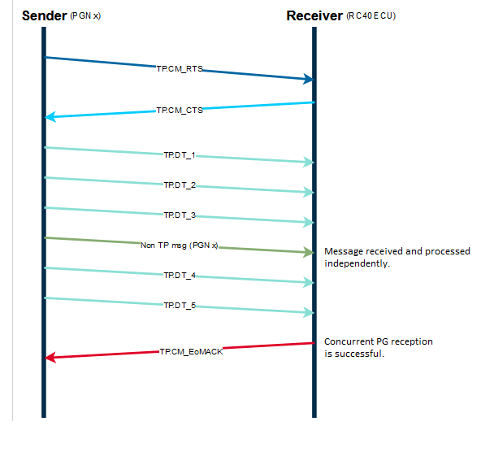

# ISOBUS message formats and transport protocols {#isobus-message-formats-and-transport-protocols .p_Heading1 style="page-break-after: avoid;"}

+:-----------------------------------------------------------------------------------------------------------------------------------------------------------------------------------------+---------------------------------------------------------------------------------------------------------------------------------------------------------+
| **Navigation:**  [System features](system-concepts.html) \> [BSW](bsw.html) \> [Network communication & protocols](network-comm-protocols.html) \> [ISOBUS/J1939](isobus-module.html) \> |    |
|                                                                                                                                                                                          |                                                                                                                                                         |
| # ISOBUS message formats and transport protocols {#isobus-message-formats-and-transport-protocols-1 .p_Heading1 style="page-break-after: avoid;"}                                        |                                                                                                                                                         |
+------------------------------------------------------------------------------------------------------------------------------------------------------------------------------------------+---------------------------------------------------------------------------------------------------------------------------------------------------------+

The following chapter gives a short overview about the message formats and transport protocols of the ISOBUS communication protocol.

Message formats

The CAN identifiers of the ISOBUS messages have the following format:

 

+----------------------+---------------------------------------------------------------------------------------------------------+
| Message format       | 29 Bit CAN Identifier                                                                                   |
|                      +---------------+----------------+---------------+-----------------------+---------------+----------------+
|                      | Priority      | ext. Data Page | Data Page     | PDU Format            | PDU Specific  | Source Address |
|                      +---------------+----------------+---------------+-----------------------+---------------+----------------+
|                      | 3 Bits        | 1 Bit          | 1 Bit         | 8 Bits                | 8 Bits        | 8 Bits         |
+======================+===============+================+===============+=======================+===============+================+
| PDU1                 | 0..7          | 0              | 0..1          | 0..239 (0xEF)         | 0..253 (0xFD) | 0..253 (0xFD)  |
|                      |               |                |               |                       |               |                |
| specific destination |               |                |               |                       | Destination   |                |
+----------------------+---------------+----------------+---------------+-----------------------+---------------+----------------+
| PDU1                 | 0..7          | 0              | 0..1          | 0..239 (0xEF)         | 255 (0xFF)    | 0..253 (0xFD)  |
|                      |               |                |               |                       |               |                |
| global destination   |               |                |               |                       | Broadcast     |                |
+----------------------+---------------+----------------+---------------+-----------------------+---------------+----------------+
| PDU2                 | 0..7          | 0              | 0..1          | 240..255 (0xF0..0xFF) | 0..255 (0xFF) | 0..253 (0xFD)  |
|                      |               |                |               |                       |               |                |
| global destination   |               |                |               |                       | PDU extension |                |
+----------------------+---------------+----------------+---------------+-----------------------+---------------+----------------+

 

The following addresses have a special meaning:

- The address 254 (0xFE) is the NULL ADDRESS and is not allowed as a destination address and only in special cases allowed as source address (e.g. in the CannotClaimAddress message).

- The address 255 (0xFF) is the global destination address and is not allowed as a source address.

## Priority and Data Page: {#priority-and-data-page .p_Heading2 style="page-break-after: avoid;"}

- The priorities are handled according specification ISO 11783-3.

- The priority bits will be ignored by the ISOBUS stack during the receiving of any ISOBUS message.

- The application can define the priority for TX messages within the TX databox. The default value for the priority is 6.

- The priority is 7 for the TX messages of the transport protocol (e.g. TP.CM, TP.DT), independent of the value defined within the TX databox.

- The priority only has influence on the arbitration of the can messages on the physically layer in case of a very high bus load.

- Other ISOBUS message receivers should mask the priority bits.

- The default value for the extended data page (EDP) is 0 according specification ISO 11783-3.

- The data page values EDP=1 and DP=1 identify an ISO 11992-4 (diagnostic on CAN) formatted frame. This frame format does not follow the ISOBUS definitions specified in ISO 11783.

## ISOBUS Transport protocols {#isobus-transport-protocols .p_Heading2 style="page-break-after: avoid;"}

The following transport protocols are supported by the ISOBUS communication stack:

- Message length \<= 8 Bytes:

The message will be sent as a single fame CAN message. Dependent on the PGN value, the message is sent to a specific destination (peer-to-peer) or to the global destination (broadcast).

oPDU1 - format (PGN = 0x000000..0x03EFFD) is a message to a specific destination with the page pp = 0x00..0x03, the PDU format ff = 0x00..0xEF and the destination dd = 0x00..0xFD

oPDU1 - format (PGN = 0x0000FF.0x03EFFF) is a message to the global destination (broadcast) with the page pp = 0x00..0x03, the PDU format ff = 0x00..0xEF and the destination dd = 0xFF

oPDU2 - format (PGN = 0x00F000..0x03FFFF) is a message to the global destination (broadcast) with the page pp = 0x00..0x03, the PDU format ff = 0xF0..0xFF and the PDU specific ss = 0x00..0xFF

 

- Message length \>= 9 Bytes (up to 1.785 Bytes):

The message will be sent as a multi fame CAN message with a MTP (Multi Transport Protocol) format. Dependent on the PGN value, the message is sent to a specific destination (peer-to-peer) or to the global destination (broadcast).

oPDU1 - format (PGN = 0x000000..0x03EFFD) is a message to a specific destination with the page pp = 0x00..0x03, the PDU format ff = 0x00..0xEF and the destination dd = 0x00..0xFD. This message type will be sent with the CMDT (RTS/CTS) protocol.

oPDU1 - format (PGN = 0x0000FF.0x03EFFF) is a message to the global destination (broadcast) with the page pp = 0x00..0x03, the PDU format ff = 0x00..0xEF and the destination dd = 0xFF. This message type will be sent with the BAM protocol.

oPDU2 - format (PGN = 0x00F000..0x03FFFF) is a message to the global destination (broadcast) with the page pp = 0x00..0x03, the PDU format ff = 0xF0..0xFF and the PDU specific ss = 0x00..0xFF. This message type will be sent with the BAM protocol.

 

- Message length \>= 1.786 Bytes (up to 117.440.512 Bytes):

The message will be sent as a multi fame CAN message with a ETP (Extended Transport Protocol) format. This kind of message can be sent only to a specific destination (peer-to-peer).

oPDU1 - format (PGN = 0x000000..0x03EFFD) is a message to a specific destination with the page pp = 0x00..0x03, the PDU format ff = 0x00..0xEF and the destination dd = 0x00..0xFD. This message type will be sent with the ETP (RTS/CTS) protocol.

 

## Concurrent PG Reception: {#concurrent-pg-reception .p_Heading2 style="page-break-after: avoid;"}

- ISOBUS/J1939 Communication Stack supports Concurrent PG Reception as per the specification of ISO 11783-3 and SAE J1939-21.

- It is possible that the same PGN can be sent in a non-transport-protocol form when they contain 8 or fewer bytes, and also sent using transport protocol when they contain more than 8 bytes. It is possible for these two forms of the same PGN to be sent concurrently.

 

<figure style="margin:0;padding:0">

<figcaption aria-hidden="true">
Figure: Concurrent PG Reception Scenario
</figcaption>
</figure>

## Timing {#timing .p_Heading2 style="page-break-after: avoid;"}

The ISOBUS communication stack controls the timing of the transport protocol according the specifications ISO11783-3.

- Transport protocol:

If a timeout occurs during the CMDT protocol then it will be aborted by sending a ConnectionAbort/Timeout message. If the RX CMDT protocol handler is busy during a further reception of a RTS message, then the busy state will be annonced with a ConnectionAbort/Busy message.

- Extended transport protocol:

If a timeout occurs during the ETP protocol then it will be aborted by sending a ConnectionAbort/Timeout message. If the RX ETP protocol handler is busy during a further reception of a ETP-RTS message, then the busy state will be annonced with a ConnectionAbort/Busy message.

- BAM protocol:

The single CAN frames of the BAM protocol will be sent with the fastest allowed speed, which corresponds to a time distance of 50ms. If the time distance between the singe CAN messages of a received BAM is to long, then the receiving of this BAM will be aborted and the databox status is set to timeout. A response to BAM messages must not be sent.

 

 
