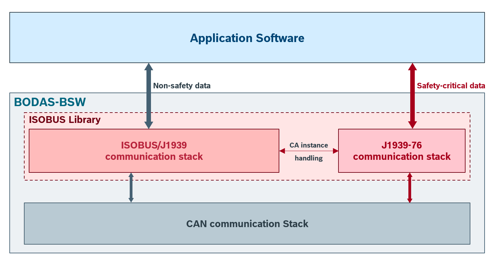
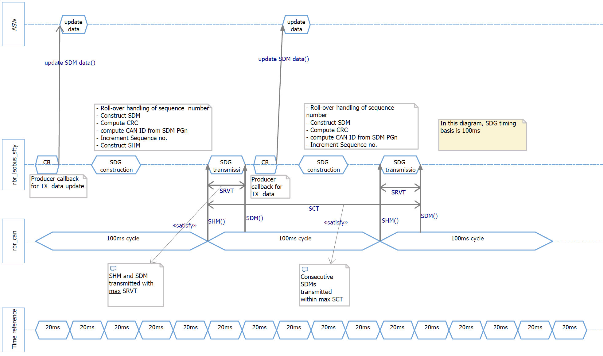
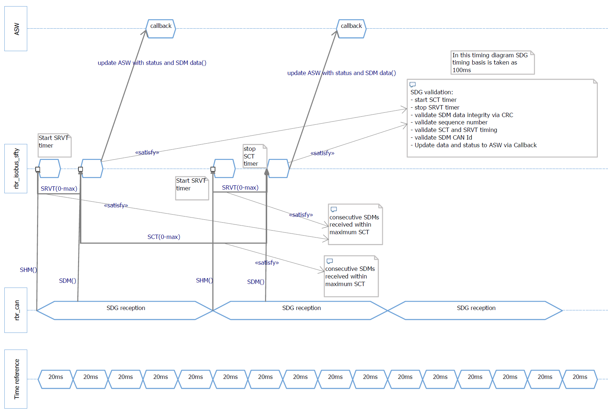
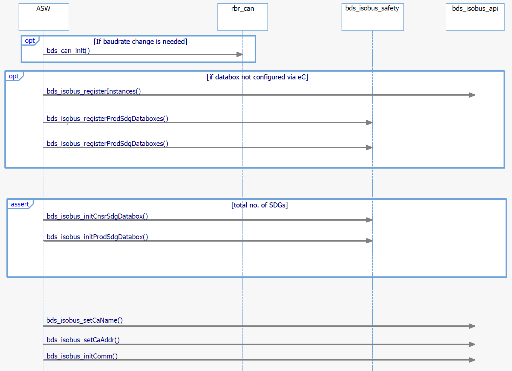

# J1939-76 in BODAS-BSW {#j1939-76-in-bodas-bsw .p_Heading1 style="page-break-after: avoid;"}

+:---------------------------------------------------------------------------------------------------------------------------------------------------------------------------------------------------------------------------------------------------------+---------------------------------------------------------------------------------------------------------------------------------------------------------------+
| **Navigation:**  [System features](system-concepts.html) \> [BSW](bsw.html) \> [Network communication & protocols](network-comm-protocols.html) \> [ISOBUS/J1939](isobus-module.html) \> [J1939-76 Safety Extension](j1939-76-safety-extension2.html) \> |    |
|                                                                                                                                                                                                                                                          |                                                                                                                                                               |
| # J1939-76 in BODAS-BSW {#j1939-76-in-bodas-bsw-1 .p_Heading1 style="page-break-after: avoid;"}                                                                                                                                                          |                                                                                                                                                               |
+----------------------------------------------------------------------------------------------------------------------------------------------------------------------------------------------------------------------------------------------------------+---------------------------------------------------------------------------------------------------------------------------------------------------------------+

  -------------------------------------------------------------------------------- -------------------------------------------------------------------------------------------------------------------------------------------------------------------------------
  {style="margin:0;width:2.1667in;height:0.6979in;border:none"}   For more information on how to integrate the J1939-76 into ASW, please refer to [How to develop a J1939-76 Application](how-to-develop-j1939-76-application.html){.topiclink}
  -------------------------------------------------------------------------------- -------------------------------------------------------------------------------------------------------------------------------------------------------------------------------

## SDG transmission {#sdg-transmission .p_Heading2 style="page-break-after: avoid;"}

In BODAS-BSW J1939-76 communication stack, SDG timing basis is the periodic time interval used for the fixed transmission of SDGs.

 

  ------------------------------------------------------------------------------------------ -------------------------------------------------------------------------------------------------------------
  {style="margin:0;width:2.1667in;height:0.7083in;border:none"}   The J1939-76 Communication stack in the ISOBUS/J1939  of RC4x BSW supports only fixed transmission rate PGs
  ------------------------------------------------------------------------------------------ -------------------------------------------------------------------------------------------------------------

## Sequence Number {#sequence-number .p_Heading2 style="page-break-after: avoid;"}

The J1939-76 communication stack in BODAS-BSW implements the sequence number concept in the following manner

- Each SHM includes a sequence number that is managed independently for each safety data group series.

- Sequence number is incremented by one for each new SDG instance.

- Sequence number rolls over to zero on the next increment after 31.

- Upon startup of J1939-76 producer, the sequence number shall be 0 for the SHM of the first SDG of each combination.

For J1939-76 consumer, sequence number is declared validated if the current sequence number is equal to the last received sequence number incremented by one.

## Cyclic Redundancy Check (CRC) {#cyclic-redundancy-check-crc .p_Heading2 style="page-break-after: avoid;"}

The 32-bit CRC of SDM data field is calculated by using the following algorithm

- Length: 32 bits.

- Polynomial hex representation of divisor: 6938392Dh.

- Initial value = FFFFFFFFh and final XOR value = 0.

For J1939-76 consumer, CRC validation is declared validated if CRC of the received data in SDM is equal to CRC data field in SHM of the given SDG.

 

  ------------------------------------------------------------------------------------------ ----------------------------------------------------------------------------------------------------------------------------------------------------------------------------------------
  {style="margin:0;width:2.1667in;height:0.7083in;border:none"}   The Producer safety application is expected to properly set all unused and undefined bits of the SDM data field to "0xFF" value prior to CRC computation, as specified by SAE J1939-71
  ------------------------------------------------------------------------------------------ ----------------------------------------------------------------------------------------------------------------------------------------------------------------------------------------

 

## BODAS-BSW Modules Interaction {#bodas-bsw-modules-interaction .p_Heading2 style="text-align: justify; page-break-after: avoid;"}

The J1939-76 communication stack is an extension of the existing ISOBUS/J1939 communication stack and a part of the ISOBUS/J1939 library in the BODAS-BSW.

The J1939-76 communication stack and ISOBUS/J1939 communication stack interact with each other for CA instance handling. They share the same CA instance for the communication of data but the concept of databox handling differs and is independent for both. The safety-critical data flows via the J1939-76 communication stack while the non-safety data flows via the ISOBUS/J1939 communication stack. Finally CAN communication stack in the physical layer takes care of the transmission and reception of data on the bus.

The figure below visualizes the interaction of various modules in the BODAS-BSW to achieve the J1939 communication.

{style="margin:0;width:9.4688in;height:5.0729in;border:none"}

### Timing Overview {#timing-overview .p_Heading3 style="page-break-after: avoid;"}

The timing diagram below shows the sequence of steps involved in BODAS-BSW J1939-76 producer execution in ISOBUS/J1939 library. The SDG timing basis is considered as 100ms in this example. The SDGs are transmitted cyclically every 100ms. Before the transmission of an SDG, producer callback is invoked by BSW. This callback has to be implemented by the ASW and it is expected to update the SDM data and length required for transmission. Once the data is updated, the SDG is constructed and SHM followed by SDM are transmitted by the BODAS-BSW J1939-76 producer safety application by following the timing requirements as per the specification.

{style="margin:0;width:12.6042in;height:7.4479in;border:none"}

 

 

The timing diagram below shows the sequence of steps involved in BODAS-BSW J1939-76 consumer execution in ISOBUS/J1939 library. The SDG timing basis of J1939-76 producer is considered as 100ms in this example. Once an SDG is received by the BODAS-BSW J1939-76 consumer, the required validations as per the J1939-76 specification are performed. The detailed steps involved in the validation are explained in the \'Concept of Operation\' diagram above. The validation result and the SDM data received are updated to ASW by making use of consumer callback. This callback has to be implemented by the ASW.

{style="margin:0;width:12.9688in;height:8.8229in;border:none"}

 

### J1939-76 API initialization {#j1939-76-api-initialization .p_Heading3 style="page-break-after: avoid;"}

The Initialization of the BODAS-BSW APIs required for J1939-76 Application is explained in the image below. It highlights all the ISOBUS/J1939 and J1939-76 APIs which are mandatory for the application development.

- bds_can_init API can be used if baud rate change is required by the ASW for any given CAN channel.

- bds_isobus_registerInstances API can be used to register ISOBUS/J1939 CA instances if not configured in easyConfig.

- For registering memory for J1939-76 producer and consumer,  bds_isobus_registerProdSdgDataboxes and  bds_isobus_registerCnsrSdgDataboxes APIs can be used if not configured in easyConfig.

- For Initialization of J1939-76 producer and consumer databoxes,  bds_isobus_initProdSdgDatabox and  bds_isobus_initCnsrSdgDatabox APIs can be used.

- For establishing the J1939 communication black channel as explained in [J1939-76 Protocol Description](j1939-76-protocol-description.html){.topiclink},  bds_isobus_setCaName,  bds_isobus_setCaAddr and  bds_isobus_initComm APIs can be used.

{style="margin:0;width:9.4792in;height:6.8750in;border:none"}

 

 
