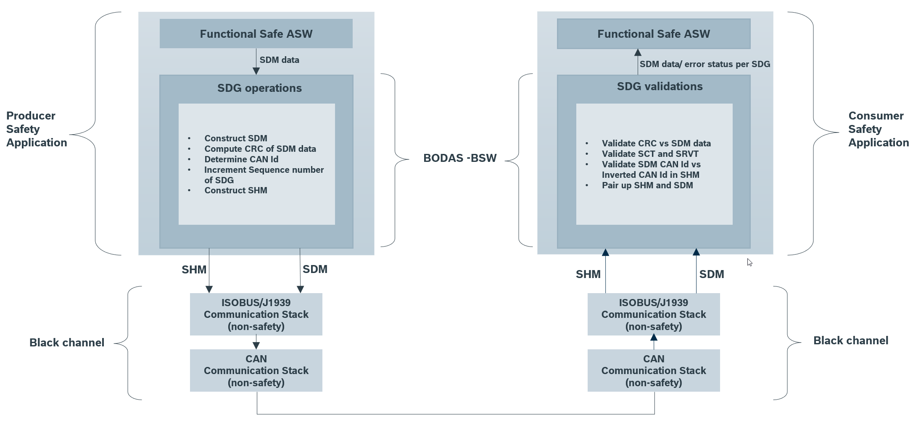
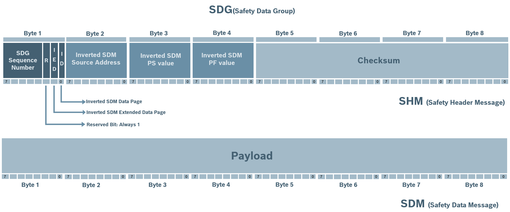
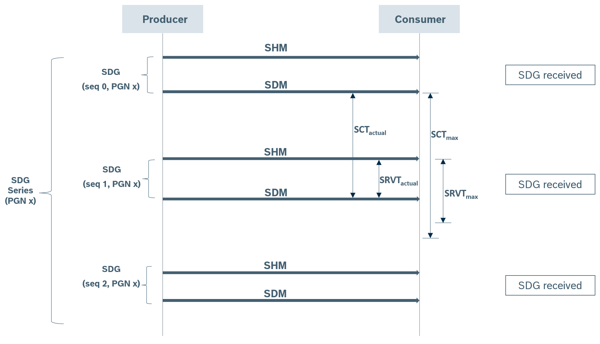

# J1939-76 Protocol Description {#j1939-76-protocol-description .p_Heading1 style="page-break-after: avoid;"}

+:---------------------------------------------------------------------------------------------------------------------------------------------------------------------------------------------------------------------------------------------------------+---------------------------------------------------------------------------------------------------------------------------------------+
| **Navigation:**  [System features](system-concepts.html) \> [BSW](bsw.html) \> [Network communication & protocols](network-comm-protocols.html) \> [ISOBUS/J1939](isobus-module.html) \> [J1939-76 Safety Extension](j1939-76-safety-extension2.html) \> |    |
|                                                                                                                                                                                                                                                          |                                                                                                                                       |
| # J1939-76 Protocol Description {#j1939-76-protocol-description-1 .p_Heading1 style="page-break-after: avoid;"}                                                                                                                                          |                                                                                                                                       |
+----------------------------------------------------------------------------------------------------------------------------------------------------------------------------------------------------------------------------------------------------------+---------------------------------------------------------------------------------------------------------------------------------------+

The [SAE J1939-76 standard](j1939-76-safety-extension2.html){.topiclink} describes an extension to J1939 specification to enhance communication and exchange of safety critical data among various vehicle components and systems.

## Concept of Operation: {#concept-of-operation .p_Heading2 style="text-align: justify; page-break-after: avoid;"}

The J1939-76 protocol improves the reliable and safe delivery of critical data over an SAE J1939 network in a control system by pairing an additional message, known as a safety header message (SHM), together with each transmitted instance of a critical data message, known as the safety data message (SDM). The associated pair of SHM and its SDM constitutes a single safety data group (SDG) instance. In this manner, the paired messages along with the specified cross-checking reduce the possibility of undetected message corruption and addressing errors and provide the ability to detect insertion, loss, unintended repetition, unacceptable delay, masquerade, and incorrect sequence.

The J1939-76 communication protocol deals with the reliable and safe delivery of critical data over an SAE J1939-based communication channel between the safety communication layer in the producer safety application (Producer) and the safety communication layer in the consumer safety application (Consumer). Destination-specific (PDU1 type) and broadcast (PDU2 type) PGs (Parameter Group) can be used as SDMs in this safety protocol since the behaviors of the producer and consumer are decoupled, i.e., no handshaking is required. The SHM is a general-purpose SAE J1939 PG designed to be used in conjunction with any SAE J1939 PG (SDM) that carries application or system operational data. The data field of each SHM instance contains the CAN ID of the paired SDM, the cyclic redundancy check (CRC) of the SDM data, and the relative sequence of the paired SDM. The SHM provides data that allows the paired SDM to be validated for correctness and consistency. Each SHM and SDM pair is known as a Safety Data Group (SDG). A safety data group series describes the sequence of periodic SDGs where every SDM consists of the same SAE J1939 PG sent by the same source address and, in the case of a PDU1 type PG, addressed to the same destination address.

This specification allows the communication link to be a black channel, which is a communication channel containing components that are not designed or validated according to applicable functional safety standards. The black channel approach requires that all safety measures relied upon in the quantitative analysis must be part of the safety critical application layer and that no credit shall be claimed for the CAN physical and data link layers.

### Producer: {#producer .p_Heading3 style="text-align: justify; page-break-after: avoid;"}

The producer is responsible for periodically constructing each SDM and its SHM and then transmitting the SHM and SDM within a certain time of one another and in a specific order relative to one another. The producer constructs the SHM data field with the CAN ID of the paired SDM, the CRC of the SDM data, and the relative sequence of the paired SDM. The producer repeats this cycle in each successive instance of the SDM.

### Consumer: {#consumer .p_Heading3 style="text-align: justify; page-break-after: avoid;"}

The consumer is responsible for pairing up the SHM and SDM and validating the timing and data integrity of the SDG prior to potentially providing the SDM for application use. The consumer verifies the SHM and SDM are received in the correct order and within the required timing constraint, uses the SHM data to validate the SDM data integrity, and validates the SHM sequence number for duplicated or missed SDM. If a received SDG fails one or more of these validations, then a communication error for the SDG shall be reported to the consumer safety application.

The figure below explains the concept of operation of the J1939-76 Safety extension.

{style="margin:0;width:12.4167in;height:5.8438in;border:none"}

 

 

The figure below describes the frame format of an SDG instance which contains SHM and SDM.

{style="margin:0;width:11.4479in;height:4.7604in;border:none"}

### Cyclic Redundancy Check (CRC) {#cyclic-redundancy-check-crc .p_Heading3 style="page-break-after: avoid;"}

The J1939-76 communication protocol uses data integrity (CRC) as the measure for message corruption communication errors. Each SHM includes a CRC of the data field of the SDM of the SDG. The CRC provides the means for a consumer to detect bit errors and incorrectly paired SHM and SDM within the safety data group series. The 32-bit CRC is computed on the SDM data field.

### Sequence Number {#sequence-number .p_Heading3 style="page-break-after: avoid;"}

The J1939-76 communication protocol uses sequence number as the measure for several communication errors, including repetition, incorrect sequence, loss, and insertion. The Producer periodically constructs each SDM and its SHM and then transmits the SHM and SDM with a certain sequence making use of SHM sequence numbers. The Consumer verifies the SHM and SDM are received in order and checks for duplicated or missed SDM instances using the SHM sequence number. Each Safety Data Group series will have its own sequence associated with it.

## SDG Timing Overview {#sdg-timing-overview .p_Heading2 style="text-align: justify; page-break-after: avoid;"}

The J1939-76 communication protocol uses time expectation as the measure for unacceptable communication delay errors. Timing measures are used with the timing between consecutive SDMs (SCT interval) and with the timing between the SHM and SDM (SRVT interval) of an SDG instance. The timing basis for the SCT and SRVT intervals for an SDG are derived from the SAE J1939-defined transmission rate for the SAE J1939 PG of the SDM. The basis for the maximum SCT and maximum SRVT depends upon the characterization of the SAE J1939 PG as a \"Fixed Transmission Rate PG\" or a \"Variable Transmission Rate PG.\"

### SDG Timing Basis {#sdg-timing-basis .p_Heading3 style="text-align: justify; page-break-after: avoid;"}

The SDG timing basis describes the time interval used as the basis for the SCT and SRVT for an SDG. The SDG timing basis is derived from the SAE J1939-defined transmission rate for the SAE J1939 PG of the SDM.

### Fixed Transmission Rate PG {#fixed-transmission-rate-pg .p_Heading3 style="text-align: justify; page-break-after: avoid;"}

A fixed transmission rate PG describes an SAE J1939 PG transmitted continually at a fixed periodic interval, according to its SAE J1939 transmission Rate. A fixed transmission rate PG is characterized as having an SAE J1939 transmission rate declared with only a single periodic interval, such as "100 ms". For fixed transmission rate PG, the SDG timing basis shall be the periodic interval specified as the SAE J1939 transmission rate property of the PG. For example, the SDG timing basis would be "100 ms" for a PG with an SAE J1939-defined transmission rate of "100 ms."

### Variable Transmission Rate PG {#variable-transmission-rate-pg .p_Heading3 style="text-align: justify; page-break-after: avoid;"}

A variable transmission rate PG describes an SAE J1939 PG transmitted continually, but with the possibility of varying intervals between any two consecutive instances. A variable transmission rate PG is characterized as having an SAE J1939 transmission rate describing on-event transmit behavior or a variable transmit period, such as "every 100 ms and on change but no faster than 20 ms". For variable transmission Rate PG, the SDG timing basis shall be the shortest period interval specified in the SAE J1939 transmission rate property of the PG. For example, the SDG timing basis would be "20 ms" for a PG with an SAE J1939-defined transmission rate of "every 100 ms and on change but no faster than 20 ms."

The associated pair of SHM and its SDM constitutes a single safety data group (SDG) instance. The safety-relevant validation time (SRVT) identifies the timing between the SHM and SDM of a single SDG instance. The safety cycle time (SCT) identifies the timing between consecutive SDM instances. Multiple SDG instances may exist on the network simultaneously from the same or different Producer.

### Safety Cycle Time (SCT) {#safety-cycle-time-sct .p_Heading3 style="text-align: justify; page-break-after: avoid;"}

SCT is the period of time that transpires between the reception of successive SDM instances of the same safety data group series. The actual SCT interval for the received SDM of an SDG shall be within the maximum SCT for that SDG. The maximum SCT defines the maximum time allowed to transpire between the reception of consecutive instances of SDMs of a valid SDG sequence. The failure to receive the subsequent instance of an SDM within the maximum SCT is the basis for a communications incident for that SDG sequence.

### Safety Relevant Validation Time (SRVT) {#safety-relevant-validation-time-srvt .p_Heading3 style="text-align: justify; page-break-after: avoid;"}

SRVT is the time that transpired between SHM reception and the corresponding SDM reception of the same safety data group instance. The time transpired between the received SHM and the received SDM shall be within the maximum SRVT for that SDG. The maximum SRVT defines the maximum time allowed to transpire between the SHM reception and the SDM reception of a valid SDG instance. The failure to receive the SHM and SDM within the maximum SRVT is the basis for a communications incident for that SDG sequence.The sequential order of SHM and SDM reception in an SDG is enforced here. The consumer requires the SHM to be received before the SDM to which it will be paired. The maximum SRVT time constraint limits the duration between the SHM and the SDM that follows.

The figure below gives an overview of the J1939-76 safety protocol communication

{style="margin:0;width:11.4063in;height:6.5417in;border:none"}

 

The table below explains the maximum SCT requirements based upon the SDG timing Basis

  SDG Timing Basis              Maximum SCT
  ----------------------------- ------------------------------
  Less than or equal to 200ms   150% of the SDG timing basis
  Greater than 200ms            SDG timing basis plus 100ms

 

The table below explains the maximum SRVT requirements based upon the SDG Timing Basis

  SDG Timing Basis              Maximum SRVT
  ----------------------------- -----------------------------
  Less than or equal to 200ms   50% of the SDG timing basis
  Greater than 200ms            100ms

 

## Communication Error Coverage {#communication-error-coverage .p_Heading2 style="page-break-after: avoid;"}

The SAE J1939 Functional safety communication protocol (J1939-76) defines diagnostic measures for each of the IEC 61784 communication errors like message Corruption, unintended repetition, incorrect sequence, message loss, unacceptable delay, insertion, masquerade and addressing.

 

The table below contains the qualitative measures used to detect communication errors and the coverage provided by each measure.

 

  IEC 61784-3 Communication Errors   Sequence Number   Time expectation   Connection Authentication   Data Integrity   Redundancy with cross check   Different data integrity assurance
  ---------------------------------- ----------------- ------------------ --------------------------- ---------------- ----------------------------- ------------------------------------
  Message Corruption                                                                                  X                                               
  Unintended Repetition              X                                                                                                                
  Incorrect Sequence                 X                                                                                                                
  Message Loss                       X                                                                                                                
  Unacceptable Delay                                   X                                                                                              
  Insertion                          X                                                                                 X                              
  Masquerade                                                                                                                                         X
  Addressing                                                              X                                                                           

##   {#section .p_Heading2 style="text-align: justify; page-break-after: avoid;"}
