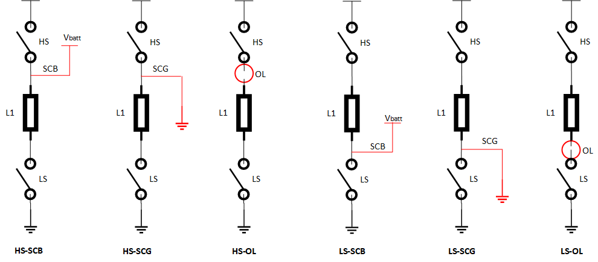

# Linked outputs {#linked-outputs .p_Heading1 style="page-break-after: avoid;"}

+:----------------------------------------------------------------------------------------------------------+------------------------------------------------------------------------------------------------------------------------+
| **Navigation:**  [System features](system-concepts.html) \> [BSW](bsw.html) \> [Outputs](outputs.html) \> |    |
|                                                                                                           |                                                                                                                        |
| # Linked outputs {#linked-outputs-1 .p_Heading1 style="page-break-after: avoid;"}                         |                                                                                                                        |
+-----------------------------------------------------------------------------------------------------------+------------------------------------------------------------------------------------------------------------------------+

A linked output means that the load is connected between a high power high-side and a low power/high power low-side output. The high-side output shall be configured as power supply for low-side output through the API functions bds_out_po_cfgPwrLs, bds_out_do_cfgPwrLs, bds_outPwm_cfgDiag and bds_outDig_cfgDiag.

## Remarks: {#remarks .p_Heading2 style="page-break-after: avoid;"}

 

[SAFOUT function](safety-outputs.html){.topiclink} is recommended to be used for combination of more than one high-side and low-side outputs.

## Hint: {#hint .p_Heading2 style="page-break-after: avoid;"}

The table is only valid for a 1:1 link.

 \
Fault detection table for linked outputs for low power low-side output:

 

High power high-side output shall be configured as power supply for low power low-side output through  bds_out_po_cfgPwrLs, bds_out_do_cfgPwrLs,\
bds_outPwm_cfgDiag and bds_outDig_cfgDiag.

 

<figure style="margin:0;padding:0">

<figcaption aria-hidden="true">
Figure 81: Fault detection of inked outputs
</figcaption>
</figure>

Fault detection of the output device when error occurred at high power high-side when low power low-side is switched OFF:\
 

+---------------------------------+-----------------------------------------------------------------------------------------------------+
| Error status high side          | Switched ON with 100% of dutycycle                                                                  |
|                                 +---------------------------------+---------------------------------+---------------------------------+
|                                 | SCB                             | SCG                             | OL                              |
+=================================+=================================+=================================+=================================+
| stDFC_SCB                       | a                               |                                 |                                 |
+---------------------------------+---------------------------------+---------------------------------+---------------------------------+
| stDFC_SCG                       |                                 | a                               |                                 |
+---------------------------------+---------------------------------+---------------------------------+---------------------------------+
| stDFC_OL                        |                                 |                                 | b                               |
+---------------------------------+---------------------------------+---------------------------------+---------------------------------+
| Error status low power low side |                                                                                  Switched OFF       |
|                                 +---------------------------------+---------------------------------+---------------------------------+
|                                 | SCB                             | SCG                             | OL                              |
+---------------------------------+---------------------------------+---------------------------------+---------------------------------+
| stDFC_SCB                       |                                 |                                 |                                 |
+---------------------------------+---------------------------------+---------------------------------+---------------------------------+
| stDFC_SCG                       |                                 | a                               | a                               |
+---------------------------------+---------------------------------+---------------------------------+---------------------------------+
| stDFC_OL                        |                                 | a                               | a                               |
+---------------------------------+---------------------------------+---------------------------------+---------------------------------+

a        Diagnostic error is detected hence output is switched OFF.\
b        Open load failure at the high-side output will always be suppressed. This is due to the high-side output is used as a power supply for a low-side output.

 

Fault detection of the output device when error occurred at high power high-side when low power low-side is switched ON:

 

+---------------------------------+--------------------------------------------+
| Error status high side          | Switched ON with 100% of dutycycle         |
|                                 +--------------+--------------+--------------+
|                                 | SCB          | SCG          | OL           |
+=================================+==============+==============+==============+
| stDFC_SCB                       | a            |              |              |
+---------------------------------+--------------+--------------+--------------+
| stDFC_SCG                       |              | a            |              |
+---------------------------------+--------------+--------------+--------------+
| stDFC_OL                        |              |              | b            |
+---------------------------------+--------------+--------------+--------------+
| Error status low power low side | Switched ON with 100% of dutycycle         |
|                                 +--------------+--------------+--------------+
|                                 | SCB          | SCG          | OL           |
+---------------------------------+--------------+--------------+--------------+
| stDFC_SCB                       |              |              |              |
+---------------------------------+--------------+--------------+--------------+
| stDFC_SCG                       |              |              |              |
+---------------------------------+--------------+--------------+--------------+
| stDFC_OL                        |              |              |              |
+---------------------------------+--------------+--------------+--------------+

a        Diagnostic error is detected hence output is switched OFF.\
b        Open load failure at the high-side output will always be suppressed. This is due to the high-side output is used as a power supply for a low-side output.        

 

Fault detection of the output device when error occurred at high power high-side when low power low-side is switched ON with 50% of dutycycle:

 

+---------------------------------+--------------------------------------------+
| Error status high side          | Switched ON with 100% of dutycycle         |
|                                 +--------------+--------------+--------------+
|                                 | SCB          | SCG          | OL           |
+=================================+==============+==============+==============+
| stDFC_SCB                       | a            | a            |              |
+---------------------------------+--------------+--------------+--------------+
| stDFC_SCG                       |              |              |              |
+---------------------------------+--------------+--------------+--------------+
| stDFC_OL                        |              |              | b            |
+---------------------------------+--------------+--------------+--------------+
| Error status low power low side | Switched ON with 50% of dutycycle          |
|                                 +--------------+--------------+--------------+
|                                 | SCB          | SCG          | OL           |
+---------------------------------+--------------+--------------+--------------+
| stDFC_SCB                       |              |              |              |
+---------------------------------+--------------+--------------+--------------+
| stDFC_SCG                       |              | a            | a            |
+---------------------------------+--------------+--------------+--------------+
| stDFC_OL                        |              | a            | a            |
+---------------------------------+--------------+--------------+--------------+

a        Diagnostic error is detected hence output is switched OFF.\
b        Open load failure at the high-side output will always be suppressed. This is due the high-side output is used as a power supply for a low-side output.

 

Fault detection of the output device when error occurred at low power low-side, if low power low-side is switched OFF:\
 

+---------------------------------+--------------------------------------------+
| Error status high side          | Switched ON with 100% of dutycycle         |
|                                 +--------------+--------------+--------------+
|                                 | SCB          | SCG          | OL           |
+=================================+==============+==============+==============+
| stDFC_SCB                       | a            |              |              |
+---------------------------------+--------------+--------------+--------------+
| stDFC_SCG                       |              |              |              |
+---------------------------------+--------------+--------------+--------------+
| stDFC_OL                        |              |              | b            |
+---------------------------------+--------------+--------------+--------------+
| Error status low power low side | Switched OFF                               |
|                                 +--------------+--------------+--------------+
|                                 | SCB          | SCG          | OL           |
+---------------------------------+--------------+--------------+--------------+
| stDFC_SCB                       | a1)          |              |              |
+---------------------------------+--------------+--------------+--------------+
| stDFC_SCG                       |              | a            | a            |
+---------------------------------+--------------+--------------+--------------+
| stDFC_OL                        |              | a            | a            |
+---------------------------------+--------------+--------------+--------------+

 

 

1\)        SCB only detected if there is any other active error is present e.g., OL (then additional test pulses active to detect all possible errors)

 

a        Diagnostic error is detected hence output is switched OFF.\
b        Open load failure at the high-side output will always be suppressed. This is due to the high-side output is used as a power supply for a low-side output.

 

Fault detection of the output device when error occurred at low power low side if low power low-side is switched ON:

 

+---------------------------------+--------------------------------------------+
| Error status high side          | Switched ON with 100% of dutycycle         |
|                                 +--------------+--------------+--------------+
|                                 | SCB          | SCG          | OL           |
+=================================+==============+==============+==============+
| stDFC_SCB                       | a            |              |              |
+---------------------------------+--------------+--------------+--------------+
| stDFC_SCG                       |              |              |              |
+---------------------------------+--------------+--------------+--------------+
| stDFC_OL                        |              |              | b            |
+---------------------------------+--------------+--------------+--------------+
| Error status low power low side | Switched ON with 100% of dutycycle         |
|                                 +--------------+--------------+--------------+
|                                 | SCB          | SCG          | OL           |
+---------------------------------+--------------+--------------+--------------+
| stDFC_SCB                       | a            |              |              |
+---------------------------------+--------------+--------------+--------------+
| stDFC_SCG                       |              |              |              |
+---------------------------------+--------------+--------------+--------------+
| stDFC_OL                        |              |              |              |
+---------------------------------+--------------+--------------+--------------+

 

a        Diagnostic error is detected hence output is switched OFF.\
b        Open load failure at the high-side output will always be suppressed. This is due to the high-side output is used as a power supply for a low-side output.

 

Fault detection of the output device when error occurred at low power low-side if low power low-side is switched ON with 50% of dutycycle:

 

+---------------------------------+--------------------------------------------+
| Error status high side          | Switched ON with 100% of dutycycle         |
|                                 +--------------+--------------+--------------+
|                                 | SCB          | SCG          | OL           |
+=================================+==============+==============+==============+
| stDFC_SCB                       | a            |              |              |
+---------------------------------+--------------+--------------+--------------+
| stDFC_SCG                       |              |              |              |
+---------------------------------+--------------+--------------+--------------+
| stDFC_OL                        |              |              | b            |
+---------------------------------+--------------+--------------+--------------+
| Error status low power low side | Switched ON with 50% of dutycycle          |
|                                 +--------------+--------------+--------------+
|                                 | SCB          | SCG          | OL           |
+---------------------------------+--------------+--------------+--------------+
| stDFC_SCB                       | a            |              |              |
+---------------------------------+--------------+--------------+--------------+
| stDFC_SCG                       |              | a            | a            |
+---------------------------------+--------------+--------------+--------------+
| stDFC_OL                        | a            | a            | a            |
+---------------------------------+--------------+--------------+--------------+

 

a        Diagnostic error is detected hence output is switched OFF.\
b        Open load failure at the high-side output will always be suppressed. This is due to the high-side output is used as a power supply for a low-side output.

 

 

Fault detection table for linked outputs for high power low-side output:

 

High power high-side output shall be configured as power supply for high power low-side output through bds_out_po_cfgPwrLs, bds_out_do_cfgPwrLs,\
bds_outPwm_cfgDiag and bds_outDig_cfgDiag.

 

Fault detection of the output device when error occurred at high power high-side if high power low-side is switched OFF:\
 

+---------------------------------+--------------------------------------------+
| Error status high side          | Switched ON with 100% of dutycycle         |
|                                 +--------------+--------------+--------------+
|                                 | SCB          | SCG          | OL           |
+=================================+==============+==============+==============+
| stDFC_SCB                       | a            |              |              |
+---------------------------------+--------------+--------------+--------------+
| stDFC_SCG                       |              | a            |              |
+---------------------------------+--------------+--------------+--------------+
| stDFC_OL                        |              |              | b            |
+---------------------------------+--------------+--------------+--------------+
| Error status low power low side | Switched OFF                               |
|                                 +--------------+--------------+--------------+
|                                 | SCB          | SCG          | OL           |
+---------------------------------+--------------+--------------+--------------+
| stDFC_SCB                       |              |              |              |
+---------------------------------+--------------+--------------+--------------+
| stDFC_SCG                       |              | a            | a            |
+---------------------------------+--------------+--------------+--------------+
| stDFC_OL                        |              |              |              |
+---------------------------------+--------------+--------------+--------------+

 

a        Diagnostic error is detected hence output is switched OFF.\
b        Open load failure at the high-side output will always be suppressed. This is due to the high-side output is used as a power supply for a low-side output.

 

Fault detection of the output device when error occurred at high power high-side if high power low-side is switched ON:

 

+---------------------------------+--------------------------------------------+
| Error status high side          | Switched ON with 100% of dutycycle         |
|                                 +--------------+--------------+--------------+
|                                 | SCB          | SCG          | OL           |
+=================================+==============+==============+==============+
| stDFC_SCB                       | a            |              |              |
+---------------------------------+--------------+--------------+--------------+
| stDFC_SCG                       |              | a            |              |
+---------------------------------+--------------+--------------+--------------+
| stDFC_OL                        |              |              | b            |
+---------------------------------+--------------+--------------+--------------+
| Error status low power low side | Switched ON with 100% of dutycycle         |
|                                 +--------------+--------------+--------------+
|                                 | SCB          | SCG          | OL           |
+---------------------------------+--------------+--------------+--------------+
| stDFC_SCB                       |              |              |              |
+---------------------------------+--------------+--------------+--------------+
| stDFC_SCG                       |              | a            |              |
+---------------------------------+--------------+--------------+--------------+
| stDFC_OL                        |              |              | a            |
+---------------------------------+--------------+--------------+--------------+

 

a        Diagnostic error is detected hence output is switched OFF.\
b        Open load failure at the high-side output will always be suppressed. This is due to the high-side output is used as a power supply for a low-side output.

 

Fault detection of the output device when error occurred at high power high-side if high power low-side is switched ON with 50% of dutycycle:

 

+---------------------------------+--------------------------------------------+
| Error status high side          | Switched ON with 100% of dutycycle         |
|                                 +--------------+--------------+--------------+
|                                 | SCB          | SCG          | OL           |
+=================================+==============+==============+==============+
| stDFC_SCB                       | a            |              |              |
+---------------------------------+--------------+--------------+--------------+
| stDFC_SCG                       |              | a            |              |
+---------------------------------+--------------+--------------+--------------+
| stDFC_OL                        |              |              | b            |
+---------------------------------+--------------+--------------+--------------+
| Error status low power low side | Switched ON with 50% of dutycycle          |
|                                 +--------------+--------------+--------------+
|                                 | SCB          | SCG          | OL           |
+---------------------------------+--------------+--------------+--------------+
| stDFC_SCB                       |              |              |              |
+---------------------------------+--------------+--------------+--------------+
| stDFC_SCG                       |              | a            |              |
+---------------------------------+--------------+--------------+--------------+
| stDFC_OL                        |              |              | a            |
+---------------------------------+--------------+--------------+--------------+

 

a        Diagnostic error is detected hence output is switched OFF.\
b        Open load failure at the high-side output will always be suppressed. This is due to the high-side output is used as a power supply for a low-side output.

 

Fault detection of the output device when error occurred at high power low-side if high-power low-side is switched OFF:\
 

+---------------------------------+--------------------------------------------+
| Error status high side          | Switched ON with 100% of dutycycle         |
|                                 +--------------+--------------+--------------+
|                                 | SCB          | SCG          | OL           |
+=================================+==============+==============+==============+
| stDFC_SCB                       | a            |              |              |
+---------------------------------+--------------+--------------+--------------+
| stDFC_SCG                       |              |              |              |
+---------------------------------+--------------+--------------+--------------+
| stDFC_OL                        |              |              | b            |
+---------------------------------+--------------+--------------+--------------+
| Error status low power low side | Switched OFF                               |
|                                 +--------------+--------------+--------------+
|                                 | SCB          | SCG          | OL           |
+---------------------------------+--------------+--------------+--------------+
| stDFC_SCB                       | a            |              |              |
+---------------------------------+--------------+--------------+--------------+
| stDFC_SCG                       |              | a            |              |
+---------------------------------+--------------+--------------+--------------+
| stDFC_OL                        |              |              | a            |
+---------------------------------+--------------+--------------+--------------+

 

a        Diagnostic error is detected hence output is switched OFF.\
b        Open load failure at the high-side output will always be suppressed. This is due to the high-side output is used as a power supply for a low-side output.

 

Fault detection of the output device when error occurred at high power low-side if high-power low-side is switched ON:

 

+---------------------------------+--------------------------------------------+
| Error status high side          | Switched ON with 100% of dutycycle         |
|                                 +--------------+--------------+--------------+
|                                 | SCB          | SCG          | OL           |
+=================================+==============+==============+==============+
| stDFC_SCB                       | a            |              |              |
+---------------------------------+--------------+--------------+--------------+
| stDFC_SCG                       |              |              |              |
+---------------------------------+--------------+--------------+--------------+
| stDFC_OL                        |              |              | b            |
+---------------------------------+--------------+--------------+--------------+
| Error status low power low side | Switched ON with 100% of dutycycle         |
|                                 +--------------+--------------+--------------+
|                                 | SCB          | SCG          | OL           |
+---------------------------------+--------------+--------------+--------------+
| stDFC_SCB                       | a            |              |              |
+---------------------------------+--------------+--------------+--------------+
| stDFC_SCG                       |              | a            |              |
+---------------------------------+--------------+--------------+--------------+
| stDFC_OL                        |              |              | a            |
+---------------------------------+--------------+--------------+--------------+

 

a        Diagnostic error is detected hence output is switched OFF.\
b        Open load failure at the high-side output will always be suppressed. This is due to the high-side output is used as a power supply for a low-side output.

 

Fault detection of the output device when error occurred at high power low-side if high-power low-side is switched ON with 50% of dutycycle:

 

+---------------------------------+--------------------------------------------+
| Error status high side          | Switched ON with 100% of dutycycle         |
|                                 +--------------+--------------+--------------+
|                                 | SCB          | SCG          | OL           |
+=================================+==============+==============+==============+
| stDFC_SCB                       | a            |              |              |
+---------------------------------+--------------+--------------+--------------+
| stDFC_SCG                       |              |              |              |
+---------------------------------+--------------+--------------+--------------+
| stDFC_OL                        |              |              | b            |
+---------------------------------+--------------+--------------+--------------+
| Error status low power low side | Switched ON with 50% of dutycycle          |
|                                 +--------------+--------------+--------------+
|                                 | SCB          | SCG          | OL           |
+---------------------------------+--------------+--------------+--------------+
| stDFC_SCB                       | a            |              |              |
+---------------------------------+--------------+--------------+--------------+
| stDFC_SCG                       |              | a            |              |
+---------------------------------+--------------+--------------+--------------+
| stDFC_OL                        |              |              | a            |
+---------------------------------+--------------+--------------+--------------+

 

a        Diagnostic error is detected hence output is switched OFF.\
b        Open load failure at the high-side output will always be suppressed. This is due to the high-side output is used as a power supply for a low-side output.

 

The stated diagnostic error code in all cases of the table above is 0x3F7F. For detailed information about each hex code mentioned in the table please follow [diagnostics fault check](diagnostic-fault-check.html){.topiclink}.

The over temperature fault cannot be detected. The temperatur is detected by internal  NTC/PTCs. The user has to define the temperature limit and implement the temperature comparison in the application software.

## Over-/Undervoltage handling {#over-undervoltage-handling .p_Heading2 style="page-break-after: avoid;"}

The normal operation of the RC lies within in the range of 11 - 32 V. The supply voltage is checked by [cyclic monitoring](cyclic-monitoring-checks.html){.topiclink}. In case an undervoltage (\<11 V) or an overvoltage (\>32 V) is detected, the RC is transferred into safe state and the respective [Diagnostic Trouble Code](diagnostic-trouble-code.html){.topiclink} is provided.
