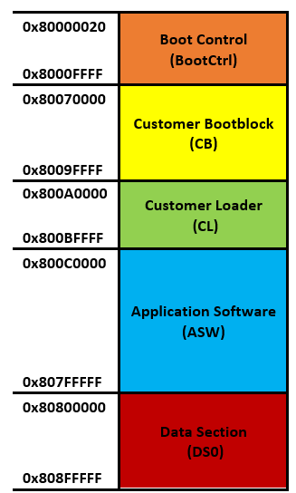
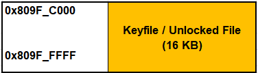
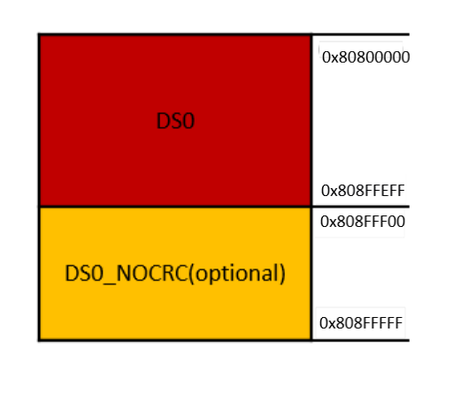
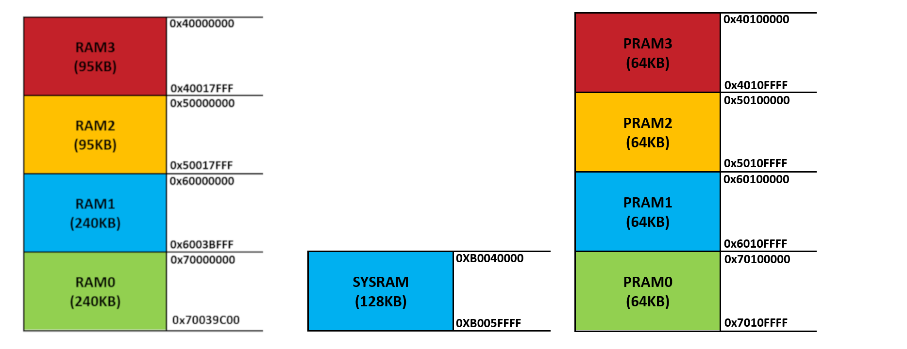

# Memory layout RC18-12/40, RC27-18/40 {#memory-layout-rc18-1240-rc27-1840 .p_Heading1 style="page-break-after: avoid;"}

+:-----------------------------------------------------------------------------------------------------------------------------------------------+--------------------------------------------------------------------------------------------------------------------------------------+
| **Navigation:**  [System features](system-concepts.html) \> [BSW](bsw.html) \> [Memory](memory.html) \> [Memory layout](memory-layout.html) \> |    |
|                                                                                                                                                |                                                                                                                                      |
| # Memory layout RC18-12/40, RC27-18/40 {#memory-layout-rc18-1240-rc27-1840-1 .p_Heading1 style="page-break-after: avoid;"}                     |                                                                                                                                      |
+------------------------------------------------------------------------------------------------------------------------------------------------+--------------------------------------------------------------------------------------------------------------------------------------+

## PFlash sections {#pflash-sections .p_Heading2 style="page-break-after: avoid;"}

 

<figure style="margin:0;padding:0">

<figcaption aria-hidden="true">
Figure34: Memory Layout RC18-12/40 / RC27-18/40
</figcaption>
</figure>

 

<figure style="margin:0;padding:0">

<figcaption aria-hidden="true">
Figure 35 Key File for RC18-12/40 and RC27-18/40
</figcaption>
</figure>

         

The PFlash sections are contiguous memory locations starting from address 0x80000020 up to address 0x808FFFFF. This includes bootcontrol, Customer-bootblock (CB), Application program flash section-ASW0 (default) and data flash section-DS0.

DS0 flash is not allowed for direct use by the application. DS0 variables can be read or written from outside through diagnostic services (XCP).

The memory layout can be found in the linker script: file: \"prj_linker_cmd.lcf\".

Example code to locate variables into DS0 section

The DS0 area can be used by the ASW as shown below:

 

#pragma section \".caldata0\" a

static const uint8 calibData1_u8 = 0x12;

#pragma section

## DS0_NOCRC Special Section (Optional) {#ds0_nocrc-special-section-optional .p_Heading2 style="page-break-after: avoid;"}

 

                     

<figure style="margin:0;padding:0">

<figcaption aria-hidden="true">
Figure36: DSO_NOCRC section RC18-12/40 / RC27-18/40
</figcaption>
</figure>

 

This section is special section created in the data flash section-DS0 and is used to store data without the usual CRC protection,  e.g for data created & stored after the CRC calculation during build (e.g. date of flashing, software version).

It has a length of 256 bytes.  

+-----------------------------------------------------------------------------------------------------------------+--------------------------------------------------------------------------------------------------------------------------------------------------------------------------------------------------------+
| {style="margin:0;width:1.4792in;height:0.2813in;border:none"} | If section-DS0_NOCRC is used, the user has to take care of epilog of the section-DS0.                                                                                                                  |
|                                                                                                                 |                                                                                                                                                                                                        |
|                                                                                                                 | During every compilation, the user has to check that the epilog does not overlap into the DS0_NOCRC area, otherwise the data of section - DS0 can overwrite the data of the special section-DS0_NOCRC! |
|                                                                                                                 |                                                                                                                                                                                                        |
|                                                                                                                 |                                                                                                                                                                                                        |
|                                                                                                                 |                                                                                                                                                                                                        |
|                                                                                                                 | This should not be used for safety critical data (due to the missing CRC protection)!                                                                                                                  |
|                                                                                                                 |                                                                                                                                                                                                        |
|                                                                                                                 |                                                                                                                                                                                                        |
|                                                                                                                 |                                                                                                                                                                                                        |
|                                                                                                                 | If section-DS0_NOCRC of 256 bytes is not used, the section-DS0 is extended to 0x808FFFFF (i.e., the section-DS0 can be used completely)                                                                |
+-----------------------------------------------------------------------------------------------------------------+--------------------------------------------------------------------------------------------------------------------------------------------------------------------------------------------------------+

Example code to store variables into DS0_NOCRC section

 

/\*store the read-only data variables into DS0_NOCRC section \*/

 \
#pragma section \".rodata.DS0_NOCRC\" a

 

/\*Data Header \*/

typedef struct

{

 uint32  ApplicationVersion;

 uint32  bootblockVersion;

 uint8   softwareVersion;

 uint8   hardwareVersion;

 uint8   date;

} HeaderDa;

 

/\*Variable declaration to structure \*/

const HeaderDa DSO_NOCRC_var_s={0x82,0x04,0x78,0x71,0x10};

 

/\* finish special locating \*/

#pragma section

 

## RAM Section {#ram-section .p_Heading2 style="page-break-after: avoid;"}

<figure style="margin:0;padding:0">

<figcaption aria-hidden="true">
Figure 37: RAM layout - RC18-12/40 / RC27-18/40
</figcaption>
</figure>

 

The different RAM sections available and their usage are listed below:

- Local Data-Ram (RAMx).

- Instruction-Ram (PRAMx).

- One global Data-Ram is available (SYSRAM).

## Use of different RAM sections {#use-of-different-ram-sections .p_Heading2 style="page-break-after: avoid;"}

- RAM: This section can be used for storing application variables. It is subdivided into four sections RAM0, RAM1, RAM2 and RAM3.

- PRAM(PCP PARAMETER MEMORY): The Infineon microcontroller contains a Peripheral Controller Processor(PCP) which is used as an Interrupt Service Provider. The PRAM section can be used specifically to store interrupt parameters. It is subdivided into four sections PRAM0, PRAM1, PRAM2 and PRAM3.

- SYSRAM: This section is not accessible by bus masters configured as not secure. So secure parameters can be stored in this section.

 

Zero-initialized application variables are stored in RAM1 section by default. If user needs to access other RAM sections, variables can be declared under that particular section using the syntax provided below.

 

+-----------------------------------------------------------------------------------------------------------------+----------------------------------------------------------------------------------------------------------------------------------------------------------------+
| {style="margin:0;width:1.4792in;height:0.2813in;border:none"} | Storing application variables in different RAM sections can be done by developer who is familiar with memory structure of the controller.                      |
|                                                                                                                 |                                                                                                                                                                |
|                                                                                                                 | After a successful build, developers can verify variable\'s memory placement by inspecting the generated map file, which shows the memory section assignments. |
+-----------------------------------------------------------------------------------------------------------------+----------------------------------------------------------------------------------------------------------------------------------------------------------------+

 

Example code to store variables in available RAM sections

 

1\. Store the (global) zero initialized variables into RAM0

 

/\*store the (global) zero initialized variables into RAM0 \*/

 \
#pragma section \".bss.ram0\" awB\
uint16 speed_u16;\
uint32 height_u32;

 \
/\* finish special locating \*/\
#pragma section

 

2\. Store the (global) zero initialized variables into RAM2

 

/\*store the (global) zero initialized variables into RAM2 \*/

 \
#pragma section \".bss.ram2\" awB\
uint16 speed_u16;\
uint32 height_u32;

 \
/\* finish special locating \*/\
#pragma section

 

[]{#ml_ram2_core2_bss .hmanchor}3. Store the (global) zero initialized variables into RAM2 for core 2

 

/\*store the (global) zero initialized variables into RAM2 \*/\
#pragma section \".bss.ram2.core2.a8\" awB

 \
uint16 speed_u16;\
uint32 height_u32;

 \
/\* finish special locating \*/\
#pragma section

 

or

 

/\*store the (global) zero initialized variables into RAM2 \*/\
bds_sysDxch_start_ram2Core2Uninit_sect_D

 \
uint16 speed_u16;\
uint32 height_u32;

 \
/\* finish special locating \*/\
bds_sysDxch_stop_ram2Core2Uninit_sect_D

For more information refer  Memory allocation with example.

4\. Store the (global) zero initialized variables into RAM3

 

/\*store the (global) zero initialized variables into RAM3 \*/\
#pragma section \".bss.ram3\" awB\
uint16 speed_u16;\
uint32 height_u32;

 \
/\* finish special locating \*/\
#pragma section

 

[]{#ml_ram3_core3_bss .hmanchor}5. Store the (global) zero initialized variables into RAM3 for core 3

 

/\*store the (global) zero initialized variables into RAM3 \*/\
#pragma section \".bss.ram3.core3.a8\" awB

 \
uint16 speed_u16;\
uint32 height_u32;

 \
/\* finish special locating \*/\
#pragma section

 

or

 

/\*store the (global) zero initialized variables into RAM3 \*/\
bds_sysDxch_start_ram3Core3Uninit_sect_D

 \
uint16 speed_u16;\
uint32 height_u32;

 \
/\* finish special locating \*/\
bds_sysDxch_stop_ram3Core3Uninit_sect_D

For more information refer  Memory allocation with example.

6\. Store the (global) zero initialized variables into PRAM0

 

/\* store the (global) zero initialized variables into PRAM0 \*/

 \
#pragma section \".bss.pram0\" awB\
uint16 speed_u16;\
uint32 height_u32;

 \
/\* finish special locating \*/\
#pragma section

 

7\. Store the (global) zero initialized variables into PRAM1

 

/\* store the (global) zero initialized variables into PRAM1 \*/

 \
#pragma section \".bss.pram1\" awB\
uint16 speed_u16;\
uint32 height_u32;

 \
/\* finish special locating \*/\
#pragma section

 

8\.  Store the (global) zero initialized variables into PRAM2

 

/\* store the (global) zero initialized variables into PRAM2 \*/

 \
#pragma section \".bss.pram2\" awB\
uint16 speed_u16;\
uint32 height_u32;

 \
/\* finish special locating \*/\
#pragma section

 

9\.  Store the (global) zero initialized variables into PRAM3

 

/\* store the (global) zero initialized variables into PRAM3 \*/

 \
#pragma section \".bss.pram3\" awB\
uint16 speed_u16;\
uint32 height_u32;

 \
/\* finish special locating \*/\
#pragma section

 

10\.  Store the (global) zero initialized variables into SYSRAM

 

/\* store the (global) zero initialized variables into SYSRAM \*/

 \
#pragma section \".bss.sysram\" awB\
uint16 speed_u16;\
uint32 height_u32;

 \
/\* finish special locating \*/\
#pragma section

 

 

The other way of storing variables or functions into the available RAM sections(except default) is as shown below:

1\. Store the (global) zero initialized variables into RAM0

 

#define RBA_MEMLAY_USE_RAM0       \_\_attribute\_\_ ((asection(\".bss.ram0\",\"f=awB\"))) // Linker label for section RAM0

 

uint8 var1_u8 RBA_MEMLAY_USE_RAM0;

 

2\. Store the (global) zero initialized variables into RAM2

 

#define RBA_MEMLAY_USE_RAM2       \_\_attribute\_\_ ((asection(\".bss.ram2\",\"f=awB\"))) // Linker label for section RAM2

 

uint8 var2_u8 RBA_MEMLAY_USE_RAM2;

 

3\. Store the (global) zero initialized variables into RAM2 for core 2

 

#define RBA_MEMLAY_USE_RAM2_CORE2 \_\_attribute\_\_ ((asection(\".bss.ram2.core2.a8\",\"f=awB\"))) // Linker label for section RAM2

 

uint8 var3_u8 RBA_MEMLAY_USE_RAM2_CORE2;

 

4\. Store the (global) zero initialized variables into RAM3

 

#define RBA_MEMLAY_USE_RAM3       \_\_attribute\_\_ ((asection(\".bss.ram3\",\"f=awB\"))) // Linker label for section RAM3

 

uint8 var4_u8 RBA_MEMLAY_USE_RAM3;

 

5\. Store the (global) zero initialized variables into RAM3 for core 3

 

#define RBA_MEMLAY_USE_RAM3_CORE3 \_\_attribute\_\_ ((asection(\".bss.ram3.core3.a8\",\"f=awB\"))) // Linker label for section RAM3

 

uint8 var5_u8 RBA_MEMLAY_USE_RAM3_CORE3;

 

6\. Store the (global) zero initialized variables into PRAM0

 

#define RBA_MEMLAY_USE_PRAM0       \_\_attribute\_\_ ((asection(\".bss.pram0\",\"f=awB\"))) // Linker label for section PRAM0

 

uint8 var6_u8 RBA_MEMLAY_USE_PRAM0;

 

7\. Store the (global) zero initialized variables into PRAM1

 

#define RBA_MEMLAY_USE_PRAM1       \_\_attribute\_\_ ((asection(\".bss.pram1\",\"f=awB\"))) // Linker label for section PRAM1

 

uint8 var7_u8 RBA_MEMLAY_USE_PRAM1;

 

8\. Store the (global) zero initialized variables into PRAM2

 

#define RBA_MEMLAY_USE_PRAM2       \_\_attribute\_\_ ((asection(\".bss.pram2\",\"f=awB\"))) // Linker label for section PRAM2

 

uint8 var8_u8 RBA_MEMLAY_USE_PRAM2;

 

9\. Store the (global) zero initialized variables into PRAM3

 

#define RBA_MEMLAY_USE_PRAM3       \_\_attribute\_\_ ((asection(\".bss.pram3\",\"f=awB\"))) // Linker label for section PRAM3

 

uint8 var9_u8 RBA_MEMLAY_USE_PRAM3;

 

10\. Store the (global) zero initialized variables into SYSRAM

 

#define RBA_MEMLAY_USE_SYSRAM       \_\_attribute\_\_ ((asection(\".bss.sysram\",\"f=awB\"))) // Linker label for section SYSRAM

 

uint8 var10_u8 RBA_MEMLAY_USE_SYSRAM;

 

Initialized variables:

All the Initialized application variables are stored in \" .data.initvar0 \" section of RAM0 by default. Application variables shall be stored in RAM2 and RAM3 by below pragmas, this would be useful when application executes in core 2 and core 3 respectively.

[]{#ml_ram2_core2_data .hmanchor}1. Store the (global) application initialized variables into RAM2 for core 2

 

/\*store the (global) application initialized variables into RAM2 \*/\
#pragma section \".data.ram2.core2.a8\" awB

 \
uint16 speed_u16 = 58;\
uint32 height_u32 = 92;

 \
/\* finish special locating \*/\
#pragma section

 

or

 

/\*store the (global) zero initialized variables into RAM2 \*/\
bds_sysDxch_start_ram2Core2Init_sect_D

 \
uint16 speed_u16 = 58;\
uint32 height_u32 = 92;

 \
/\* finish special locating \*/\
bds_sysDxch_stop_ram2Core2Init_sect_D

For more information refer  Memory allocation with example.

[]{#ml_ram3_core3_data .hmanchor}2. Store the (global) application initialized variables into RAM3 for core 3

 

/\*store the (global) application initialized variables into RAM3 \*/\
#pragma section \".data.ram3.core3.a8\" awB

 \
uint16 speed_u16 = 78;\
uint32 height_u32 = 35;

 \
/\* finish special locating \*/\
#pragma section

 

or

 

/\*store the (global) zero initialized variables into RAM3 \*/\
bds_sysDxch_start_ram3Core3Init_sect_D

 \
uint16 speed_u16 = 78;\
uint32 height_u32 = 35;

 \
/\* finish special locating \*/\
bds_sysDxch_stop_ram3Core3Init_sect_D

For more information refer  Memory allocation with example.

Remarks:

- Variables used in internal APIs are also stored in different RAM sections. Thus the complete RAM memory is not available for application.

- Each RAM area(RAM,PRAM,SYSRAM) is fragmented into 3 sub sections.The specific subsection is to be chosen according to usage. They are as follows:

 

+-------------------------------------------------------------------------------+-----------------------------------+
| Initial state of variable                                                     | Prefix of section                 |
+===============================================================================+===================================+
| Initialized with zero without an allocation in declaration\                   |                                   |
| example: uint16 speed_u16;                                                    |                                   |
|                                                                               | .bss                              |
|                                                                               |                                   |
+-------------------------------------------------------------------------------+-----------------------------------+
| Initialized with a specific value with an allocation in declaration\          |                                   |
| example: uint16 speed_u16 = 100;                                              |                                   |
|                                                                               | .data                             |
|                                                                               |                                   |
+-------------------------------------------------------------------------------+-----------------------------------+
| Uninitialized\                                                                |                                   |
| Data is unavailable in case of a coldstart (ignition was off) .\              |                                   |
| Data can be retained in case of a warmstart\...depends on ECU and type of RAM | \"no prefix\"                     |
|                                                                               |                                   |
|                                                                               |                                   |
+-------------------------------------------------------------------------------+-----------------------------------+
