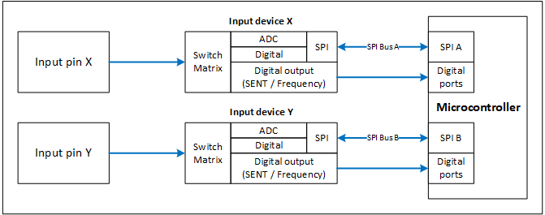

# Multi-functional inputs in general {#multi-functional-inputs-in-general .p_Heading1 style="page-break-after: avoid;"}

+:------------------------------------------------------------------------------------------------------------------------------------------------------------------------+-----------------------------------------------------------------------------------------------------------------------------+
| **Navigation:**  [Safety manual](safety-manual.html) \> [Safety-related inputs](safety-relatedinputs.html) \> [Multi-functional inputs](multi-functionalinputs.html) \> |    |
|                                                                                                                                                                         |                                                                                                                             |
| # Multi-functional inputs in general {#multi-functional-inputs-in-general-1 .p_Heading1 style="page-break-after: avoid;"}                                               |                                                                                                                             |
+-------------------------------------------------------------------------------------------------------------------------------------------------------------------------+-----------------------------------------------------------------------------------------------------------------------------+

As illustrated in the following figure, RCs support the use of multi-functional inputs to form completely independent signal paths from the input pins via the input devices to the µC.

<figure style="margin:0;padding:0">

<figcaption aria-hidden="true">
Figure 119: Independent input paths with multi-functional inputs
</figcaption>
</figure>

 

The two independent signals can either be used to form redundancy or be used for plausibility check. If the ASW implements a proper comparison/plausibility check of the two input signals, failures in the input processing circuitry external to and internal of the RC can be detected with high reliability.

 

For RC18-12/40 and RC27-18/40, the assignment of each multi-functional input to the input devices and hence the signal channels are given in the following tables.

+--------------------------------------------------------------------------+----------------+--------------------------+----------------------------------------------------------------------+---------------------------------------------------------------------------------------------------------------------------------------------+
| Type                                                                     | Input device   | Connector pin number     | Remark                                                               | Function group in [Reliability parameters of the safety function "system integrity"](reliabilityparameterssystemintegrity.html){.topiclink} |
+==========================================================================+================+==========================+======================================================================+=============================================================================================================================================+
| Multi-functional input  \                                                | Input device 1 | K43,                     | All pins are configurable as AI or DI.                               | Input devices (K1)                                                                                                                          |
| (see [Multi-functional inputs](multi-functionalinputs.html){.topiclink}) |                |                          |                                                                      |                                                                                                                                             |
|                                                                          |                | K38, K39, K40, K41, K42, |                                                                      |                                                                                                                                             |
|                                                                          |                |                          |                                                                      |                                                                                                                                             |
|                                                                          |                | K52, K53, K59, K60,      |                                                                      |                                                                                                                                             |
|                                                                          |                |                          |                                                                      |                                                                                                                                             |
|                                                                          |                | K54, K55                 |                                                                      |                                                                                                                                             |
|                                                                          |                |                          +----------------------------------------------------------------------+                                                                                                                                             |
|                                                                          |                |                          | K38, K39, K40, K41, K42, K54 and K55 are configurable as AIC as well |                                                                                                                                             |
|                                                                          |                |                          +----------------------------------------------------------------------+                                                                                                                                             |
|                                                                          |                |                          | K52, K53, K59, K60 are configurable as SENT or FI as well            |                                                                                                                                             |
|                                                                          +----------------+--------------------------+----------------------------------------------------------------------+                                                                                                                                             |
|                                                                          | Input device 2 | K62,                     | All pins are configurable as AI or DI.                               |                                                                                                                                             |
|                                                                          |                |                          |                                                                      |                                                                                                                                             |
|                                                                          |                | K44, K45, K63, K64, K65, |                                                                      |                                                                                                                                             |
|                                                                          |                |                          |                                                                      |                                                                                                                                             |
|                                                                          |                | K36, K56, K57, K58,      |                                                                      |                                                                                                                                             |
|                                                                          |                |                          |                                                                      |                                                                                                                                             |
|                                                                          |                | K37, K61                 |                                                                      |                                                                                                                                             |
|                                                                          |                |                          +----------------------------------------------------------------------+                                                                                                                                             |
|                                                                          |                |                          | K44, K45, K63, K64, K65, K37 and K61 are configurable as AIC as well |                                                                                                                                             |
|                                                                          |                |                          +----------------------------------------------------------------------+                                                                                                                                             |
|                                                                          |                |                          | K36, K56, K57, K58 are configurable as SENT or FI as well            |                                                                                                                                             |
+--------------------------------------------------------------------------+----------------+--------------------------+----------------------------------------------------------------------+---------------------------------------------------------------------------------------------------------------------------------------------+
| Frequency /DSM input                                                     | Input device 1 | K54, K55                 | Configurable as FI/ DSM                                              | Frequency/ DSM input (K2)                                                                                                                   |
|                                                                          |                |                          |                                                                      |                                                                                                                                             |
| (see [Frequency/DSM inputs](frequencydsminputs.html){.topiclink})        |                |                          |                                                                      |                                                                                                                                             |
|                                                                          +----------------+--------------------------+----------------------------------------------------------------------+                                                                                                                                             |
|                                                                          | Input device 2 | K37, K61                 | Configurable as FI/ DSM                                              |                                                                                                                                             |
+--------------------------------------------------------------------------+----------------+--------------------------+----------------------------------------------------------------------+---------------------------------------------------------------------------------------------------------------------------------------------+

[]{#fig_a4ed43 .hmanchor}Table 27: Input types and pin assignment for input device 1 and input device 2 in RC18-12/40 and RC28-17/40.

 

+--------------------------------------------------------------------------+----------------+--------------------------+----------------------------------------------------------------------+---------------------------------------------------------------------------------------------------------------------------------------------+
| Type                                                                     | Input device   | Connector pin number     | Remark                                                               | Function group in [Reliability parameters of the safety function "system integrity"](reliabilityparameterssystemintegrity.html){.topiclink} |
+==========================================================================+================+==========================+======================================================================+=============================================================================================================================================+
| Multi-functional input  \                                                | Input device 2 | K62,                     | All pins are configurable as AI or DI.                               | Input devices (K1)                                                                                                                          |
| (see [Multi-functional inputs](multi-functionalinputs.html){.topiclink}) |                |                          |                                                                      |                                                                                                                                             |
|                                                                          |                | K44, K45, K63, K64, K65, |                                                                      |                                                                                                                                             |
|                                                                          |                |                          |                                                                      |                                                                                                                                             |
|                                                                          |                | K36, K56, K57, K58,      |                                                                      |                                                                                                                                             |
|                                                                          |                |                          |                                                                      |                                                                                                                                             |
|                                                                          |                | K37, K61                 |                                                                      |                                                                                                                                             |
|                                                                          |                |                          +----------------------------------------------------------------------+                                                                                                                                             |
|                                                                          |                |                          | K44, K45, K63, K64, K65, K37 and K61 are configurable as AIC as well |                                                                                                                                             |
|                                                                          |                |                          +----------------------------------------------------------------------+                                                                                                                                             |
|                                                                          |                |                          | K36, K56, K57, K58 are configurable as SENT or FI as well            |                                                                                                                                             |
|                                                                          +----------------+--------------------------+----------------------------------------------------------------------+                                                                                                                                             |
|                                                                          | Input device 3 | K32, K33,                | All pins are configurable as AI or DI.                               |                                                                                                                                             |
|                                                                          |                |                          |                                                                      |                                                                                                                                             |
|                                                                          |                | A36, A37, A38, A39,      |                                                                      |                                                                                                                                             |
|                                                                          |                |                          |                                                                      |                                                                                                                                             |
|                                                                          |                | A21, A22, A23, A24,      |                                                                      |                                                                                                                                             |
|                                                                          |                |                          |                                                                      |                                                                                                                                             |
|                                                                          |                | A43, K30                 |                                                                      |                                                                                                                                             |
|                                                                          |                |                          +----------------------------------------------------------------------+                                                                                                                                             |
|                                                                          |                |                          | A36, A37, A38, A39, A43 and A30 are configurable as AIC as well      |                                                                                                                                             |
|                                                                          |                |                          +----------------------------------------------------------------------+                                                                                                                                             |
|                                                                          |                |                          | A21, A22, A23, A24                                                   |                                                                                                                                             |
|                                                                          |                |                          |                                                                      |                                                                                                                                             |
|                                                                          |                |                          | are configurable FI as well                                          |                                                                                                                                             |
+--------------------------------------------------------------------------+----------------+--------------------------+----------------------------------------------------------------------+---------------------------------------------------------------------------------------------------------------------------------------------+
| Frequency /DSM input                                                     | Input device 2 | K37, K61                 | Configurable as FI/ DSM                                              | Frequency/ DSM input (K2)                                                                                                                   |
|                                                                          |                |                          |                                                                      |                                                                                                                                             |
| (see [Frequency/DSM inputs](frequencydsminputs.html){.topiclink})        |                |                          |                                                                      |                                                                                                                                             |
|                                                                          +----------------+--------------------------+----------------------------------------------------------------------+                                                                                                                                             |
|                                                                          | Input device 3 | K43, K30                 | Configurable as FI/ DSM                                              |                                                                                                                                             |
+--------------------------------------------------------------------------+----------------+--------------------------+----------------------------------------------------------------------+---------------------------------------------------------------------------------------------------------------------------------------------+

[]{#fig_134a06 .hmanchor}Table 28: Input types and pin assignment for input device 2 and input device 3 in RC18-12/40 and RC28-17/40

 

  {style="margin:0;width:8.3333in;height:0.4583in;border:none"}
  -------------------------------------------------------------------------------------------------------------------------------------------------------------------------
  For RC18-12/40 and RC27-18/40, in order to assure the independence, combination of the inputs belonging to the input device 1 and the input device 3 shall not be used.

 
