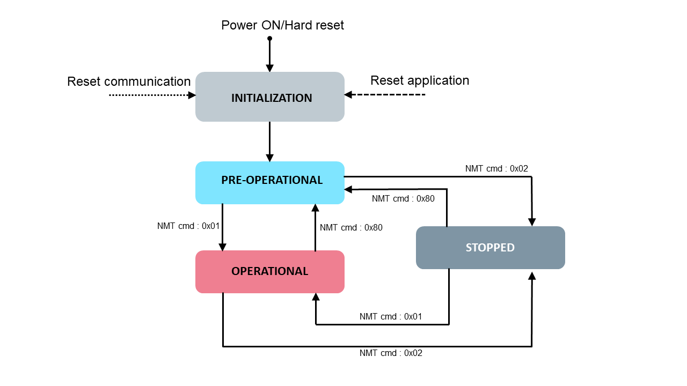

# Network Management (NMT) {#network-management-nmt .p_Heading1 style="page-break-after: avoid;"}

+:----------------------------------------------------------------------------------------------------------------------------------------------------------------------------------------------------------------------------------------------------+-------------------------------------------------------------------------------------------------------------------------------------------------------------+
| **Navigation:**  [System features](system-concepts.html) \> [BSW](bsw.html) \> [Network communication & protocols](network-comm-protocols.html) \> [CANopen](canopen2.html) \> [CANopen protocol description](canopen-protocol-description.html) \> | .html "Previous Topic")  .html "Next Topic") |
|                                                                                                                                                                                                                                                     |                                                                                                                                                             |
| # Network Management (NMT) {#network-management-nmt-1 .p_Heading1 style="page-break-after: avoid;"}                                                                                                                                                 |                                                                                                                                                             |
+-----------------------------------------------------------------------------------------------------------------------------------------------------------------------------------------------------------------------------------------------------+-------------------------------------------------------------------------------------------------------------------------------------------------------------+

The CANopen stack provides the network management objects which are necessary for the function of a master or slave in the network. The term network management refers to the CAN messages which are transmitted to the CAN bus to control or monitor other devices in the network.

 

- Network Management follows a master-slave relationship.

- NMT requires a CANopen device in the network that performs the role of the CANopen master and all other devices have the role of the NMT slave.

- Each NMT slave can be addressed with its node-ID in the range from 1 to127.

- NMT services can be used to initiate, start, monitor, reset or stop CANopen devices.

 

The NMT state machine is shown in the below diagram:

<figure style="margin:0;padding:0">

<figcaption aria-hidden="true">
Figure71: NMT states
</figcaption>
</figure>

 

  Transition                  NMT Command
  --------------------------- -------------
  Switch to Operational       0x01
  Switch to Stop              0x02
  Switch to Pre-Operational   0x80
  Reset Node                  0x81
  Reset Communication         0x82

The below table is an overview of the CANopen services in the respective states. Note that the \"Stopped\" state stops communication completely and only permits control of the NMT state machine.

## CANopen services in different NMT states: {#canopen-services-in-different-nmt-states .p_Heading2 style="page-break-after: avoid;"}

 

  --------------- -------------- ----------------- ------------- ---------
  Service/State   Initializing   Pre-Operational   Operational   Stopped
  PDO             \-             \-                X             \-
  SDO             \-             X                 X             \-
  SYNC            \-             X                 X             \-
  EMCY            \-             X                 X             \-
  NMT             \-             X                 X             X
  BOOT-UP         X              \-                \-            \-
  --------------- -------------- ----------------- ------------- ---------

 

The \"Network Management\" message has CAN-ID 0. A message is always two bytes long and has the following structure:

 

+--------+-----------------------+
| CAN-ID | Data                  |
|        +-------------+---------+
|        | Byte 0      | Byte 1  |
+========+=============+=========+
| 0x000  | NMT Command | Node-ID |
+--------+-------------+---------+

 

  NMT Command   Meaning
  ------------- ---------------------------
  0x01          Switch to Operational
  0x02          Switch to Stop
  0x80          Switch to Pre-Operational
  0x81          Reset Node
  0x82          Reset Communication

 

 

In the NMT command, the value for Node-ID can be 00h. In this case, the NMT command applies to all devices (including the master node) on the CAN bus (broadcast). If a number not equal to zero is used, only the device with the corresponding node-ID is addressed. If the Node-ID is 128h then the NMT command applies to all the slave nodes.

The \"Reset Node\" command completely restarts the controller and the \"Reset Communication\" command only resets the CANopen settings and restarts communication.

 

- Boot-up message

 

CANopen node transmits a boot-up message to indicate to the master controller that it has reached the \"Pre-Operational\" state from the \"initialization\" state.

The boot-up message has CAN-ID \"0x700+NodeID\". The boot-up message is always one byte and has the following structure:

 

+--------------+--------+
| CAN-ID       | Data   |
|              +--------+
|              | Byte 0 |
+==============+========+
| 0x700+NodeID | 0x00   |
+--------------+--------+

 

 

 

 

 

 

 

 

 

 

 
