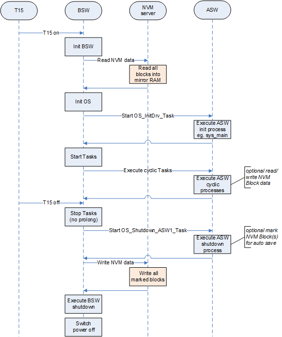
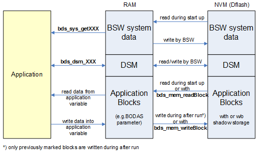
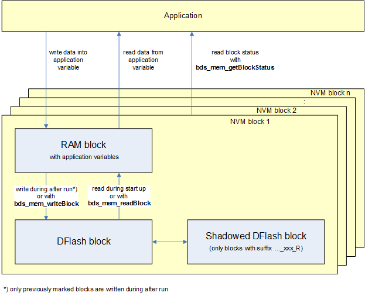

# NVM general description {#nvm-general-description .p_Heading1 style="page-break-after: avoid;"}

+:-------------------------------------------------------------------------------------------------------------------------------------------------+--------------------------------------------------------------------------------------------------------------------------------------+
| **Navigation:**  [System features](system-concepts.html) \> [BSW](bsw.html) \> [Memory](memory.html) \> [NVM management](nvm-management.html) \> |    |
|                                                                                                                                                  |                                                                                                                                      |
| # NVM general description {#nvm-general-description-1 .p_Heading1 style="page-break-after: avoid;"}                                              |                                                                                                                                      |
+--------------------------------------------------------------------------------------------------------------------------------------------------+--------------------------------------------------------------------------------------------------------------------------------------+

The following chapters of the NVM module only describes the application blocks part of the NVM. Further NVM blocks which are used internally by BSW are not mentioned here. The structure of these blocks is not relevant for the application because the access to the corresponding data will be performed by API functions of these BSW modules.

The NVM component provides a uniform interface for memory operations such as reading and writing data to persistent storage (Non Volatile Memory).\
The following figure shows the NVM operations during startup and shut down.

 

<figure style="margin:0;padding:0">

<figcaption aria-hidden="true">
Figure 38: NVM operations during start up
</figcaption>
</figure>

The RAM mirrors of all NVM blocks are automatically loaded with the NVM (Dflash) contents during start up of the system. But during after run or software reset by  bds_sys_resetEcu  these RAM mirrors are stored automatically in the NVM only if the blocks are marked previously with function  bds_mem_markBlock. Therefore the application normally needs not to care about the loading and saving the data.

 

<figure style="margin:0;padding:0">

<figcaption aria-hidden="true">
Figure39: Application access to NVM via RAM mirror
</figcaption>
</figure>

                 

The application can access the application blocks in the NVM only via the RAM mirror. Some NVM data like system data and DSM error storage are handled internally and are only accessible for the application by means of special API functions.

Each NVM block consists of at least one block of persistent data within NVM Dflash and one block of the same size in RAM. The application variables / structures must be mapped directly into specific NVM RAM blocks.

 

<figure style="margin:0;padding:0">

<figcaption aria-hidden="true">
Figure40: NVM block overview
</figcaption>
</figure>

                                 

The NVM API functions can be used by the application to trigger additional write or read (restore) processes of the RAM mirror.

NVM offers following API functions related to NVM blocks:

- Read a block from persistent storage to RAM mirror with function bds_mem_readBlock.

- Write a block from the RAM mirror into the persistent storage with function bds_mem_writeBlock.

- Read the status of the last read/write NVM block operation with function bds_mem_getBlockStatus.

- Mark NVM block for automatically storing during after run with function bds_mem_markBlock.

The read/write operations are carried out in an asynchronous fashion. The NVM user only triggers a job by invoking a NVM service. This service immediately returns after queueing the job request. In general, only one job can be requested at a time for a given block, subsequent job requests for the same block are rejected as long as the previous job did not finish.

After issuing a read or a write request to NVM, the user typically waits for this operation to finish. The standard procedure, in order to determine whether an asynchronous NVM operation is still in progress, is to poll the current block status by calling the function  bds_mem_getBlockStatus.

A table with all available application NVM blocks is shown in chapter [NVM Block Description](nvm-block-description.html){.topiclink}.

Note - Data will be written to NVM only if battery voltage is \>7V.
