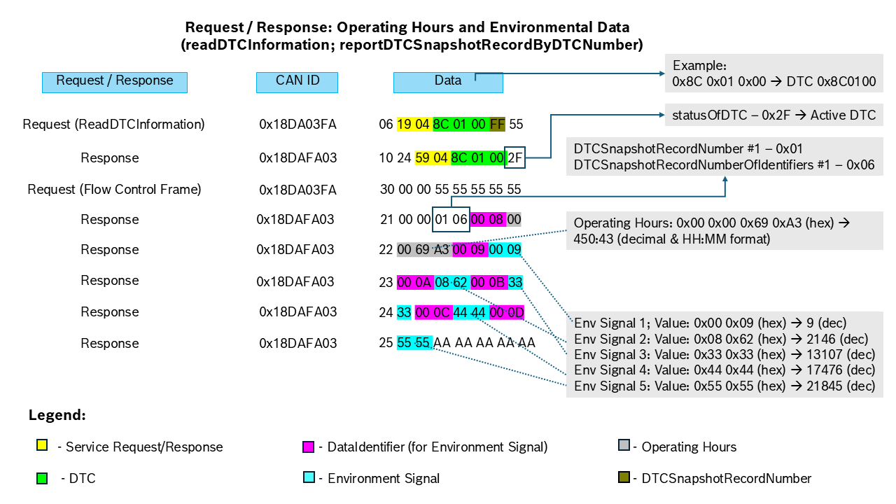

# Operating Hours and Environment Data, Sub-function 0x04 {#operating-hours-and-environment-data-sub-function-0x04 .p_Heading1 style="page-break-after: avoid;"}

+:------------------------------------------------------------------------------------------------------------------------------------------------------------------------------------------------------------------------------------------------------------------------------------------------------------------+----------------------------------------------------------------------------------------------------------------------------------------------------------------------+
| **Navigation:**  [System features](system-concepts.html) \> [BSW](bsw.html) \> [Diagnostic services (UDS)](diagnostic-services.html) \> [UDS overview](uds---overview.html) \> [Supported UDS services](supported-uds-services.html) \> [SID - ReadDTCInformation (0x19)](sid---readdtcinformation-(0x19.html) \> |   .html "Next Topic") |
|                                                                                                                                                                                                                                                                                                                   |                                                                                                                                                                      |
| # Operating Hours and Environment Data, Sub-function 0x04 {#operating-hours-and-environment-data-sub-function-0x04-1 .p_Heading1 style="page-break-after: avoid;"}                                                                                                                                                |                                                                                                                                                                      |
+-------------------------------------------------------------------------------------------------------------------------------------------------------------------------------------------------------------------------------------------------------------------------------------------------------------------+----------------------------------------------------------------------------------------------------------------------------------------------------------------------+

The sub-function 0x04 - reportDTCSnapshotRecordByDTCNumber allows the client to retrieve captured DTCSnapshot record data, primarily:

- Operating hours: Refers to the Operating hours of the RC.

- Environmental data: Refers to the [environmental data](environmental-data.html){.topiclink} of a given DTC.

A sample request and response for the same shall be depicted as follows:

<figure style="margin:0;padding:0">

<figcaption>
Figure 51: Request and response for SID 0x19, Sub-function 0x04
</figcaption>
</figure>

 

 

 
