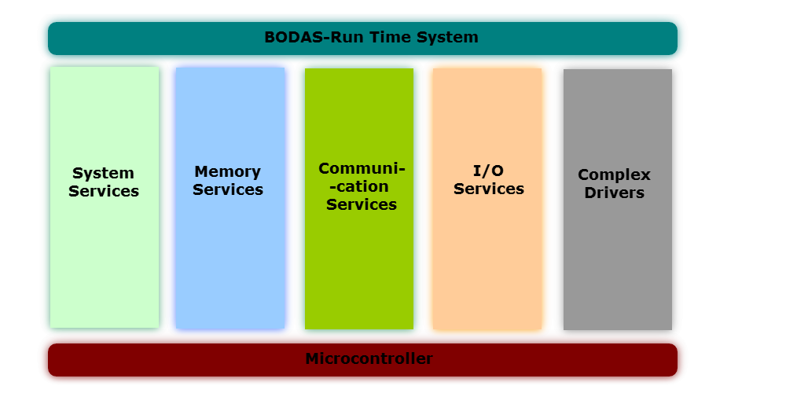

# Overview BODAS-RTS {#overview-bodas-rts .p_Heading1 style="page-break-after: avoid;"}

+:------------------------------------------------------------------------------------------+------------------------------------+
| **Navigation:**  »No topics above this level«                                             |  |
|                                                                                           |                                    |
| # Overview BODAS-RTS {#overview-bodas-rts-1 .p_Heading1 style="page-break-after: avoid;"} |                                    |
+-------------------------------------------------------------------------------------------+------------------------------------+

The modules supported by RC 40 series and the link to the supported APIs is as below:

 

 

{style="margin:0;width:10.4167in;height:5.2083in;border:none"}
