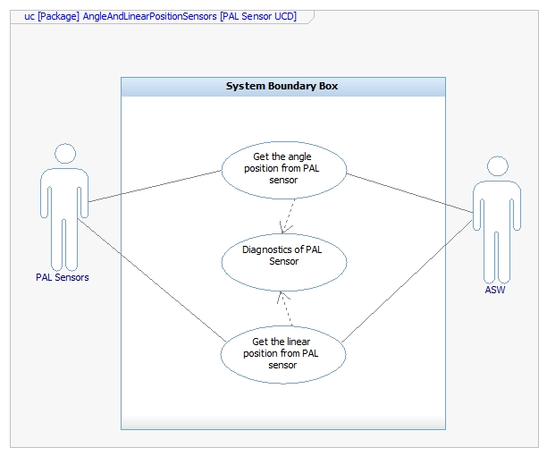

# PAL 2/10 {#pal-210 .p_Heading1 style="page-break-after: avoid;"}

+:-------------------------------------------------------------------------------+------------------------------------------------------------------------------------------------------+
| **Navigation:**  [System features](system-concepts.html) \> [BDL](bdl.html) \> |    |
|                                                                                |                                                                                                      |
| # PAL 2/10 {#pal-210-1 .p_Heading1 style="page-break-after: avoid;"}           |                                                                                                      |
+--------------------------------------------------------------------------------+------------------------------------------------------------------------------------------------------+

This chapter contains an overview about angle and linear position sensors PAL 2/10 (Position sensor for Angular and Linear).

The sensor signals can be directly evaluated by a BODASDriver, for more technical information refer to PAL 2/10 sensor data sheet (RE 95161).

BODASDriver updates:

- The angle position calculation is in milli-degree.

- The linear position calculation is in micro-meter.

- The diagnostics status of the PAL sensor.

- The BODASDriver for PAL 2/10 sensor supports the post build selectable feature, refer to chapter \"[Post build selectable](postbuildselectable.html){.topiclink}\".

- The following functions can be used only for the PAL sensor variant with SENT signals:

obds_snsrPal_getTemp

obds_snsrPal_getFldStrength

obds_snsrPal_getSnsrInfo

The Pal sensors are always providing a two channel measurement. This can be combinations of Analog/Analog, Analog/PWM, PWM/PWM or SENT/SENT signals.

For None-Safety / Safety functionality:

The BODASdriver for PAL 2/10 sensors can be used for safety or None-Safety applications. It is dependent on the configuration that was done in easyConfig for the sensor instance.

The BODASdriver for PAL 2/10 provide the lower safety (None-Safety) information within the bit field of the return status of the API.

 

  ------------------------------------------------------------------------------------------ -----------------------------------------------------------------------------------------------------------------------------------------------------------------------------------------------------------------------
  {style="margin:0;width:2.1667in;height:0.7083in;border:none"}   The BODASdriver library for PAL 2/10 fulfills the needs for safety functionality (EN ISO 13849-1 and ISO 25119) if two input pins are configured in easyConfig for dual-channel operation on different input devices.
  ------------------------------------------------------------------------------------------ -----------------------------------------------------------------------------------------------------------------------------------------------------------------------------------------------------------------------

 

  -------------------------------------------------------------------------------- --------------------------------------------------------------------------------------------------------------------
  {style="margin:0;width:2.1667in;height:0.6979in;border:none"}   The diagnostic status errors of the PAL sensor will be healed automatically, if PAL sensor is in fault free state.
  -------------------------------------------------------------------------------- --------------------------------------------------------------------------------------------------------------------

 

{style="margin:0;width:6.3750in;height:5.3125in;border:none"}

Sensor angle position measurement:

The BODASdriver provides:

- The angle position with a resolution in milli-degree, the range depends on the sensor variant.

Diagnosis of angle position measurement:

The assignment of errors from sensor Output 1 and Output 2 are detected via the measured values from the PAL sensor.

The BODASdriver error detection:

- Possible errors are shown in the return status description, see  bds_snsrPal_getAgr_ts.

Sensor linear position measurement:

The BODASdriver provides:

- The linear position with the resolution of micro-meter, the range is depended on the PAL sensor variant.

Diagnosis of linear position measurement:

The assignment of errors from sensor Output 1 and Output 2 are detected via the measured values from PAL sensor.

The BODASdriver error detection:

- Possible errors are shown in the return status description, see  bds_snsrPal_getLnrPosn_ts.
