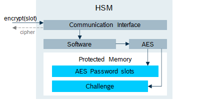
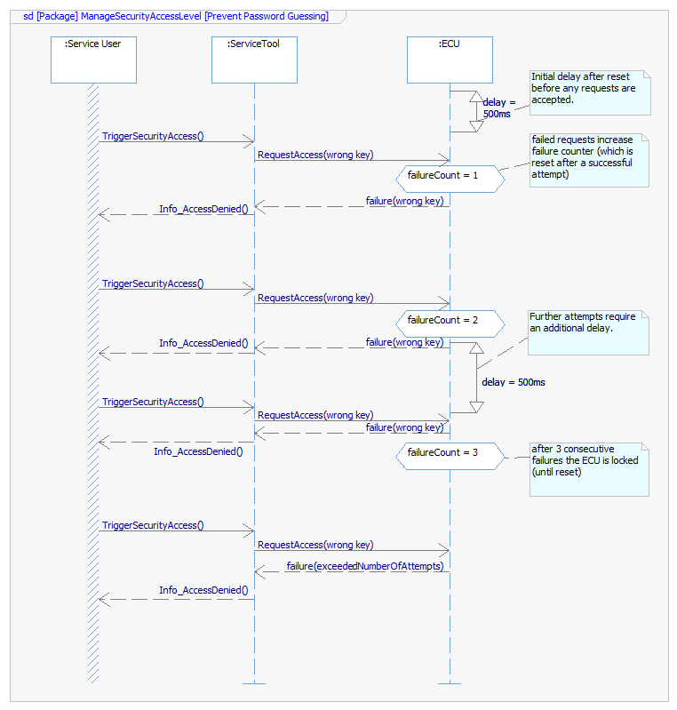

# Password protection {#password-protection .p_Heading1 style="page-break-after: avoid;"}

+:-------------------------------------------------------------------------------------------------------------------------------------------------------------------------------------------------+---------------------------------------------------------------------------------------------------------------------------------------------------+
| **Navigation:**  [System features](system-concepts.html) \> [Security](security.html) \> [Authentication](authentication.html) \> [Diagnostic authentication](diagnostic-authentication.html) \> |    |
|                                                                                                                                                                                                  |                                                                                                                                                   |
| # Password protection {#password-protection-1 .p_Heading1 style="page-break-after: avoid;"}                                                                                                      |                                                                                                                                                   |
+--------------------------------------------------------------------------------------------------------------------------------------------------------------------------------------------------+---------------------------------------------------------------------------------------------------------------------------------------------------+

The authentication password used for the diagnostic authentication is access-protected by the HSM.

- There is one password for each customer access level (10 passwords overall).

- Passwords can be changed by calling  bds_sec_saveSecret.

- Read the [Password Guideline](password-guideline.html){.topiclink} and make sure that you follow all suggested best practices.

- Passwords cannot be retrieved once they are stored on the HSM. Results returned by the HSM interface cannot be used for deriving the original passwords with which the result was calculated.

<figure style="margin:0;padding:0">

<figcaption aria-hidden="true">
Figure22:  The HSM-stored password is inaccessible from outside.
</figcaption>
</figure>

## Prevention of password guessing {#prevention-of-password-guessing .p_Heading2 style="page-break-after: avoid;"}

Password guessing, i.e., trying multiple passwords until the right password is accepted by the device, is a common way to retrieve the used password without knowing it. If the chosen password is strong enough (i.e., hard to guess), a device-internal timeout mechanism reduces the chance of a successful brute-force algorithm within a feasible time window significantly:

1.The initial delay after a reset and the first user request is 500 ms.

2.After entering an invalid password, a delay of 500 ms before the next request prevents systematic password guessing attempts.

3.Once three invalid authentication attempts have been performed, the RC has to be reset to enable further communication.

<figure style="margin:0;padding:0">

<figcaption aria-hidden="true">
Figure23:  Counter mechanic against password guessing.
</figcaption>
</figure>
