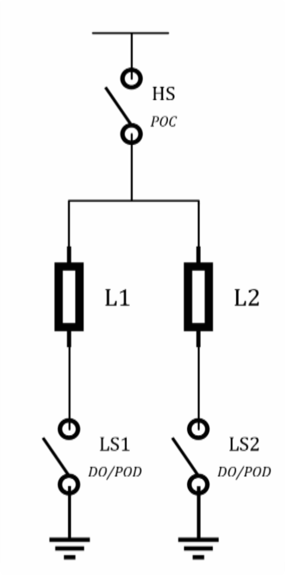
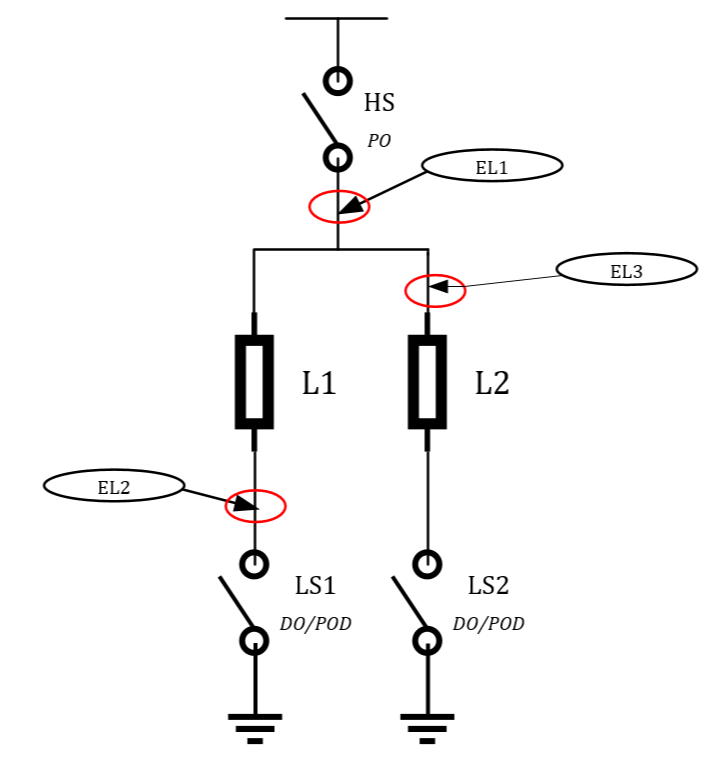

# PHDLS {#phdls .p_Heading1 style="page-break-after: avoid;"}

+:----------------------------------------------------------------------------------------------------------------------------------------------------+------------------------------------------------------------------------------------------------------+
| **Navigation:**  [System features](system-concepts.html) \> [BSW](bsw.html) \> [Outputs](outputs.html) \> [SAFOUT function](safety-outputs.html) \> |    |
|                                                                                                                                                     |                                                                                                      |
| # PHDLS {#phdls-1 .p_Heading1 style="page-break-after: avoid;"}                                                                                     |                                                                                                      |
+-----------------------------------------------------------------------------------------------------------------------------------------------------+------------------------------------------------------------------------------------------------------+

Proportional High - Digital Low Switchable (PHDLS) operating mode.

PHDLS is the combination of 1 PWM (POC) (high-side power output (HS) with close-loop current control (CLCC)) and 2 switchable DOs (digital low-side power output (LS)) or proportional outputs used as a digital outputs (POD):

- Only one LS can be ON at a time (e.g. direction change).

- If the other digital LS is switched ON, a switchover takes place.

- With a set point of zero current, the channel is switched OFF i.e., common outputs and LS\'s are switched OFF, that means, regardless of which LS was switched ON.

 

                   

           

<figure style="margin:0;padding:0">

<figcaption aria-hidden="true">
Figure 84:  SAFOUT channel comprised of a HS with CLCC combined with two digital LS output
</figcaption>
</figure>

## Safety functions {#safety-functions .p_Heading2 style="page-break-after: avoid;"}

Safety functions related to this configuration are

- Safe current control, and

- Safe switching of the actuators

For the safe current control safety function, the high-side power output is considered to be the functional channel.

For the safe switching of the actuators safety function, the low-side power outputs serve as the functional channels.

## Failure detection possibilities of the PHDLS mode {#failure-detection-possibilities-of-the-phdls-mode .p_Heading2 style="page-break-after: avoid;"}

+-------------------------------+----------------------------------------------------+-------------+
| Failure mode                  | Failure detected?                                  | Comments    |
|                               |                                                    |             |
|                               |                                                    |             |
|                               +----------------+----------------+------------------+             |
|                               | Active load    | Inactive load  | Inactive channel |             |
|                               |                |                |                  |             |
|                               | (HS = PWM,     | (HS = PWM,     | (HS = LS = OFF)  |             |
|                               |                |                |                  |             |
|                               | LS = ON)       | LS = OFF)      |                  |             |
+===============================+================+================+==================+=============+
| HS                            | Yes            | Yes            | Yes              | \-          |
|                               |                |                |                  |             |
| short circuit to ground       |                |                |                  |             |
+-------------------------------+----------------+----------------+------------------+-------------+
| HS                            | Yes            | Yes            | Yes              | \-          |
|                               |                |                |                  |             |
| short circuit to battery      |                |                |                  |             |
+-------------------------------+----------------+----------------+------------------+-------------+
| HS                            | Yes            | Yes            | Yes              | \-          |
|                               |                |                |                  |             |
| open circuit                  |                |                |                  |             |
+-------------------------------+----------------+----------------+------------------+-------------+
| LS                            | Yes,           | Yes,           | Yes              | \-          |
|                               |                |                |                  |             |
| short circuit to ground       | with HLCC      | with HLCC      |                  |             |
+-------------------------------+----------------+----------------+------------------+-------------+
| LS                            | Yes            | Yes,           | Yes              | \-          |
|                               |                |                |                  |             |
| short circuit to battery      |                | with HLCC      |                  |             |
+-------------------------------+----------------+----------------+------------------+-------------+
| LS                            | Yes            | No             | Yes              | \-          |
|                               |                |                |                  |             |
| open circuit                  |                |                |                  |             |
+-------------------------------+----------------+----------------+------------------+-------------+
| Over current                  | Yes            | N.A.           | N.A.             | \-          |
+-------------------------------+----------------+----------------+------------------+-------------+
| Mismatch of HS and LS current | Yes,           | N.A.           | N.A.             | \-          |
|                               |                |                |                  |             |
|                               | with HLCC      |                |                  |             |
+-------------------------------+----------------+----------------+------------------+-------------+

## Configuration {#configuration .p_Heading2 style="page-break-after: avoid;"}

Example:

 

#define PHDLS_CHNL1  (PHDLS \| CHNL1)

bds_safout_cfg(PHDLS_CHNL1, K73, K14, K51, 0, 0);

## Use {#use .p_Heading2 style="page-break-after: avoid;"}

Switch ON LS1:(LS1 is ON and LS2 is OFF)

bds_safout(PHDLS_CHNL1, K14, 1000);

 

Switch ON LS2: (LS2 is ON and LS1 is OFF)

bds_safout(PHDLS_CHNL1, K51, 1000);

 

Shut-OFF:

bds_safout(PHDLS_CHNL1, K51, 0);

or

bds_safout(PHDLS_CHNL1, K14, 0);

 

## Diagnostics {#diagnostics .p_Heading2 style="page-break-after: avoid;"}

 

<figure style="margin:0;padding:0">

<figcaption aria-hidden="true">
Figure 85: Error locations (EL) in 1:2 HS-LS combination of SAFOUT
</figcaption>
</figure>

 

The table below indicates the different [diagnostic fault checks (DFC)](diagnostic-fault-check.html){.topiclink} status words that will be displayed in case of different errors (short circuit to battery (SCB) / ground (SCG), open load (OL)) depending on the SAFOUT channel status.

+------------+-----------------------+-----------------------------------------+-----------------------------------------------------+
| Error type | Safout channel status | diag_u32                                | Remarks                                             |
|            |                       |                                         |                                                     |
| some text  |                       |                                         |                                                     |
|            |                       +-------------+-------------+-------------+                                                     |
|            |                       | EL1         | EL2         | EL3         |                                                     |
+============+=======================+=============+=============+=============+=====================================================+
| SCB        | OFF                   | 0x00001     | 0x00001     | 0x00001     | only detected by HS                                 |
|            +-----------------------+-------------+-------------+-------------+-----------------------------------------------------+
|            | ON1                   | 0x00001     | 0x00010     | 0x00001     | \*not detected by LS, detected as current deviation |
+------------+-----------------------+-------------+-------------+-------------+-----------------------------------------------------+
| SCG        | OFF                   | 0x00222     | 0x00220     | 0x00222     |                                                     |
|            +-----------------------+-------------+-------------+-------------+-----------------------------------------------------+
|            | ON1                   | 0x00002     | 0x00000\*   | 0x00002     | \*not detected by LS, detected as Current deviation |
+------------+-----------------------+-------------+-------------+-------------+-----------------------------------------------------+
| OL         | OFF                   | 0x00440     | 0x00040     | 0x00400     | OL is not detected by HS                            |
|            +-----------------------+-------------+-------------+-------------+-----------------------------------------------------+
|            | ON1                   | 0x00004     | 0x00004     | 0x00000\*   | \*OL is not detected                                |
+------------+-----------------------+-------------+-------------+-------------+-----------------------------------------------------+

 

 

1 LS1 ON and LS2 is OFF

 

 

 
