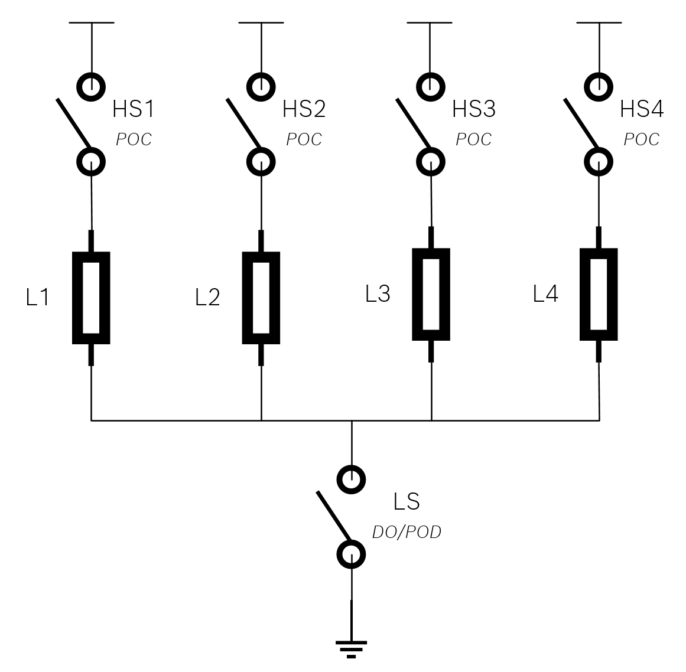
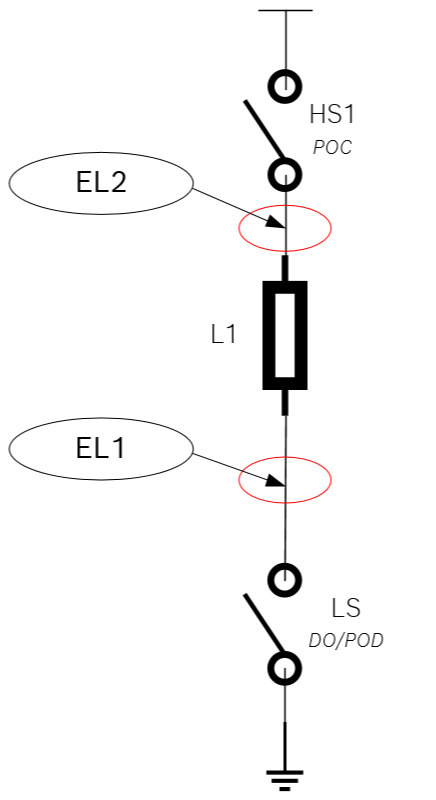
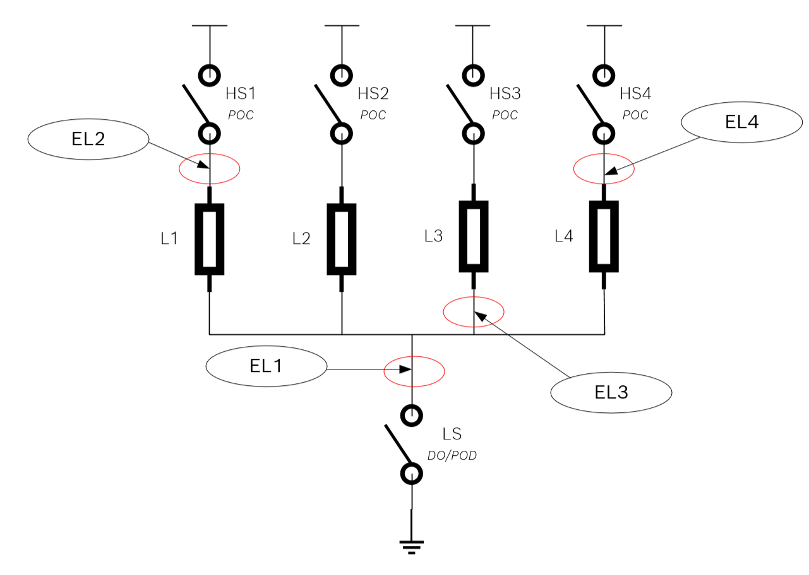

# PHMDL {#phmdl .p_Heading1 style="page-break-after: avoid;"}

+:----------------------------------------------------------------------------------------------------------------------------------------------------+------------------------------------------------------------------------------------------------------+
| **Navigation:**  [System features](system-concepts.html) \> [BSW](bsw.html) \> [Outputs](outputs.html) \> [SAFOUT function](safety-outputs.html) \> |    |
|                                                                                                                                                     |                                                                                                      |
| # PHMDL {#phmdl-1 .p_Heading1 style="page-break-after: avoid;"}                                                                                     |                                                                                                      |
+-----------------------------------------------------------------------------------------------------------------------------------------------------+------------------------------------------------------------------------------------------------------+

Proportional High Multiple - Digital Low (PHMDL) operating mode is the combination of up to 4 parallel PWM POC (high-side proportional power outputs (HS) with close-loop current control (CLCC)) and 1 common DO (digital low-side power output (LS)) or a proportional output used as a digital output (POD).

     

<figure style="margin:0;padding:0">

<figcaption aria-hidden="true">
Figure 86: SAFOUT channel comprised of up to four HS with CLCC combined with a digital LS output
</figcaption>
</figure>

## Safety functions {#safety-functions .p_Heading2 style="page-break-after: avoid;"}

Safety functions related to this configuration are

- Safe current control, and

- Prevention from unintended actuation

For these safety functions, each of the high-side power outputs is considered to be a functional channel.

## Failure detection possibilities {#failure-detection-possibilities .p_Heading2 style="page-break-after: avoid;"}

+-------------------------------+----------------------------------------------------+------------------------------------------------------------------------------------------+
| Failure mode                  | Failure detected?                                  | Comment                                                                                  |
|                               |                                                    |                                                                                          |
|                               |                                                    |                                                                                          |
|                               +----------------+----------------+------------------+                                                                                          |
|                               | Active load    | Inactive load  | Inactive channel |                                                                                          |
|                               |                |                |                  |                                                                                          |
|                               | (HS = PWM,     | (HS = OFF,     | (HS = LS = OFF)  |                                                                                          |
|                               |                |                |                  |                                                                                          |
|                               | LS = ON)       | LS = ON)       |                  |                                                                                          |
+===============================+================+================+==================+==========================================================================================+
| HS                            | Yes            | Yes            | Yes              | \-                                                                                       |
|                               |                |                |                  |                                                                                          |
| short circuit to ground       |                |                |                  |                                                                                          |
+-------------------------------+----------------+----------------+------------------+------------------------------------------------------------------------------------------+
| HS                            | Yes\*          | Yes\*          | Yes              | \* if the ON-time or OFF-time of the channel \< 130 ms, failure detection relies on HLCC |
|                               |                |                |                  |                                                                                          |
| short circuit to battery      |                |                |                  |                                                                                          |
+-------------------------------+----------------+----------------+------------------+------------------------------------------------------------------------------------------+
| HS                            | Yes            | Yes            | No\*\*           | \*\*The API bds_safout_enableTest  can be called by the ASW to detect this failure.      |
|                               |                |                |                  |                                                                                          |
| open circuit                  |                |                |                  |                                                                                          |
+-------------------------------+----------------+----------------+------------------+------------------------------------------------------------------------------------------+
| LS                            | Yes,           | Yes,           | Yes              | \-                                                                                       |
|                               |                |                |                  |                                                                                          |
| short circuit to ground       | with HLCC      | with HLCC      |                  |                                                                                          |
+-------------------------------+----------------+----------------+------------------+------------------------------------------------------------------------------------------+
| LS                            | Yes            | Yes            | Yes              | \-                                                                                       |
|                               |                |                |                  |                                                                                          |
| short circuit to battery      |                |                |                  |                                                                                          |
+-------------------------------+----------------+----------------+------------------+------------------------------------------------------------------------------------------+
| LS                            | Yes            | Yes            | Yes              | \-                                                                                       |
|                               |                |                |                  |                                                                                          |
| open circuit                  |                |                |                  |                                                                                          |
+-------------------------------+----------------+----------------+------------------+------------------------------------------------------------------------------------------+
| Over current                  | Yes            | N.A.           | N.A.             | \-                                                                                       |
+-------------------------------+----------------+----------------+------------------+------------------------------------------------------------------------------------------+
| Mismatch of HS and LS current | Yes,           | Yes,           | N.A.             | \-                                                                                       |
|                               |                |                |                  |                                                                                          |
|                               | with HLCC      | with HLCC      |                  |                                                                                          |
+-------------------------------+----------------+----------------+------------------+------------------------------------------------------------------------------------------+

 

## Configuration {#configuration .p_Heading2 style="page-break-after: avoid;"}

 

Example:

 

#define PHMDL_CHNL1  (PHMDL \| CHNL1)

bds_safout_cfg(PHMDL_CHNL1, K12, K73, K08, K07, 0);

## Use {#use .p_Heading2 style="page-break-after: avoid;"}

 

Switch ON HS1 and HS2:

bds_safout(PHMDL_CHNL1, K73, 1000);    /\* Switch ON HS1:(HS1 is ON ) \*/

bds_safout(PHMDL_CHNL1, K08, 1500);    /\* Switch ON HS2:(HS2 is ON ) \*/

 

Shut-OFF:

bds_safout(PHMDL_CHNL1, K73, 0);

bds_safout(PHMDL_CHNL1, K08, 0);

 

## Diagnostics {#diagnostics .p_Heading2 style="page-break-after: avoid;"}

The diagnostic information of the SAFOUT channel is read using  bds_safout_getStatus.

In the figure below, ELx represents the error location.

 

1 HS : 1 LS configuration  

 

<figure style="margin:0;padding:0">

<figcaption aria-hidden="true">
Figure 87: Error locations (EL) in 1:1 HS-LS combination of SAFOUT
</figcaption>
</figure>

 

The table below indicates the different [diagnostic fault checks (DFC)](diagnostic-fault-check.html){.topiclink} status words that will be displayed in case of different errors (short circuit to battery (SCB) / ground (SCG), open load (OL)) depending on the SAFOUT channel status.

+------------+-----------------------+-----------------------+-----------------------------------------------------+
| Error type | Safout channel status | diag_u32              | Remarks                                             |
|            |                       +-----------+-----------+                                                     |
|            |                       | EL1       | EL2       |                                                     |
+============+=======================+===========+===========+=====================================================+
| SCB        | OFF                   | 0x00011   | 0x00010   |                                                     |
|            +-----------------------+-----------+-----------+-----------------------------------------------------+
|            | ON                    | 0x00001   | 0x00010   |                                                     |
+------------+-----------------------+-----------+-----------+-----------------------------------------------------+
| SCG        | OFF                   | 0x00002   | 0x00002   | only detected by LS                                 |
|            +-----------------------+-----------+-----------+-----------------------------------------------------+
|            | ON                    | 0x00000\* | 0x00020   | \*not detected by LS, detected as Current deviation |
+------------+-----------------------+-----------+-----------+-----------------------------------------------------+
| OL         | OFF                   | 0x00004   | 0x00004   | \*not detected by HS                                |
|            +-----------------------+-----------+-----------+-----------------------------------------------------+
|            | ON                    | 0x00040   | 0x00040\* | \*OL detected only on HS                            |
+------------+-----------------------+-----------+-----------+-----------------------------------------------------+

Note : OL error on HS is not healed if no physical error. Check open load error on LS if no open load error report after 150ms, then no physical OL error

4 HS : 1 LS configuration  

 

<figure style="margin:0;padding:0">

<figcaption aria-hidden="true">
Figure 88: Error locations (EL) in 4:1 HS-LS combination of SAFOUT
</figcaption>
</figure>

The table below indicates the different [diagnostic fault checks (DFC)](diagnostic-fault-check.html){.topiclink} status words that will be displayed in case of different errors (short circuit to battery (SCB) / ground (SCG), open load (OL)) depending on the SAFOUT channel status.

+------------+-----------------------+-----------------------------------------------+-----------------------------------------------------+
| Error type | Safout channel Status | diag_u32                                      | Remarks                                             |
|            |                       +-----------+-----------+-----------+-----------+                                                     |
|            |                       | EL1       | EL2       | EL3       | EL4       |                                                     |
+============+=======================+===========+===========+===========+===========+=====================================================+
| SCB        | OFF                   | 0x11111   | 0x11110   | 0x11111   | 0x11110   |                                                     |
|            +-----------------------+-----------+-----------+-----------+-----------+-----------------------------------------------------+
|            | ON                    | 0x00001   | 0x00010   | 0x00001   | 0x10000   |                                                     |
+------------+-----------------------+-----------+-----------+-----------+-----------+-----------------------------------------------------+
| SCG        | OFF                   | 0x00002   | 0x00002   | 0x00002   | 0x00002   | only detected by LS                                 |
|            +-----------------------+-----------+-----------+-----------+-----------+-----------------------------------------------------+
|            | ON                    | 0x00000\* | 0x00020   | 0x00000\* | 0x20000   | \*not detected by LS, detected as Current deviation |
+------------+-----------------------+-----------+-----------+-----------+-----------+-----------------------------------------------------+
| OL         | OFF                   | 0x00004   | 0x00000\* | 0x00000\* | 0x00000\* | \*not detected by HS,use bds_safout_enableTest      |
|            +-----------------------+-----------+-----------+-----------+-----------+-----------------------------------------------------+
|            | ON                    | 0x55540\* | 0x00040   | 0x04000   | 0x40000   | \*HS1 is ON, other HS\'s OFF                        |
+------------+-----------------------+-----------+-----------+-----------+-----------+-----------------------------------------------------+

 
