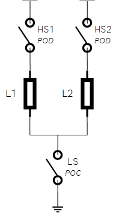
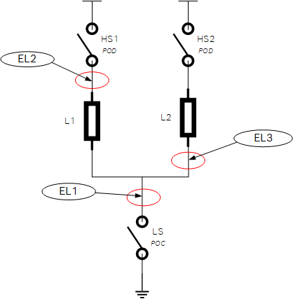

# PLDHS {#pldhs .p_Heading1 style="page-break-after: avoid;"}

+:----------------------------------------------------------------------------------------------------------------------------------------------------+------------------------------------------------------------------------------------------------------+
| **Navigation:**  [System features](system-concepts.html) \> [BSW](bsw.html) \> [Outputs](outputs.html) \> [SAFOUT function](safety-outputs.html) \> |    |
|                                                                                                                                                     |                                                                                                      |
| # PLDHS {#pldhs-1 .p_Heading1 style="page-break-after: avoid;"}                                                                                     |                                                                                                      |
+-----------------------------------------------------------------------------------------------------------------------------------------------------+------------------------------------------------------------------------------------------------------+

Proportional Low - Digital High Switchable (PLDHS) operating mode.

PLDHS is the combination of 1 PWM POC (low-side power output (LS) with close-loop current control (CLCC)) and 2 PODs (switchable digital high-side power outputs (HS)):

- Only one HS can be ON at a time (e.g. direction change).

- If the other digital HS is switched ON, a switchover takes place.

- With a set point of zero current the channel is switched OFF, i.e common output and HS\'s are switched OFF, that means, regardless of which HS was switched ON.

                   

           

<figure style="margin:0;padding:0">

<figcaption aria-hidden="true">
Figure 92: SAFOUT channel comprised of two digital HS combined with a digital LS outputs with CLCC
</figcaption>
</figure>

 

## Safety functions {#safety-functions .p_Heading2 style="page-break-after: avoid;"}

Safety functions related to this configuration are

- Safe current control, and

- Safe switching of the actuators

For the safe current control safety functions, the low-side power output is considered to be the functional channel.

For the safe switching of the actuators safety function, the high-side power outputs serve as the functional channels.

## Failure detection possibilities of the PLDHS mode {#failure-detection-possibilities-of-the-pldhs-mode .p_Heading2 style="page-break-after: avoid;"}

+-----------------------------------+----------------+----------------+------------------+-------------+
| Failure mode                      | Failure detected?                                  | Comment     |
|                                   +----------------+----------------+------------------+             |
|                                   | Active load    | Inactive load  | Inactive channel |             |
|                                   |                |                |                  |             |
|                                   | (HS = ON,      | (HS = OFF,     | (HS = LS = OFF)  |             |
|                                   |                |                |                  |             |
|                                   | LS = PWM)      | LS = PWM)      |                  |             |
+-----------------------------------+----------------+----------------+------------------+-------------+
| HS                                | Yes            | Yes,           | Yes              | \-          |
|                                   |                |                |                  |             |
| short circuit to ground           |                | with HLCC      |                  |             |
+-----------------------------------+----------------+----------------+------------------+-------------+
| HS                                | Yes,           | Yes,           | Yes              | \-          |
|                                   |                |                |                  |             |
| short circuit to battery          | with HLCC      | with HLCC      |                  |             |
+-----------------------------------+----------------+----------------+------------------+-------------+
| HS                                | Yes            | No             | No               | \-          |
|                                   |                |                |                  |             |
| open circuit                      |                |                |                  |             |
+-----------------------------------+----------------+----------------+------------------+-------------+
| LS                                | Yes            | Yes            | Yes              | \-          |
|                                   |                |                |                  |             |
| short circuit to ground           |                |                |                  |             |
+-----------------------------------+----------------+----------------+------------------+-------------+
| LS                                | Yes            | Yes            | Yes              | \-          |
|                                   |                |                |                  |             |
| short circuit to battery          |                |                |                  |             |
+-----------------------------------+----------------+----------------+------------------+-------------+
| LS                                | Yes            | Yes            | Yes              | \-          |
|                                   |                |                |                  |             |
| open circuit                      |                |                |                  |             |
+-----------------------------------+----------------+----------------+------------------+-------------+
| Over current                      | Yes            | N.A.           | N.A.             | \-          |
+-----------------------------------+----------------+----------------+------------------+-------------+
| Mismatch of the HS and LS current | Yes,           | N.A.           | N.A.             | \-          |
|                                   |                |                |                  |             |
|                                   | with HLCC      |                |                  |             |
+-----------------------------------+----------------+----------------+------------------+-------------+

## Configuration {#configuration .p_Heading2 style="page-break-after: avoid;"}

Example:

#define PLDHS_CHNL1  (PLDHS \| CHNL1)

bds_safout_cfg(PLDHS_CHNL1, K16, K73, K08, 0, 0);

## Use {#use .p_Heading2 style="page-break-after: avoid;"}

Switch ON LS1: (LS1 is ON and LS2 is OFF)

bds_safout(PLDHS_CHNL1, K73, 1000);

 

Switch ON LS2: (LS2 is ON and LS1 is OFF)

bds_safout(PLDHS_CHNL1, K08, 1000);

Shut-OFF:

bds_safout(PLDHS_CHNL1, K73, 0);

or

bds_safout(PLDHS_CHNL1, K08, 0);

## Diagnostics {#diagnostics .p_Heading2 style="page-break-after: avoid;"}

 

 

<figure style="margin:0;padding:0">

<figcaption aria-hidden="true">
Figure 93: Error locations (EL) in 2:1 HS-LS combination of SAFOUT
</figcaption>
</figure>

 

+------------+-----------------------+-----------------------------------------+----------------------------------------------------------------+
| Error type | Safout channel status | diag_u32                                | Remarks                                                        |
|            |                       |                                         |                                                                |
| some text  |                       |                                         |                                                                |
|            |                       +-------------+-------------+-------------+                                                                |
|            |                       | EL1         | EL2         | EL3         |                                                                |
+============+=======================+=============+=============+=============+================================================================+
| SCB        | OFF                   | 0x00110     | 0x00110     | 0x00110     | only detected by HS                                            |
|            +-----------------------+-------------+-------------+-------------+----------------------------------------------------------------+
|            | ON1                   | 0x00001     | 0x00000\*   | 0x00001     | \*not detected by LS, detected as current deviation            |
+------------+-----------------------+-------------+-------------+-------------+----------------------------------------------------------------+
| SCG        | OFF                   | 0x00002     | 0x00002     | 0x00002     |                                                                |
|            +-----------------------+-------------+-------------+-------------+----------------------------------------------------------------+
|            | ON1                   | 0x00002     | 0x00000\*   | 0x00002     | \*HS1 is OFF and HS2 is ON, EL2 (0x5) OL can be detected by HS |
+------------+-----------------------+-------------+-------------+-------------+----------------------------------------------------------------+
| OL         | OFF                   | 0x00004     | 0x00000\*   | 0x00000\*   | OL is not detected by HS´s                                     |
|            |                       |             |             |             |                                                                |
|            |                       |             |             |             |                                                                |
|            +-----------------------+-------------+-------------+-------------+----------------------------------------------------------------+
|            | ON1                   | 0x00004     | 0x00000\*   | 0x00000\*   | \*OL is not detected                                           |
+------------+-----------------------+-------------+-------------+-------------+----------------------------------------------------------------+

 

1 HS1 is ON and HS2 is OFF

 
