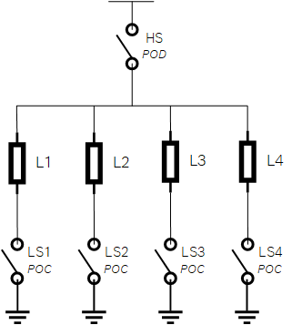
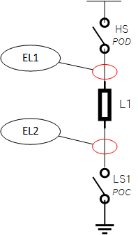
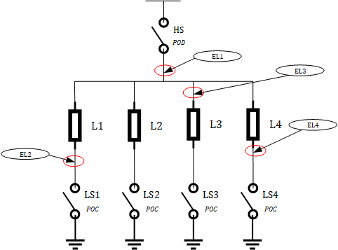

# PLMDH {#plmdh .p_Heading1 style="page-break-after: avoid;"}

+:----------------------------------------------------------------------------------------------------------------------------------------------------+-------------------------------------------------------------------------------------------------------------+
| **Navigation:**  [System features](system-concepts.html) \> [BSW](bsw.html) \> [Outputs](outputs.html) \> [SAFOUT function](safety-outputs.html) \> |    |
|                                                                                                                                                     |                                                                                                             |
| # PLMDH {#plmdh-1 .p_Heading1 style="page-break-after: avoid;"}                                                                                     |                                                                                                             |
+-----------------------------------------------------------------------------------------------------------------------------------------------------+-------------------------------------------------------------------------------------------------------------+

Proportional Low Multiple - Digital High (PLMDH)  operating mode.

PLMDH is the combination of 1 common POD (proportional high-side power output (HS) used as digital output) and up to 4 parallel PWM POCs (proportional low-side power outputs (LS) with close-loop current control (CLCC)).

     

<figure style="margin:0;padding:0">

<figcaption aria-hidden="true">
Figure 94: SAFOUT channel comprised of one digital HS combined with up to four digital LS outputs with CLCC
</figcaption>
</figure>

 

## Safety functions {#safety-functions .p_Heading2 style="page-break-after: avoid;"}

Safety functions related to this configuration are

- Safe current control, and

- Prevention from unintended actuation

For these safety functions, each of the low-side power outputs is considered to be a functional channel.

## Failure detection possibilities of the PLMDH mode {#failure-detection-possibilities-of-the-plmdh-mode .p_Heading2 style="page-break-after: avoid;"}

+-----------------------------------+----------------+----------------+------------------+-------------------------------------------------------------------------------------------------+
| Failure mode                      | Failure detected?                                  | Comment                                                                                         |
|                                   +----------------+----------------+------------------+                                                                                                 |
|                                   | Active load    | Inactive load  | Inactive channel |                                                                                                 |
|                                   |                |                |                  |                                                                                                 |
|                                   | (HS = ON,      | (HS = OFF,     | (HS = LS = OFF)  |                                                                                                 |
|                                   |                |                |                  |                                                                                                 |
|                                   | LS = ON)       | LS = ON)       |                  |                                                                                                 |
+-----------------------------------+----------------+----------------+------------------+-------------------------------------------------------------------------------------------------+
| HS                                | Yes            | Yes            | Yes              | \-                                                                                              |
|                                   |                |                |                  |                                                                                                 |
| short circuit to ground           |                |                |                  |                                                                                                 |
+-----------------------------------+----------------+----------------+------------------+-------------------------------------------------------------------------------------------------+
| HS                                | Yes,           | Yes,           | Yes              | \-                                                                                              |
|                                   |                |                |                  |                                                                                                 |
| short circuit to battery          | with HLCC      | with HLCC      |                  |                                                                                                 |
+-----------------------------------+----------------+----------------+------------------+-------------------------------------------------------------------------------------------------+
| HS                                | Yes            | Yes            | Yes              | \-                                                                                              |
|                                   |                |                |                  |                                                                                                 |
| open circuit                      |                |                |                  |                                                                                                 |
+-----------------------------------+----------------+----------------+------------------+-------------------------------------------------------------------------------------------------+
| LS                                | Yes\*          | Yes\*          | Yes              | \* If the ON-time or OFF-time of the SAFOUT channel \< 130 ms, failure detection relies on HLCC |
|                                   |                |                |                  |                                                                                                 |
| short circuit to ground           |                |                |                  |                                                                                                 |
+-----------------------------------+----------------+----------------+------------------+-------------------------------------------------------------------------------------------------+
| LS                                | Yes            | Yes            | Yes              | \-                                                                                              |
|                                   |                |                |                  |                                                                                                 |
| short circuit to battery          |                |                |                  |                                                                                                 |
+-----------------------------------+----------------+----------------+------------------+-------------------------------------------------------------------------------------------------+
| LS                                | Yes            | Yes            | Yes              | \-                                                                                              |
|                                   |                |                |                  |                                                                                                 |
| open circuit                      |                |                |                  |                                                                                                 |
+-----------------------------------+----------------+----------------+------------------+-------------------------------------------------------------------------------------------------+
| Over current                      | Yes            | N.A.           | N.A.             | \-                                                                                              |
+-----------------------------------+----------------+----------------+------------------+-------------------------------------------------------------------------------------------------+
| Mismatch of the HS and LS current | Yes,           | Yes,           | N.A.             | \-                                                                                              |
|                                   |                |                |                  |                                                                                                 |
|                                   | with HLCC      | with HLCC      |                  |                                                                                                 |
+-----------------------------------+----------------+----------------+------------------+-------------------------------------------------------------------------------------------------+

 

## Configuration {#configuration .p_Heading2 style="page-break-after: avoid;"}

Example:

#define PLMDH_CHNL1  (PLMDH \| CHNL1)

bds_safout_cfg(PLMDH_CHNL1, K73, K16, K14, K15, 0);

## Use {#use .p_Heading2 style="page-break-after: avoid;"}

Switch ON HS1 and HS2:

bds_safout(PLMDH_CHNL1, K16, 1000);    /\* Switch ON LS1:(LS1 is ON ) \*/

bds_safout(PLMDH_CHNL1, K15, 1500);    /\* Switch ON LS2:(LS2 is ON ) \*/

Shut-OFF:

bds_safout(PLMDH_CHNL1, K16, 0);

bds_safout(PLMDH_CHNL1, K15, 0);

 

## Diagnostics {#diagnostics .p_Heading2 style="page-break-after: avoid;"}

The diagnostic information of a safout channel is read using  bds_safout_getStatus.

In the figure, ELx represents the error location.

## 1 HS : 1 LS configuration   {#hs-1-ls-configuration .p_Heading2 style="page-break-after: avoid;"}

##   {#section .p_Heading2 style="page-break-after: avoid;"}

<figure style="margin:0;padding:0">

<figcaption aria-hidden="true">
Figure 95: Error locations (EL) in 1:1 HS-LS combination of SAFOUT
</figcaption>
</figure>

 

 

 

+------------+-----------------------+-----------+---------+-----------------------------------------------+
| Error type | Safout channel status | diag_u32            | Remarks                                       |
|            |                       +-----------+---------+                                               |
|            |                       | EL1       | EL2     |                                               |
+------------+-----------------------+-----------+---------+-----------------------------------------------+
| SCB        | OFF                   | 0x00001   | 0x00001 | only detected by HS                           |
|            +-----------------------+-----------+---------+-----------------------------------------------+
|            | ON                    | 0x00000\* | 0x00010 | \*Not detected, detected as current deviation |
+------------+-----------------------+-----------+---------+-----------------------------------------------+
| SCG        | OFF                   | 0x00022   | 0x00020 |                                               |
|            +-----------------------+-----------+---------+-----------------------------------------------+
|            | ON                    | 0x00002   | 0x00020 |                                               |
+------------+-----------------------+-----------+---------+-----------------------------------------------+
| OL         | OFF                   | 0x00040   | 0x00040 | OL is not detected by HS                      |
|            +-----------------------+-----------+---------+-----------------------------------------------+
|            | ON                    | 0x00040   | 0x00040 | OL is not detected by HS                      |
+------------+-----------------------+-----------+---------+-----------------------------------------------+

Note : OL error on HS is not healed if no physical error. Check open load error on LS: if no open load error reported after 150ms, then there is no physical OL error.

4 LS : 1 HS configuration  

 

<figure style="margin:0;padding:0">

<figcaption aria-hidden="true">
Figure 96: Error locations (EL) in 1:4 HS-LS combination of SAFOUT
</figcaption>
</figure>

 

+------------+-----------------------+-----------+---------+-----------+---------+------------------------------------------------+
| Error type | Safout channel Status | diag_u32                                  | Remarks                                        |
|            |                       +-----------+---------+-----------+---------+                                                |
|            |                       | EL1       | EL2     | EL3       | EL4     |                                                |
+------------+-----------------------+-----------+---------+-----------+---------+------------------------------------------------+
| SCB        | OFF                   | 0x00001   | 0x00001 | 0x00001   | 0x00001 | only detected by HS                            |
|            +-----------------------+-----------+---------+-----------+---------+------------------------------------------------+
|            | ON                    | 0x00000\* | 0x00010 | 0x00000\* | 0x10000 | \* Not detected, detected as current deviation |
+------------+-----------------------+-----------+---------+-----------+---------+------------------------------------------------+
| SCG        | OFF                   | 0x22222   | 0x22220 | 0x22220   | 0x22220 |                                                |
|            +-----------------------+-----------+---------+-----------+---------+------------------------------------------------+
|            | ON                    | 0x00002   | 0x00020 | 0x00002   | 0x20000 |                                                |
+------------+-----------------------+-----------+---------+-----------+---------+------------------------------------------------+
| OL         | OFF                   | 0x44440   | 0x00040 | 0x04000   | 0x40000 | OL is not detected by HS                       |
|            +-----------------------+-----------+---------+-----------+---------+------------------------------------------------+
|            | ON                    | 0x22240\* | 0x00040 | 0x04000   | 0x40000 | \*LS1 is ON, other LS\'s OFF                   |
+------------+-----------------------+-----------+---------+-----------+---------+------------------------------------------------+
