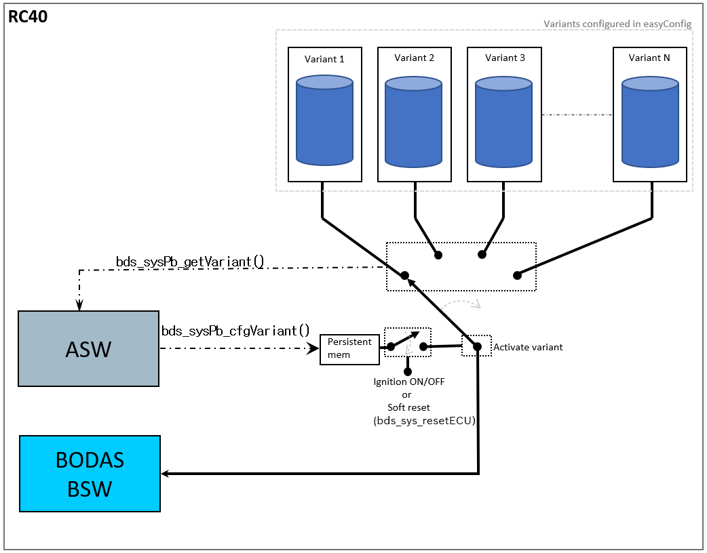

# Post build selectable {#post-build-selectable .p_Heading1 style="page-break-after: avoid;"}

+:--------------------------------------------------------------------------------------------------------------------------+---------------------------------------------------------------------------------------------------------------+
| **Navigation:**  [System features](system-concepts.html) \> [BSW](bsw.html) \> [System services](system-services.html) \> |    |
|                                                                                                                           |                                                                                                               |
| # Post build selectable {#post-build-selectable-1 .p_Heading1 style="page-break-after: avoid;"}                           |                                                                                                               |
+---------------------------------------------------------------------------------------------------------------------------+---------------------------------------------------------------------------------------------------------------+

## Introduction {#introduction .p_Heading2 style="page-break-after: avoid;"}

The RC4x BSW implements the feature called post build selectable. As the name suggests, this feature enables the ASW to select different combinations of BSW configurations after the build. In this feature, it is possible to create multiple variants of configuration or configuration sets for BSW and the ASW can switch between the configured variant.

## Basic working {#basic-working .p_Heading2 style="page-break-after: avoid;"}

{style="margin:0;width:7.2604in;height:5.6875in;border:none"}

- Each post build variants shall be configured in easyConfig.

- The new selected variant via API  bds_sysPb_cfgVariant() is active only after a soft reset via  bds_sys_resetECU or Ignition OFF-ON cycle.

- By default variant-1 (first variant) will be activated in BSW.

 

+--------------------------------------------------------------------------------+----------------------------------------------------------------------------+
| {style="margin:0;width:2.1667in;height:0.6979in;border:none"} | •The post-build selectable feature supports only the input configurations. |
|                                                                                |                                                                            |
|                                                                                | •The BSW supports maximum 16 variants.                                     |
+--------------------------------------------------------------------------------+----------------------------------------------------------------------------+

## Getting started with post-build selectable {#getting-started-with-post-build-selectable .p_Heading2 style="page-break-after: avoid;"}

1.The easyConfig supports \"Post Build Selectable\" view in dashboard.

2.Configure the variants in easyConfig. (refer to easyConfig user manual (\>WF 180) and section \"Post Build Selectable\" for more details and steps of configuration)

3.In ASW, call API bds_sysPb_cfgVariant() to select the required variant.

4.Issue a soft reset (API) or Ignition OFF and ON, to activate the ECU with a configured variant in STEP 3.

5.After reset, API bds_sysPb_getVariant can be used to check if the desired variant is activated.

##   {#section .p_Heading2 style="page-break-after: avoid;"}

 

 

 

 
