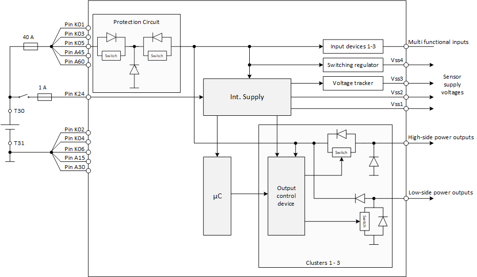

# Power supply concept {#power-supply-concept .p_Heading1 style="page-break-after: avoid;"}

+:--------------------------------------------------------------------------------------------------------------------+----------------------------------------------------------------------------------------------------------------------------------+
| **Navigation:**  [System features](system-concepts.html) \> [BSW](bsw.html) \> [Power supply](power-supply.html) \> |    |
|                                                                                                                     |                                                                                                                                  |
| # Power supply concept {#power-supply-concept-1 .p_Heading1 style="page-break-after: avoid;"}                       |                                                                                                                                  |
+---------------------------------------------------------------------------------------------------------------------+----------------------------------------------------------------------------------------------------------------------------------+

 

<figure style="margin:0;padding:0">

<figcaption aria-hidden="true">
Figure97: RC18-12/40 and RC27-18/40 power supply concept
</figcaption>
</figure>

The RCs monitor periodically the battery voltage, their internal voltages, the sensor supply voltages and take corresponding actions to ensure the functional safety (details see [Failure detection possibilities](failuredetectionpossibilities.html){.topiclink}).  The various voltages can also be read by the ASW via API functions (see  bds_sys_aiv,  bds_sys_getVSS for more details)

The RCs can be used in 12 V or 24 V battery networks within a voltage range for normal operation mode from 11 V to 32 V. Since an allowable supply voltage for 24 V battery network (e.g. 30 V) would be hazardous for a 12 V battery network, it is therefore suggested for the machine manufacturers to define valid voltage supply ranges for their applications and to implement corresponding diagnostic methods in the ASW. Behaviors of the RCs regarding supply voltages are given in [\[RE95207\]](references.html#re_95207){.topiclink}, [\[RE95208\]](references.html#re_95208){.topiclink}, which could be taken as a reference.

 

 

  ----------------------------------------------------------------------------------------------------------------- -------------------------------------------------------------------------------------------------------------------------------------------------------------------
  {style="margin:0;width:1.4792in;height:0.2813in;border:none"}   The measurement of the battery voltage in the RC has a tolerance of ±6% referred to 32 V. This uncertainty shall to be considered by the ASW monitoring function.
  ----------------------------------------------------------------------------------------------------------------- -------------------------------------------------------------------------------------------------------------------------------------------------------------------

 

  ----------------------------------------------------------------------------------------------------------------- -----------------------------------------------------------------------------------------------------------------------------
  {style="margin:0;width:1.4792in;height:0.2813in;border:none"}   The inverted diesel engine start pin ("Terminal X") should NOT be used to disable power supply via inhibit (pins 21 and 22)
  ----------------------------------------------------------------------------------------------------------------- -----------------------------------------------------------------------------------------------------------------------------

 
