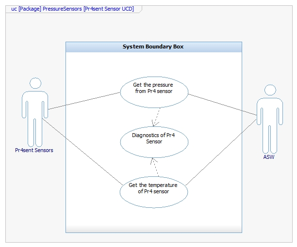

# PR4 {#pr4 .p_Heading1 style="page-break-after: avoid;"}

+:-------------------------------------------------------------------------------+-------------------------------------------------------------------------------------------------+
| **Navigation:**  [System features](system-concepts.html) \> [BDL](bdl.html) \> |    |
|                                                                                |                                                                                                 |
| # PR4 {#pr4-1 .p_Heading1 style="page-break-after: avoid;"}                    |                                                                                                 |
+--------------------------------------------------------------------------------+-------------------------------------------------------------------------------------------------+

This chapter contains an overview about pressure sensors PR4 SENT/Analog.

The sensor signal can be directly evaluated by a BODASdriver, for more technical information refer to PR4 SENT/Analog sensor data sheet (RE 95156).

 

The BODASdriver for PR4 sensors provides this information/features:

- The measured pressure in decibar.

- The temperature detection in degree Celsius is only available with the PR4 SENT sensor.

- The diagnostics status information.

- The BODASdriver for PR4 SENT/Analog sensor supports the feature post build selectable, refer to chapter \"[Post build selectable](postbuildselectable.html){.topiclink}\".

 

  -------------------------------------------------------------------------------- ----------------------------------------------------------------------------------------------------------------------------------
  {style="margin:0;width:2.1667in;height:0.6979in;border:none"}   Errors displayed in the diagnostic status of the PR4 sensor are automatically reset/healed as soon as the error has disappeared.
  -------------------------------------------------------------------------------- ----------------------------------------------------------------------------------------------------------------------------------

 

{style="margin:0;width:6.3750in;height:5.3125in;border:none"}

Sensor pressure measurement:

The BODASdriver provides:

- The pressure in a range of 0 decibar up to used PR4 SENT sensor type 500/2800/4200/6000 decibar and for the PR4 Analog sensor type 500/1000/2800/4000/4200/6000 decibar.

- The pressure in decibar from 0 to the maximum depends on the range of the selected sensor type:

oFor PR4 sent: 500, 2800, 4200 or 6000

oFor PR4 analog: 500, 1000, 2800, 4000, 4200 or 6000

Diagnosis for PR4 SENT sensor type:

The assignment of errors from SENT Fast-Channel are detected via the measured digit value from PR4 SENT sensor.

The BODASdriver detects:

- Pressure value out of range:

oC3 (reduced accuracy) \< value \< C4 (high clamp) -\> output value is set to the max of the sensor type

oC2 (reduced accuracy) \> value \> C1 (low clamp) -\> output value is set to 0 decibar

- Pressure value initialization:

ovalue \< C1 -\> output value is set to 0 decibar

- Pressure value error:

ovalue \> C4 -\> output value is set to 0 decibar

Remark:\
Definition of parameter C1, C2, C3, C4 refer to PR4 SENT sensor data sheet (RE 95156).

Diagnosis for PR4 Analog sensor type:

The assigned errors are derived from the measured analog voltage value.

The BODASdriver detects:

- Pressure value out of range:

o4.5V (reduced accuracy) \< value \< 4.8 (high clamp) -\> output value is set to the max of the sensor type

o0.5V (reduced accuracy) \> value \> 0.2V (low clamp) -\> output value is set to 0 decibar

- Pressure value short cut to ground:

ovalue \<= 0.2V -\> output value is set to 0 decibar

- Pressure value open load and short cut to battery:

ovalue \>= 4.8V -\> output value is set to 0 decibar

Remark:\
Definition of diagnosis analog voltage values refer to PR4 Analog sensor data sheet (RE 95156).

Sensor temperature detection (only applicable for PR4 SENT) :

The BODASdriver provides:

- The temperature in degrees of Celsius, from -40 to 140.

Diagnosis:

The assignment of errors derived from the temperature value received via the Fast-Channel data of the SENT interface:

The BODASdriver detects:

- Temperature value out of range:

ovalue \< -40 degrees of Celsius -\> output value temperature is set to -40 degrees of Celsius

ovalue \> 140 degrees of Celsius -\> output value temperature is set to 140 degrees of Celsius

The assignment of errors derived from the digital value received via the Slow-Channel data message ID 0x01 of the SENT interface:

The assignment of errors from SENT Slow-Channel are detected via the \"Error codes\", for more technical information refer to PR4 SENT sensor data sheet (RE 95156).

The BODASdriver detects:

- Low or high voltage supply (threshold exceeded), error code 32 or 33

- Pressure is above the limit, error code 2056

- Overflow or saturation in supply voltage path or signal path, error code 2079 or 2075

 
