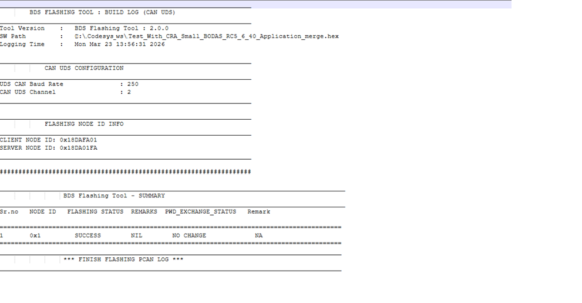

# Report Generation {#report-generation .p_Heading1 style="page-break-after: avoid;"}

+:-------------------------------------------------------------------------------------------------------------------------------------------------------------------------+--------------------------------------------------------------------------------------------------------------------------------------------------+
| **Navigation:**  [How-Tos](how-to.html) \> [Flashing using CODESYS IDE](required-tools_2.html) \> [BDS Flashing Tool Scope of Features](step-3install-library_2.html) \> |    |
|                                                                                                                                                                          |                                                                                                                                                  |
| # Report Generation {#report-generation-1 .p_Heading1 style="page-break-after: avoid;"}                                                                                  |                                                                                                                                                  |
+--------------------------------------------------------------------------------------------------------------------------------------------------------------------------+--------------------------------------------------------------------------------------------------------------------------------------------------+

Report Generation generates a log file with information regarding the flashing procedure.

oHex file path and name

oLog time

oBaud rate and CAN channel used

oClient and Server Node IDs

oFlashing summary in case of success or failure

 

 

Step 1: Create an empty text file e.g (debug.txt).

Step 2: Provide the text file path in the config.ini.

By creating an empty text file and providing it to the config.ini the flashing tool will create the following log.

See the following example where debug.txt is used.

 

 

{style="margin:0;width:10.3229in;height:5.3750in;border:none"}

 

                                                         Flashing Report

 

 

 
