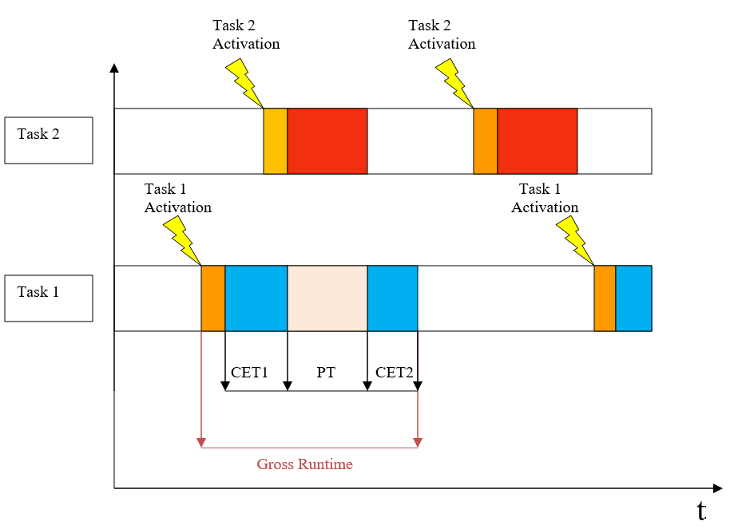

# Runtime Measurement of System Core and Tasks {#runtime-measurement-of-system-core-and-tasks .p_Heading1 style="page-break-after: avoid;"}

+:----------------------------------------------------------------------------------------------------------------------------------------------+---------------------------------------------------------------------------------------------------------------------------------------+
| **Navigation:**  [System features](system-concepts.html) \> [Application integration](application-integration.html) \>                        |    |
|                                                                                                                                               |                                                                                                                                       |
| # Runtime Measurement of System Core and Tasks {#runtime-measurement-of-system-core-and-tasks-1 .p_Heading1 style="page-break-after: avoid;"} |                                                                                                                                       |
+-----------------------------------------------------------------------------------------------------------------------------------------------+---------------------------------------------------------------------------------------------------------------------------------------+

 

The main purpose of performing Runtime measurement on system cores and registered tasks is to make sure Operating System works as intended,scheduling of process can be done correctly and CPU load can be managed properly.

Runtime Measurement process provides information of the usage resources like:

 

- CPU Core Load.

- Task Runtime.

 

 

<figure style="margin:0;padding:0">

<figcaption aria-hidden="true">
Figure 28: Task measurement
</figcaption>
</figure>

                                                                           

 

From above figure we can see two tasks Task2(Higher priority) and Task1(Lower priority)

Pre Emptive time (PT) : Time a task is left in a pre-emptive state waiting to resume.

Net Runtime : Amount of time elapsed by task on CPU core (Execution time not including pre-emptive time) and measurement does not includes interrupts.

Core Execution time (CET) : Execution time of task on CPU Core.

Net Runtime = CET1+CET2.

Gross Runtime : Amount of time elapsed since task is activated until it terminates and measurement includes with interrupts.

 

Average Runtime: Average net runtime of the task in the last elapsed time frame.

Average runtime is calculated for each task is done by dividing the accumulated runtime by call count.

Call Count: The number of calls in the last time frame.

Average runtime = Accumulated runtime/call count.

BSW provides following task measurement parameters for a given task:

   Parameter              Definition
  ----------------------- ----------------------------------------------------------------------------
  Current Gross Runtime    The gross runtime from the last cycle of the task in microsecond(µs).
  Minimum Gross Runtime    The minimum gross runtime of the task since last reset of the ECU in µs.
  Maximum Gross Runtime    The maximum gross runtime of the task since last reset of the ECU in µs.
  Minimum Net  Runtime     The minimum net runtime of the task since last reset of the ECU in µs.
  Maximum Net Runtime      The maximum net runtime of the task since last reset of the ECU in µs
  Current Net Runtime      The net runtime from the last cycle of the task in µs.
  Average Net Runtime      The average net runtime of the task in the last elapsed time frame in µs.

 

BSW provide following core load measurement parameters for a give core:

  Parameter                Definition
  ------------------------ ----------------------------------------------------------------------------------------
  Current Core Load        The current load of each core is acquired on every end of the time frame in percentage
  Current Cycle Max Load   The maximum core load in current drive cycle in percentage
  Life Cycle Max Load      The maximum core load in lifetime in percentage (stored in NVM).

 

 

 

 

 

 

 

 

 

 

 

 
