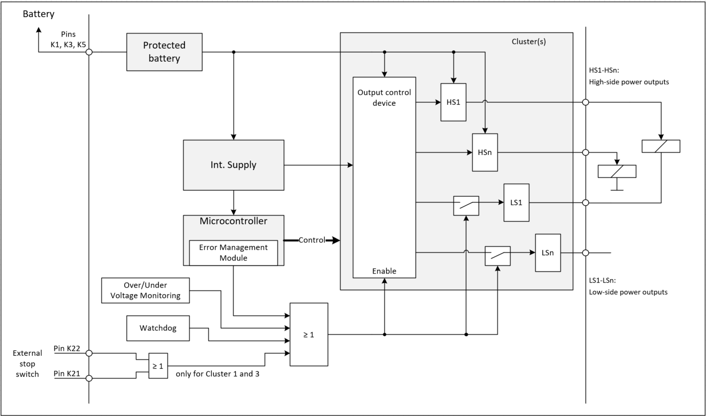

# Safety-related outputs ─ power outputs in safe output configuration {#safety-related-outputs-power-outputs-in-safe-output-configuration .p_Heading1 style="page-break-after: avoid;"}

+:------------------------------------------------------------------------------------------------------------------------------------------------------------------------------------------+-----------------------------------------------------------------------------------------------------------------------------------------------+
| **Navigation:**  [Safety manual](safety-manual.html) \>                                                                                                                                   |    |
|                                                                                                                                                                                           |                                                                                                                                               |
| # Safety-related outputs ─ power outputs in safe output configuration {#safety-related-outputs-power-outputs-in-safe-output-configuration-1 .p_Heading1 style="page-break-after: avoid;"} |                                                                                                                                               |
+-------------------------------------------------------------------------------------------------------------------------------------------------------------------------------------------+-----------------------------------------------------------------------------------------------------------------------------------------------+

## Description of the SAFOUT function {#description-of-the-safout-function .p_Heading2 style="page-break-after: avoid;"}

For safety-related applications, high-side (HS) power outputs shall be used in combination with low-side (LS) power outputs to control an actuator (see the following figure). With the interconnection an additional Shut-OFF path is implemented in the SAFOUT module. The SAFOUT function initiates an error message and switches off the channel in the event of a safety-critical fault (see [Failure detection possibilities](failuredetectionpossibilities.html){.topiclink}). The output can only be switched on again by the application. The conditions under which the failure detection capabilities for each safe output configuration and the corresponding diagnostic coverage are valid can be found in [Failure detection capability of different safe output configurations](failuredetectionsafeoutput.html){.topiclink}. For configuration of the SAFOUT module see [SAFOUT function](safety-relatedoutputs.html){.topiclink} and  SAFOUT module.

 

<figure style="margin:0;padding:0">

<figcaption aria-hidden="true">
Figure 120: Control concept of power outputs
</figcaption>
</figure>

For RC18-12/40 and RC27-18/40, 6 safe output configurations (SAFOUT modes) are supported (see [Safety outputs](safety-outputs.html){.topiclink}).

The following modes are provided for the interconnection:

- [PHDLS](phdls.html){.topiclink}

- [DHDLM](dhdlm.html){.topiclink}

- [PHMDL](phmdl.html){.topiclink}

- [PLDHS](pldhs.html){.topiclink}

- [DLDHM](dldhm.html){.topiclink}

- [PLMDH](plmdh.html){.topiclink}

 

Only the power outputs (listed in the following table) are allowed to be used for safety-related applications. Detailed description of functions and characteristics of the power outputs can be found in [\[RE95207\]](references.html#re_95207){.topiclink}, [\[RE95208\]](references.html#re_95208){.topiclink}.

 

 

 

+-------------------------+-----------------------------------------------------------------------------------------------+
| Type                    | Connector pin number                                                                          |
|                         +------------------------------+------------------------------+---------------------------------+
|                         | Output cluster 1             | Output cluster 2             | Output cluster 3                |
|                         |                              |                              |                                 |
|                         |                              |                              | (only available for RC27-18/40) |
+=========================+==============================+==============================+=================================+
| High-side power outputs | K07, K08, K09, K29, K73, K17 | A31, A32, A33, A46, A47, A48 | A34, A35, A51, A52, A53, A54    |
+-------------------------+------------------------------+------------------------------+---------------------------------+
| Low-side power outputs  | K12, K13, K14, K15, K16, K51 | A03, A04, A05, A18, A19, A20 | A02, A07, A08, A09, A10, A17    |
+-------------------------+------------------------------+------------------------------+---------------------------------+

[]{#fig_ff3c89 .hmanchor}Table 30: Power outputs allowed for safety-related applications in RC18-12/40 and RC27-18/40

 

 

+-------------------------------------------------------------------------------------------------------------------------------------------------+
| {style="margin:0;width:8.3333in;height:0.4583in;border:none"}                                                            |
+=================================================================================================================================================+
| Controlling an actuator with stand-alone power output does not have an independent Shut-OFF path.                                               |
|                                                                                                                                                 |
| •For safety-related applications, only high-side power outputs in combination with low-side power outputs shall be used to control an actuator. |
+-------------------------------------------------------------------------------------------------------------------------------------------------+

 

+------------------------------------------------------------------------------------------------------------------------------------------------------+
| {style="margin:0;width:8.3333in;height:0.4583in;border:none"}                                                                 |
+======================================================================================================================================================+
| For RC18-12/40 and RC27-18/40, the cluster 2 power outputs will NOT be switched-off by the external stop switch.                                     |
|                                                                                                                                                      |
| •Special attention shall be paid when using a safe output configuration with cluster 2 power outputs for the safety function „external stop switch". |
+------------------------------------------------------------------------------------------------------------------------------------------------------+

 

+-------------------------------------------------------------------------------------------------------------------------------------------------------------------------------------------------------------------------------------------------------------------------------+
| {style="margin:0;width:8.3333in;height:0.4479in;border:none"}                                                                                                                                                                                            |
+===============================================================================================================================================================================================================================================================================+
| RCs provide the flexibility to combine up to four high-side power outputs with a single low-side power output and vice verse in one safe output configuration.                                                                                                                |
|                                                                                                                                                                                                                                                                               |
| •It must be ensured that the accumulated current of the multiple power outputs does not exceed the maximum current limit of a single power output (for details see [\[RE95207\]](references.html#re_95207){.topiclink}, [\[RE95208\]](references.html#re_95208){.topiclink}). |
+-------------------------------------------------------------------------------------------------------------------------------------------------------------------------------------------------------------------------------------------------------------------------------+

 
