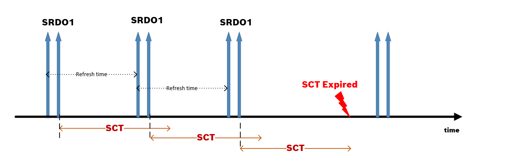
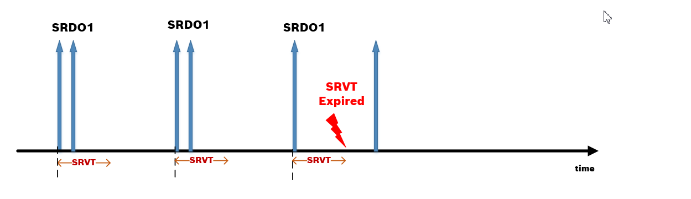

# Safety Relevant Data Object (SRDO) {#safety-relevant-data-object-srdo .p_Heading1 style="page-break-after: avoid;"}

+:----------------------------------------------------------------------------------------------------------------------------------------------------------------------------------------------------------------------------------------------------+-----------------------------------------------------------------------------------------------------------------------------------------------------------+
| **Navigation:**  [System features](system-concepts.html) \> [BSW](bsw.html) \> [Network communication & protocols](network-comm-protocols.html) \> [CANopen](canopen2.html) \> [CANopen protocol description](canopen-protocol-description.html) \> | .html "Previous Topic")  .html "Next Topic") |
|                                                                                                                                                                                                                                                     |                                                                                                                                                           |
| # Safety Relevant Data Object (SRDO) {#safety-relevant-data-object-srdo-1 .p_Heading1 style="page-break-after: avoid;"}                                                                                                                             |                                                                                                                                                           |
+-----------------------------------------------------------------------------------------------------------------------------------------------------------------------------------------------------------------------------------------------------+-----------------------------------------------------------------------------------------------------------------------------------------------------------+

Safety relevant data object is defined in CiA-304 specification which is also referred to as \"CANopen safety\". The ASW can exchange safety-related data using CANopen Safety. EN 50325-5 is the standard for CANopen Safety and CiA-304 is derived from this standard.

 

  -------------------------------------------------------------------------------- ----------------------------------------------------------------------------------------------------------------------------------------------------------
  {style="margin:0;width:2.1667in;height:0.6979in;border:none"}   The CANopen library uses the \"Black Channel Principle\" ( refer EN 50325-5). SRDO should be used for sending and receiving \"safety-critical objects\".
  -------------------------------------------------------------------------------- ----------------------------------------------------------------------------------------------------------------------------------------------------------

 

The CiA-304 standard defines the following items:

1\. SRDO (Safety relevant data object)

2\. SCT (Safeguard cycle time)

3\. SRVT (Safety relevant object validation time)

4\. SRDO Configurations

## SRDO (Safety-Relevant Data Object) {#srdo-safety-relevant-data-object .p_Heading2 style="page-break-after: avoid;"}

Safety-relevant data objects (SRDO) serve the cyclic exchange of safe data in the  NMT operational state. This is an add-on protocol that is implemented alongside existing protocols like PDO, SDO, SYNC, etc.

 

1\. An SRDO shall consist of two CAN data frames with identifiers, which shall be different in at least two-bit positions. The CAN identifier of the 1st CAN message is always odd, the CAN identifier of the 2nd CAN message is always even.

2\. The user data in both transmissions are redundant, i.e. the meaning of the data is the same, but the data on the 2nd transmission is inverted bitwise.

3\. SRDOs shall be transmitted periodically. If required, SRDOs may also be transmitted event-driven, e.g. to ensure fast reaction after a safety-critical change on the input.

4\. SRDOs shall be only allowed in the NMT state operational.

5\. An SRDO shall be only valid if both CAN frames are received properly (without failure and in time).

6\. SRDO is used for both directions - Transmission and Reception.

 

## SCT (Safeguard cycle time) {#sct-safeguard-cycle-time .p_Heading2 style="page-break-after: avoid;"}

For monitoring the correct functionality of periodical SRDO on a network, the device shall be assigned with SCT. The receiver monitors the cyclical reception using the parameter SCT. When SCT expires, then it qualifies to be a safety event. The application can decide if the device shall enter into a safe state based on the criticality of data exchanged over SRDO.

 

<figure style="margin:0;padding:0">

<figcaption aria-hidden="true">
Figure 72: Safeguard cycle time
</figcaption>
</figure>

## SRVT (Safety-relevant object validation time) {#srvt-safety-relevant-object-validation-time .p_Heading2 style="page-break-after: avoid;"}

A device shall be assigned with an SRVT for monitoring. Both CAN frames that make for an SRDO shall be received correctly within the given SRVT by the receiver. Both CAN frames in SRDO shall be transmitted with minimum delay. If the 2nd frame is not received within SRVT then this can be an indication of insufficient transmission capabilities, i.e. too much traffic on the bus. This condition qualifies to be a safety event, the application can decide if the device shall enter into a safe state based on the criticality of data exchanged over SRDO.

 

<figure style="margin:0;padding:0">

<figcaption aria-hidden="true">
Figure 73: Safety-relevant object validation time
</figcaption>
</figure>

## SRDO Configurations {#srdo-configurations .p_Heading2 style="page-break-after: avoid;"}

 

- [Object 1301h to 1310h](object-0x1301-to-0x1310-srdo-c.html){.topiclink} SRDO communication Parameters

   SRDO communication parameters allow below configurations:

  Sub-index 1 - Direction of SRDO:  

   0 - Not initialized,

   1 - Transmit

   2 - Receive

 If the direction of SRDO is \"transmit\":

Sub-index 2 - Refresh time: Interval time for sending an SRDO.

Sub-index 3 - not used

 

 If the direction of SRDO is \"receive\":

Sub-index 2 - SCT: SRDO cycle monitoring time.

Sub-index 3 - SRVT: monitoring time between two SRDO telegrams (normal and inverted)

 

   Subindex 5 and subindex 6 are COBID 1 and COBID 2, this specifies CAN ID used for telegram 1 and telegram 2 respectively.

 

- [Object 1381h to 1390h](object-0x1381-to-0x1390-srdo-m.html){.topiclink} SRDO mapping parameter contains the SRDO configurations.

  SRDO mapping parameter allows configurations of mapped objects for SRDO.

  Subindex 0: Number of Mapped objects

  SubIndex 1 to 16: Index, sub-index, and size of the mapped object  for SRDO telegram 1 and telegram 2

 

- [Object 0x13FE](object-0x13fe-configuration-va.html){.topiclink} and [object 0x13FF](object-0x13ff-safety-configura.html){.topiclink}

   Valid checksum for given SRDO is written in [object 0x13FF](object-0x13ff-safety-configura.html){.topiclink} and valid configuration 0xA5 is written into [object 0x13FE](object-0x13fe-configuration-va.html){.topiclink}. The value 0xA5 in [object 0x13FE](object-0x13fe-configuration-va.html){.topiclink} indicates configuration valid and all other values shall indicate invalid configurations.

 

The above configuration is allowed only in the NMT PRE-OPERATIONAL state. When switching to NMT OPERATIONAL, the [object 0x13FE](object-0x13fe-configuration-va.html){.topiclink} is checked for 0xA5 value. Then the checksum is calculated for the SRDO communication parameter and mapping parameter of each SRDO, calculated checksum is then validated against the checksum stored in [object 13FFh](object-0x13ff-safety-configura.html){.topiclink}. If two checksum is not equal, then SRDO communication is not allowed. [Object 13FEh](object-0x13fe-configuration-va.html){.topiclink} provides the user to maintain a status flag for configuration valid i.e on write access to any SRDO configuration object, [object 13FEh](object-0x13fe-configuration-va.html){.topiclink} is automatically set to invalid configuration, after configuration is done user writes \"valid\" value to [object 13FEh](object-0x13fe-configuration-va.html){.topiclink}

The procedure of changing the configuration data for SRDO

1\. Update SRDO communication parameter as desired in [object 0x1301 to 0x1310](object-0x1301-to-0x1310-srdo-c.html){.topiclink}.

2\. Update SRDO mapping parameter as desired in [object 0x1381 to 0x1390](object-0x1381-to-0x1390-srdo-m.html){.topiclink}.

3\. Enter the new valid checksum for respective SRDO in [object 0x13FF](object-0x13ff-safety-configura.html){.topiclink}.

4\. Switch the relevant configuration to valid by entering configuration valid value (0xA5) in [object 0x13FE](object-0x13fe-configuration-va.html){.topiclink}.

 

 

 

 

 

 

 

 
