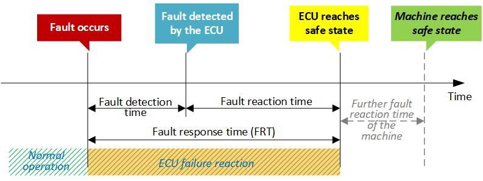

# Operating conditions for safety applications {#operating-conditions-for-safety-applications .p_Heading1 style="page-break-after: avoid;"}

+:----------------------------------------------------------------------------------------------------------------------------------------------+-------------------------------------------------------------------------------------------------------------------------------------------+
| **Navigation:**  [Safety manual](safety-manual.html) \>                                                                                       |    |
|                                                                                                                                               |                                                                                                                                           |
| # Operating conditions for safety applications {#operating-conditions-for-safety-applications-1 .p_Heading1 style="page-break-after: avoid;"} |                                                                                                                                           |
+-----------------------------------------------------------------------------------------------------------------------------------------------+-------------------------------------------------------------------------------------------------------------------------------------------+

The general technical data and instructions regarding transport, storage, installation, wiring and circuitry, as well as operation of the RCs are given in [\[RE95208\]](references.html#re_95208){.topiclink} and [\[RE95207\]](references.html#re_95207){.topiclink}.

The control units shall only be used within the specified operating conditions and for safety-related applications. Following operating conditions shall be rigidly observed and followed:

- The control units are designed mainly to be used in mobile machine applications. Please consult Bosch Rexroth for the suitability of the control units for other application types.

- The safe state of the control units is defined as "power outputs switched off" (details see [Safety-related outputs ─ power outputs in safe output configuration](safety-relatedoutputs.html){.topiclink}). The RC shall not be used if its safe state cannot support the safe state of the machine safety functions.

- The control units are to be used in applications for intermittent operations. The maximum uninterrupted operating time is defined as 24 h, i.e., the RC shall be switched off or reset at least once within 24 h.

- The diagnostic test rate (test rate = 1 / test interval) and fault response times are listed in [Failure detection possibilities](failuredetectionpossibilities.html){.topiclink}. The response time of the "external stop switch" safety function is listed in [Safety function and safe state](safetyfunctionandsafestate.html){.topiclink}.  The RC shall not be used if the response time or the test rate is determined to be insufficient for the machine safety functions. An illustration of the fault response time is given in the figure below.

- An efficient field observation process shall be established by the machine manufacturers. Any field failures involving the RCs should be immediately notified to Bosch Rexroth, even if it is not covered by warranty.

<figure style="margin:0;padding:0">

<figcaption aria-hidden="true">
Figure 112:  Illustration of fault detection and fault reaction time
</figcaption>
</figure>

 

  {style="margin:0;width:8.3333in;height:0.4583in;border:none"}
  --------------------------------------------------------------------------------------------------------------------------------------------------------------------------------------------------------------------------------
  Using the RC outside the specified boundary conditions or without following the instructions may result in danger to life and/or cause damage to components which could result in consequential damage to the complete system.
