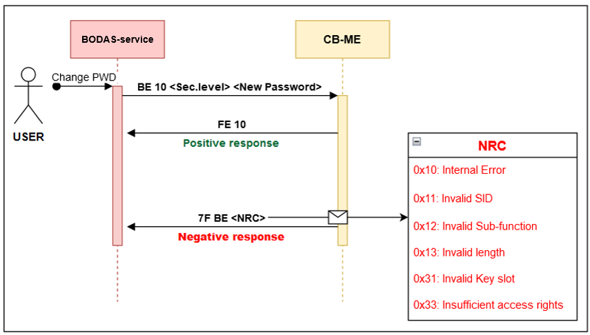

# Security change password in CB-ME {#security-change-password-in-cb-me .p_Heading1 style="page-break-after: avoid;"}

+:------------------------------------------------------------------------------------------------------------------------------------------------------------------------------------------------------------------------------------------------+----------------------------------------------------------------------------------------------------------------------------------------------------------+
| **Navigation:**  [System features](system-concepts.html) \> [Bootloader](bootloader.html) \> [Diagnostics services (UDS) in Bootloader](diagnosticsservices(uds)inbootloader.html) \> [Supported UDS services](supported-uds-services2.html) \> |    |
|                                                                                                                                                                                                                                                 |                                                                                                                                                          |
| # Security change password in CB-ME {#security-change-password-in-cb-me-1 .p_Heading1 style="page-break-after: avoid;"}                                                                                                                         |                                                                                                                                                          |
+-------------------------------------------------------------------------------------------------------------------------------------------------------------------------------------------------------------------------------------------------+----------------------------------------------------------------------------------------------------------------------------------------------------------+

The Rexroth specific UDS-service (SID: 0xBE) is used to change the password of different security levels from 1 to 10.\
This feature is available in CB-ME from version rbr_CB_ME_ML_V03.02.00 onwards.

- Service definition:\
 

  Parameter name                            No. of bytes   Byte value
  ----------------------------------------- -------------- -------------
  Change password Request SID               1              0xBE
  Sub function: Set access-level password   1              0x10
  Security level                            1              0x01 - 0x0A
  New password                              16             0x00 - 0xFF

- Positive response:

 

  Parameter name                 No. of bytes   Byte value
  ------------------------------ -------------- ------------
  Change password Response SID   1              0xFE
  Sub-function                   1              0x10

- Negative response:

 

+-----------------------------+-----------------------+----------------------------------+
| Parameter name              | No. of bytes          | Byte value                       |
+=============================+=======================+==================================+
| Negative Response SID       | 1                     | 0x7F                             |
+-----------------------------+-----------------------+----------------------------------+
| Change password Request SID | 1                     | 0xBE                             |
+-----------------------------+-----------------------+----------------------------------+
| NRC                         | 1                     | 0x10: Internal Error             |
|                             |                       |                                  |
|                             |                       | 0x11: Invalid SID                |
|                             |                       |                                  |
|                             |                       | 0x12: Invalid sub-function       |
|                             |                       |                                  |
|                             |                       | 0x13: Invalid length             |
|                             |                       |                                  |
|                             |                       | 0x31: Invalid key slot           |
|                             |                       |                                  |
|                             |                       | 0x33: Insufficient access rights |
+-----------------------------+-----------------------+----------------------------------+

 

 

<figure style="margin:0;padding:0">

<figcaption aria-hidden="true">
Figure33: Request-response diagram for security change password
</figcaption>
</figure>

 

 

  {style="margin:0;width:1.9271in;height:0.6250in;border:none"}   •Security change password feature requires security access level 2 in programming session to change password of security level 1 to security level 10.
  -------------------------------------------------------------------------------- --------------------------------------------------------------------------------------------------------------------------------------------------------

 
