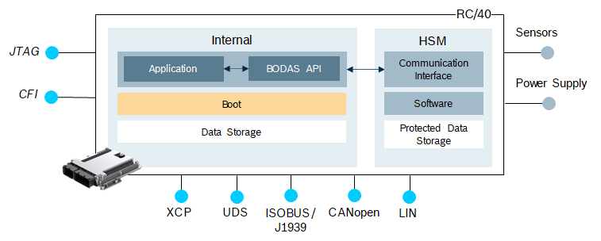

# Security concept overview {#security-concept-overview .p_Heading1 style="page-break-after: avoid;"}

+:--------------------------------------------------------------------------------------------------------+------------------------------------------------------------------------------------------------------------------+
| **Navigation:**  [System features](system-concepts.html) \> [Security](security.html) \>                |    |
|                                                                                                         |                                                                                                                  |
| # Security concept overview {#security-concept-overview-1 .p_Heading1 style="page-break-after: avoid;"} |                                                                                                                  |
+---------------------------------------------------------------------------------------------------------+------------------------------------------------------------------------------------------------------------------+

RCs are protected against many security threats and provide hardware and software solutions to ensure the integrity and functionality of the device. Security-relevant interfaces to and from the RC are either access-restricted or disabled by default if they are not used productively. Security critical data like passwords and routines are protected from external access. The following figure shows the overall architecture and the security-relevant elements of the device:

 

<figure style="margin:0;padding:0">

<figcaption aria-hidden="true">
Figure 6: Security Architecture Overview of a typical RC
</figcaption>
</figure>

 

Summarized security features:

- A Hardware Security Module (HSM) is used to protect sensitive data from being accessed and manipulated.

- Features like flashing and calibration are protected by a Role Management System.

- Interfaces to and from the RC are protected from unintended or fraudulent use wherever possible and necessary.

The following security topics are addressed in this manual:

- [Interface Protection](interface-protection.html){.topiclink} - provides general information about how the interfaces are protected.

- [Security Components](security-components.html){.topiclink} - describes individual components that are contributing to the security concept of the device.

- [Authorization](authorization.html){.topiclink} - gives an overview of the access rights management and its configuration options.

- [Authentication](authentication.html){.topiclink} - describes how access rights are granted when communicating with the device.

- [Security Advisory](security-advisory.html){.topiclink} - contains suggestions about how the device should be used and configured to achieve the highest possible security.
